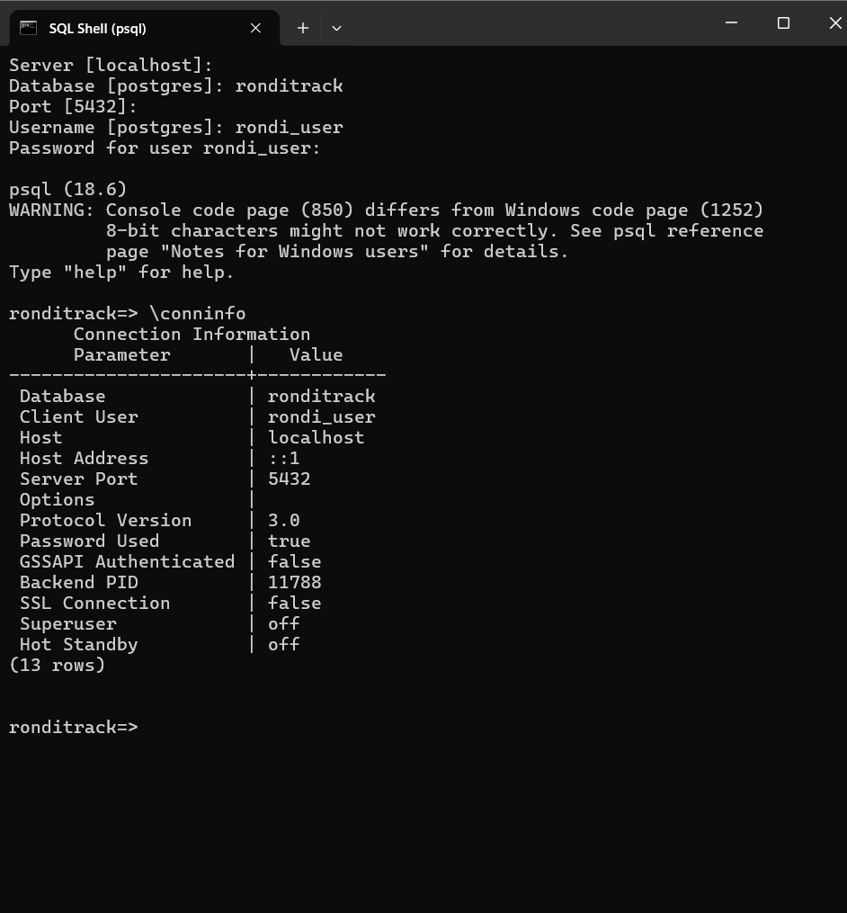
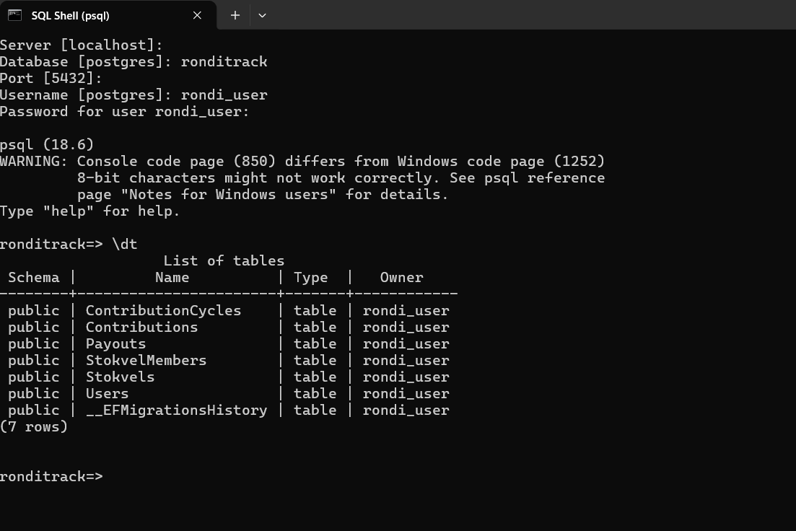
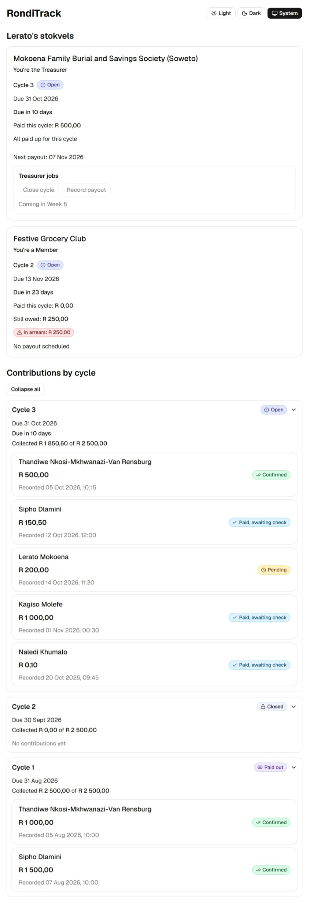

> **STATUS (submitted 2026-10-13 23:38):** Work in progress. Added so far: `ApiRoutes`, CORS / rate-limiting setup files, home-screen DTO and controller. Not yet wired in or finished: route versioning in controllers, CORS and rate limiter in the pipeline, `HomeService`, strict number handling, TypeScript client, tests. The sections below describe the intended design.
# RondiTrack API (Week 4, Day 1)

A .NET 10 Web API for tracking stokvels and their members, with in-memory data.

## Controllers vs Minimal APIs
I chose Controllers. The assignment asks for explicit attribute routing and a nested
stokvel -> members route. Controllers keep each resource's routes together in one class,
which stays readable as the API grows.

## Rules enforced in code
**User:** name required (max 100 chars); email required, valid format and normalised to
lowercase. Emails are unique (409 on duplicates). A user who belongs to a stokvel cannot be
deleted, because removing a member mid-rotation would break payouts.

**Stokvel:** name required; contribution must be > 0 with at most 2 decimal places;
frequency must be Weekly/Fortnightly/Monthly; capacity 2-50 (a rotation needs at least 2
people). A member can't join twice, a full stokvel can't take more members, and capacity
can't be lowered below the current member count.

These live in the entity constructors and methods, so an invalid User or Stokvel cannot
be created. Members is exposed read-only; the only way to change it is AddMember/RemoveMember.

## Money
ContributionAmount is `decimal`, not `double`. Binary floating point can't represent
values like 0.1 exactly, which is unacceptable for money.

## Status codes
200 OK, 201 Created (with Location), 204 No Content, 400 invalid input,
404 not found, 409 conflict, 422 request references a non-existent user.

## Run it
    dotnet run
Open http://localhost:5134/scalar/v1 (port may vary - check your terminal output).
Seeded IDs: users 10000000-0000-0000-0000-00000000000{1-6},
stokvels 20000000-0000-0000-0000-00000000000{1-2}.

## Assignment 4.2: DTOs, Service Layer & Idempotency

### DTOs and mapping
Every endpoint now sends and receives DTOs (in `Dtos/`), never the `User`/`Stokvel`/`Contribution`
entities directly. `StokvelResponse` exposes `memberCount` and `isFull` instead of the internal
member list, since that's what a caller actually needs.

Mapping is done by hand in `Dtos/MappingExtensions.cs`, one `ToResponse()` extension method per
entity. I kept manual mapping even setting the constraint aside: this project touches money, and
an auto-mapping library matches fields by name/convention, which is exactly the over-posting risk
the brief warns about — a typo'd or renamed field could silently stop mapping, or worse, a new
internal field could get exposed without anyone noticing. A hand-written method makes every field
that crosses the boundary an explicit, reviewable line of code.

### Service layer
Two services hold the real decisions:

- `StokvelMembershipService` — adding/removing a member spans two repositories (Stokvel and User)
  and needs to check both exist before touching either. That's more than validation; it's an
  orchestration decision, so it moved out of the controller.
- `ContributionService` — recording a contribution is RondiTrack's first money-moving operation.
  It has to check the stokvel exists, the user exists, the user is actually a member, the same
  cycle hasn't already been paid, and it owns the idempotency check. That's several decisions
  spanning three repositories plus the idempotency store — clearly service-layer work, not a
  controller if-statement.

Everything else (basic CRUD) stayed in the controllers, since create/read/update/delete on a
single entity is just HTTP translation plus the validation the entity already enforces on itself.

### Idempotency design
The client sends an `Idempotency-Key` header with each `POST /api/stokvels/{id}/contributions`
request. The service:
1. Computes a hash of the request (stokvel id + user id + cycle + amount).
2. Looks up the key in `IIdempotencyStore` (in-memory, same pattern as the repositories).
3. If the key exists with the *same* hash: returns the original response again, without touching
   the data a second time (a safe replay).
4. If the key exists with a *different* hash: rejects with 409 — reusing a key for a different
   request is not the same as retrying, and silently accepting it would hide a real client bug.
5. If the key is new: does the real work (all the existence/membership/duplicate-cycle checks),
   records the contribution, and saves the response under that key for future replays.

Tested in Scalar: the same key + same body sent twice returned the same contribution `id` both
times (no duplicate recorded); the same key + a changed `amount` returned 409; a new key with the
same `cycle` for the same user also returned 409, with a different message — the real
"already paid for this cycle" rule, separate from the idempotency check.

### 400 vs 422
`POST /api/stokvels/{id}/contributions` uses both, for different reasons:
- **400** — the request itself is malformed: the `Idempotency-Key` header is missing entirely.
  Nothing about the data could be evaluated yet.
- **422** — the request is well-formed JSON pointing at a real stokvel, but a reference inside
  it doesn't resolve: the `userId` doesn't exist, or exists but isn't actually a member of that
  stokvel. The request made sense structurally; its meaning just didn't hold up.

### Status codes reviewed across the whole API
All 4.1 endpoints now return RFC 9457 `application/problem+json` on every error path (via
`Problem(...)` / the `DomainProblem`/`NotFoundProblem` helpers), not bare strings. `NotFound()`
calls were replaced with `NotFoundProblem(...)` so a 404 body has the same shape as every other
error.


## Assignment 4.3: Validation & Centralized Error Handling

### Exception hierarchy
`DomainValidationException` (400), `DomainNotFoundException` (404), `DomainConflictException` (409),
`DomainReferenceException` (422), plus FluentValidation's `ValidationException` (400) for malformed
requests caught before the service layer runs.

The idempotency-key conflict and a duplicate contribution both use `DomainConflictException` — I
classified them as the same kind of failure, because both describe a request that is well-formed
and valid on its own but clashes with something that already happened (a prior contribution, a
prior use of the same key with different data).

### Validation vs exceptions
FluentValidation validators (in `Validators/`) only check shape: required fields, ranges, enum
membership. They never touch a repository. Anything needing to check whether something else exists
or already happened (duplicate email, missing stokvel, already-paid cycle, idempotency-key reuse)
is a thrown domain exception, caught by the single `RondiExceptionHandler`.

### Centralized handling
Every controller action now throws instead of building its own response. `RondiExceptionHandler`
(registered via `AddExceptionHandler`) maps every exception type to a status code, logs it with a
correlation ID, and writes a single `application/problem+json` shape. No controller constructs a
`ProblemDetails` by hand anymore.

### ContributionCycle
Plain CRUD from the controller, no service method — there's no cross-entity decision involved,
just checking the parent stokvel exists before creating a cycle. `Contribution` now references a
real `ContributionCycle.Id` instead of a placeholder cycle number.

### Correlation ID
Every error response includes a `correlationId` in its body that matches the structured log entry
for that request, e.g.:

### Negative-path tests
`RondiTrack.Tests/ErrorHandlingTests.cs` covers a malformed request (400), a not-found resource
(404), and a business-rule conflict (409) — all asserting both the status code and that the
response content type is `application/problem+json`. All 3 pass.


## Assignment 4.4: Documentation & Testing

### Documentation

Every endpoint across 4.1–4.3 now has an XML `<summary>` and `[ProducesResponseType]` attributes
for every realistic response — success and every problem+json failure it can return (400/404/409/422
as applicable) — so Scalar shows the full contract, not just the inferred happy path.

### Test suite

* `UnitTests.cs` — no HTTP, no DI container. Tests `Stokvel.AddMember` directly (full stokvel,
  duplicate member, success) and `ContributionService` built by hand from its in-memory repositories
  (duplicate-cycle rule, idempotent replay, idempotency-key conflict on a different payload).
* `IntegrationTests.cs` — through `WebApplicationFactory`, exercising the real pipeline (validation →
  service → exception handler): happy paths for Users and Stokvels, a validation failure, a not-found,
  the membership business rule (409 full, 422 nonexistent user), and the full idempotency guarantee
  (same key/same body replay, same key/different body 409, new key/same cycle 409, missing key 400).
* `ErrorHandlingTests.cs` (from 4.3) — malformed request, not-found, duplicate-email conflict.

### Edge cases

1. **Empty collection** — `GET /members` on a stokvel with no members yet. Found by asking what the
   very first request against a brand-new stokvel looks like, before anyone has joined.
2. **Boundary value** — `MaxMembers = 2`, the validator's inclusive minimum. Found by re-reading
   `InclusiveBetween(2, 50)` and checking the edge itself is accepted, not just values inside it.
3. **Cross-resource reference** — a contribution request whose `CycleId` is valid but belongs to a
   *different* stokvel than the one in the URL. Found by noticing the service only checked the cycle
   existed, not that it belonged to the stokvel being paid into.

### Deliberately broken rule

Commented out the `IsFull` check in `Stokvel.AddMember`, reran `dotnet test`:
`AddMember_Throws_When_Stokvel_Is_Full` failed as expected, confirming the suite would catch a real
regression there. Reverted immediately.

### Test run

```text
Test summary: total: 22, failed: 0, succeeded: 22, skipped: 0, duration: 8.4s
Build succeeded with 4 warning(s) in 18.0s
```

### Definition of Done

| Endpoint                    | Documented | Validated | Unit-tested                                 | Integration-tested                 | Status codes reviewed |
| --------------------------- | ---------- | --------- | ------------------------------------------- | ---------------------------------- | --------------------- |
| GET /api/users              | Yes        | N/A       | No                                          | No                                 | Yes                   |
| GET /api/users/{id}         | Yes        | N/A       | No                                          | Yes (404)                          | Yes                   |
| POST /api/users             | Yes        | Yes       | No                                          | Yes (201, 400, 409)                | Yes                   |
| PUT /api/users/{id}         | Yes        | Yes       | No                                          | No                                 | Yes                   |
| DELETE /api/users/{id}      | Yes        | N/A       | No                                          | No                                 | Yes                   |
| GET /api/stokvels           | Yes        | N/A       | No                                          | No                                 | Yes                   |
| GET /api/stokvels/{id}      | Yes        | N/A       | No                                          | Yes (404)                          | Yes                   |
| POST /api/stokvels          | Yes        | Yes       | No                                          | Yes (201, 400, boundary)           | Yes                   |
| PUT /api/stokvels/{id}      | Yes        | Yes       | No                                          | No                                 | Yes                   |
| DELETE /api/stokvels/{id}   | Yes        | N/A       | No                                          | No                                 | Yes                   |
| GET .../members             | Yes        | N/A       | No                                          | Yes (empty-list edge case)         | Yes                   |
| GET .../members/{userId}    | Yes        | N/A       | No                                          | No                                 | Yes                   |
| POST .../members            | Yes        | Yes       | Yes (full, duplicate, success)              | Yes (409, 422)                     | Yes                   |
| DELETE .../members/{userId} | Yes        | N/A       | No                                          | No                                 | Yes                   |
| POST .../contributions      | Yes        | Yes       | Yes (duplicate cycle, replay, key conflict) | Yes (400, 409×2, 422, idempotency) | Yes                   |
| GET .../cycles              | Yes        | N/A       | No                                          | No                                 | Yes                   |
| GET .../cycles/{id}         | Yes        | N/A       | No                                          | No                                 | Yes                   |
| POST .../cycles             | Yes        | Yes       | No                                          | Used as test seed helper           | Yes                   |
| PUT .../cycles/{id}         | Yes        | Yes       | No                                          | No                                 | Yes                   |
| DELETE .../cycles/{id}      | Yes        | N/A       | No                                          | No                                 | Yes                   |

### Known gap

Plain CRUD reads/updates/deletes on Users, Stokvels, and ContributionCycles (the "No" rows above)
have no dedicated integration test. Deliberate, time-boxed choice: they carry no business logic
beyond what the entity constructors and FluentValidation already unit-guarantee, so test effort went
into the endpoints that actually decide something — membership and contributions. Closing this gap
is the first thing to do before Week 5 persistence work touches these same code paths.


## Assignment 5.1 – EF Core & Database Foundations

### 1. PostgreSQL setup
I first installed Docker Desktop (with WSL 2), but its engine returned a 500 error and was very slow to start on my machine, so I switched to a **local PostgreSQL 18 install**. It has fewer moving parts, needs no WSL, and runs as a Windows service that starts again by itself after a reboot or power cut.

How a teammate with a clean machine reproduces it:
1. Download and run the PostgreSQL installer for Windows from postgresql.org. Keep the defaults (port 5432), set a password for the `postgres` user, and untick Stack Builder (cancel it if it opens).
2. Open **SQL Shell (psql)**, log in as `postgres`, and run:
```sql
   CREATE USER rondi_user WITH PASSWORD '<choose-a-password>';
   CREATE DATABASE ronditrack OWNER rondi_user;
```
3. Prove connectivity before running the API: open SQL Shell, connect to database `ronditrack` as `rondi_user`, and run `\conninfo`. I confirmed: database `ronditrack`, client user `rondi_user`, host `localhost`, port 5432, password used, superuser **off**. After migrating, `\dt` lists the six tables plus `__EFMigrationsHistory`. 


4. Set the connection string with User Secrets (section 4) and run `dotnet ef database update`.

### 2. The property that did not map
`Stokvel.Members` is an `IReadOnlyCollection<User>` that wraps a private `_members` list and has no setter. EF Core cannot fill it, and treating it as a navigation would make EF guess a one-to-many link (a stray `StokvelId` column on `Users`). That would be wrong, because a user can be in several stokvels, and it would bypass the `AddMember` rules in the domain.
**Decision:** ignore it (`e.Ignore(s => s.Members)`) and persist membership through a new `StokvelMember` join entity, which also holds `RotationPosition`. The calculated properties `PayoutPerCycle` and `IsFull` are ignored too, since storing them would let them go stale. The generated `Users` table has no stray column.
Second finding: every entity had get-only properties (e.g. `public Guid Id { get; }`). I changed these to `private set` and added a private parameterless constructor for EF. Public constructors and validation are unchanged, so the domain rules are unchanged.

### 3. Migration review
I read every `CreateTable` in `InitialCreate` before applying it. I checked: (a) six tables exist; (b) `Users` has only `Id`, `FullName`, `Email`, `CreatedAtUtc`; (c) money columns are `numeric(18,2)`; (d) `Frequency` and `Status` are stored as text, so reordering an enum can never silently change data; (e) there are deliberately no foreign keys, because the Stokvel/User/Cycle repositories are still in-memory and an FK would make every contribution insert fail (superseded by Assignment 5.2, where those repositories moved to EF Core and the foreign keys were added); (f) unique indexes: one payout per cycle, and unique `(StokvelId, UserId)` and `(StokvelId, RotationPosition)` on members.
**Something I noticed:** `Users.Email` has no unique index. The in-memory repository enforces unique emails, but the database would not. I must add that index before swapping `UserRepository`.
**Rename risk:** the migration generator cannot tell a rename from a drop-and-add, so renaming a property such as `Contributions.Amount` or `StokvelMembers.RotationPosition` would produce `DropColumn` + `AddColumn` and delete that column's data. The fix is to edit the migration to use `RenameColumn`. This first migration only creates tables, and its `Down()` only drops tables it created.

### 4. Secret management
The connection string lives in **.NET User Secrets** (stored in my Windows user profile, outside the repo). `appsettings.json` only holds an empty placeholder. I verified with `git grep -i "<password>"` that nothing git tracks contains it.
A teammate runs this in the API project folder (their own values):
```powershell
dotnet user-secrets init
dotnet user-secrets set "ConnectionStrings:RondiTrack" "Host=localhost;Port=5432;Database=ronditrack;Username=rondi_user;Password=<their-password>;Maximum Pool Size=20"
```
If the secret is missing, the app fails at startup with a clear message.

### 5. Retry and pooling
`EnableRetryOnFailure(maxRetryCount: 4, maxRetryDelay: 10 seconds)`. The delay grows between attempts, so a short database restart or network blip gets about 15–20 seconds to recover, but a user is never left waiting for minutes. **Retried:** transient failures such as a dropped connection or a server that is still starting up (PostgreSQL error 57P03). **Deliberately not retried:** a unique-constraint violation (23505) or a wrong password (28P01), because retrying gives the same result and would hide a real bug. Npgsql pooling is on by default; I set `Maximum Pool Size=20`, which is plenty for this project without exhausting PostgreSQL connections.

### 6. Repository swapped
I swapped **`ContributionRepository`** because it backs the duplicate-contribution rule (`ExistsAsync`) that my Assignment 4.4 tests exercise hardest. `EfContributionRepository` implements the existing `IContributionRepository` unchanged. `StokvelsController`, `ContributionService` and the DTOs did not change, and the registration moved from Singleton to Scoped.
What did change, honestly: the entities (private setters and private constructors for EF), a new `Status` on `ContributionCycle` (Payout needs it), `Program.cs` registrations, and the test project's EF Core package versions (see section 7).
**Why Singleton becomes Scoped:** the in-memory repositories were Singletons because they hold the data themselves and must live as long as the app. A `DbContext` is the opposite: it is not thread-safe, so two simultaneous requests sharing one instance would crash with "a second operation was started on this context". It also holds a change tracker that would grow forever, serve stale data, and leak one request's half-finished changes into another user's request. Scoped gives one `DbContext` per request, disposed at the end, which returns its connection to the pool.

### 7. Test results (real PostgreSQL)
- **Before the swap:** 22 total, 22 passed (`before-swap.txt`).
- **After the swap:** 24 total, 24 passed (`after-swap.txt`): the same 22 plus 2 new payout tests.
- **Proof it used my real database:** the EF Core log lines in `after-swap.txt` show `SELECT EXISTS ... FROM "Contributions"` and `INSERT INTO "Contributions"` against PostgreSQL. This is a new dependency (PostgreSQL must be running to run the suite); Testcontainers arrives on Day 4.
- The `fail:` lines in the output are my exception handler logging the expected 404/409/422/400 responses that the tests provoke on purpose; they are not test failures.

What the swap exposed:
1. The first after-swap run did not compile: `CS1705`, EF Core 10.0.12 (pulled in by the Design package) versus 10.0.4 in the test project. I pinned `Microsoft.EntityFrameworkCore` and `.Relational` to 10.0.12 in the test project.
2. The integration tests now write real rows that stay in PostgreSQL between runs. Nothing collides because every test uses fresh GUIDs, but the table grows. Testcontainers will fix this on Day 4.

### 8. Payout rule
Each `StokvelMember` has a `RotationPosition`. The next recipient is the member of that stokvel with the **lowest rotation position who has no payout yet**. The amount is the **sum of the cycle's contributions**; a cycle with no contributions is rejected. A cycle moves from `Open` to `PaidOut`, and a unique index on `Payouts.CycleId` means a cycle can only be paid once. Endpoint: `POST /api/stokvels/{stokvelId}/cycles/{cycleId}/payouts`. I kept it minimal on purpose: no scheduling, notifications or partial payouts.

### 9. The transaction and rollback test
`PayoutService.ProcessNextPayoutAsync` wraps two writes (insert the `Payout`, then set the cycle to `PaidOut`) in an explicit `IDbContextTransaction`, inside `CreateExecutionStrategy()` (required when retry-on-failure is enabled). A test-only `IPayoutFaultHook` throws between the two writes. The test `ProcessNextPayout_WhenItFailsAfterThePayoutInsert_LeavesNothingBehind` then re-queries with a **brand new DbContext** and asserts 0 payouts for the cycle and the cycle still `Open`. **Result: passed.** A second test checks the happy path (first member in rotation is paid 200, cycle becomes `PaidOut`): passed.

### 10. Definition of Done (extended)
Extended in Assignment 5.2 with two new columns (relationship modeled as real navigation, and N+1 measured and fixed). The "Persisted via EF Core" column now reflects the state after 5.2, when User, Stokvel, StokvelMember and ContributionCycle moved to EF Core.

| Entity | Persisted via EF Core | Explicit transaction tested | Relationship modeled as real navigation (yes/no/N-A) | N+1 measured and fixed (yes/no/N-A) |
|---|---|---|---|---|
| User | yes | N/A | yes | N-A |
| Stokvel | yes | N/A | yes | N-A |
| StokvelMember | yes | N/A | yes | N-A |
| ContributionCycle | yes | yes | yes | N-A |
| Contribution | yes | N/A | yes | yes (33 queries down to 2) |
| Payout | yes | yes | yes (composite FK, no navigation property) | N-A |

### 11. Gaps I chose not to close yet
*Written during Assignment 5.1. Partly superseded by Assignment 5.2: the User, Stokvel and ContributionCycle repositories and the foreign keys were added there. See the 5.2 gaps at the end of this file for the current list.*

- User, Stokvel, ContributionCycle and idempotency repositories stay in-memory by decision, not oversight.
- No foreign keys yet (see section 3). Add them when those repositories are swapped.
- The payout endpoint works on persisted rows, but cycles and memberships created through the API are still in-memory, so today it can only be exercised with data in PostgreSQL.
- No unique index on `Users.Email`, and "one contribution per user per cycle" is enforced in code only.
- Build warning `NU1903` (Microsoft.OpenApi 2.0.0 known vulnerability) existed before this assignment; `MSB3277` EF Core version-conflict warnings remain in the test project.
- Tests share my local PostgreSQL database until Testcontainers on Day 4.


# Assignment 5.2: Relationships and Query Behavior

## Why StokvelMember has a composite key
StokvelMember has its own data (Role, RotationPosition, JoinedAtUtc), so it cannot be a hidden many-to-many join table. Its natural key is the pair (UserId, StokvelId), because that pair already identifies a membership and a person cannot belong to the same stokvel twice. The composite primary key enforces that rule in the database for free. A surrogate Guid Id would have needed an extra unique index to do the same job, and would be a column nobody asked for. The old unique index on (StokvelId, UserId) was removed because the primary key now covers it.

## How Contribution and Payout reference a membership
Contribution and Payout reference a membership through a composite foreign key. Contribution uses (UserId, StokvelId) and Payout uses (RecipientUserId, StokvelId); both match StokvelMember's composite primary key, so the database guarantees every contribution and payout belongs to a real member of that stokvel. I did not keep a plain UserId and check membership in the service layer: that guarantee would live only in code, and any path that forgets the check could store a contribution for a non-member. I did not add a hidden surrogate Id to StokvelMember: that would undo the reason for a natural key and bring back the duplicate-membership risk.

This forced a change to Payout: it previously stored RecipientMemberId, a StokvelMember.Id that no longer exists. It now stores RecipientUserId, which together with the StokvelId it already had identifies the recipient membership. PayoutService and PayoutResponse changed to match; the payout rule itself (next unpaid member by RotationPosition) is unchanged.

## What replaced generic access for StokvelMember
RondiTrack never had a generic IRepository<T>: each entity has its own interface. StokvelMember had no repository at all, and PayoutService read it straight from the DbContext. With a composite key a single-Guid GetById would be meaningless for it, so I added a dedicated IStokvelMemberRepository whose lookup takes both ids, GetAsync(userId, stokvelId), plus GetByStokvelAsync, AddAsync and RemoveAsync. GetAsync takes a forUpdate flag (default false) so pure reads are not tracked while a load-to-modify stays tracked. PayoutService now reads members through this repository.

Making the foreign keys real also needed real rows on both sides, but Users, Stokvels and cycles were still in-memory repositories. I therefore moved IUserRepository, IStokvelRepository and IContributionCycleRepository to EF Core as well. Stokvel keeps its in-memory member list for its business rules (no duplicates, capacity); EfStokvelRepository fills it from the StokvelMember rows when loading and turns it back into rows on UpdateAsync. Demo data is seeded into Postgres once, in Development only.

## Reading an ALTER migration
This migration alters existing tables rather than creating them, so I checked for things a CREATE can't do. (1) EF printed "An operation was scaffolded that may result in the loss of data"; that warning comes from DropColumn "Id" on StokvelMembers, which is the key change. (2) StokvelMembers does DropPrimaryKey, DropIndex (the old unique index on StokvelId and UserId), DropColumn Id and AddPrimaryKey on (UserId, StokvelId), with the columns in the same order the foreign keys use. (3) For Payouts, EF scaffolded a RenameColumn from RecipientMemberId to RecipientUserId instead of a drop and add. That is more dangerous than a drop, because a rename silently keeps the old values, and those were StokvelMember.Id numbers that would now be read as UserIds, with no error to warn me. My table was empty so nothing was harmed, but with real data I would replace the rename with a script that maps each old member Id to its UserId before the old column goes. (4) The new Role column was scaffolded with a default of an empty string, which cannot be read back as a role, so I changed the default to "Member". (5) The five new foreign keys would fail on existing rows that point at users, stokvels or members that do not exist; my tables were empty. (6) No existing table is dropped and recreated, and each foreign key's onDelete (Cascade or Restrict) matches the DbContext. (7) The Down method re-adds Id with an all-zero default, which would fail on a table with several rows, so it can only roll back safely on an empty table. Because my development data was only test rows, I applied it on the empty database.

## Second relationship wired
I wired Stokvel to ContributionCycle (a stokvel has many cycles; each cycle belongs to one stokvel). A cycle cannot exist without its stokvel, and the cycles endpoints are already routed under /stokvels/{id}/cycles, so the navigation matches how the API is used. The alternative was ContributionCycle to Contribution. It was equally fair, but I left Contribution.CycleId as a bare Guid, an honest "not yet", because Contribution already received a real relationship today (to StokvelMember).

## N+1 measurement
The naive endpoint (GET /api/stokvels/{stokvelId}/cycles/{cycleId}/contributions?strategy=naive) loads the Contribution rows with no eager loading, then for each row explicitly loads its Member and then that Member's User (explicit loading in a loop, because lazy loading is not allowed in this project). With EF Core's SQL command logging turned on and 6 contributions in the cycle, the log showed **33 SQL commands** for the single request. That count includes the cycle existence check and the query for the rows, and it grows with every extra contribution because each row triggers its own extra queries. After the Include fix the same request fired **2** commands, and after the projection fix also **2** (the cycle existence check plus one query for the data).

## Which fix shipped, and why
I shipped the projection. The Include version fetched whole entities: all 6 Contribution columns, all 5 StokvelMember columns and all 4 User columns, 15 in total, then materialised an entity graph and ignored most of it. The projection fetched only the 8 columns the response returns (Id, UserId, FullName, Email, Role, RotationPosition, Amount, RecordedAtUtc), 7 fewer, and builds no entity graph at all. The answer does not change with fifty members instead of five; it gets stronger. Both versions are one query, but Include's wasted width grows with every row, while the projection stays proportional to what the response actually needs. The naive and Include versions stay in the code only for comparison, reachable in Development through ?strategy=, and ignored in any other environment.

## Loading strategy decisions
Contributions-by-cycle endpoint: the shipped version is a projection (no entity graph at all). Second read path, GET /api/stokvels: EfStokvelRepository.GetAllAsync uses eager loading (Include of the member's User), 2 queries in total however many stokvels exist. Third, GET /api/stokvels/{id} uses explicit loading: it loads the stokvel and then runs a second, deliberate query for its members, because a single stokvel is cheap and the member list is hydrated into the aggregate afterwards.

Lazy loading appears nowhere, and no lazy-loading proxy package is installed. I left it out because it hides a database round trip behind an ordinary property access, which is exactly how the N+1 problem stays invisible until it hurts. It also cannot be awaited, so it blocks a thread on every access in an async API, and it fails once the DbContext is disposed. I would rather see every query I am paying for in the code.

## AsNoTracking audit
Every GET was audited: users (list, by id), stokvels (list, by id, members list, single member), cycles (list, by id), contributions-by-cycle. All use AsNoTracking. The risky case was GetByIdAsync, which is shared by GET and by PUT flows that load an entity in order to change it. A blanket AsNoTracking would silently break a PUT that relies on change tracking. I avoided that by making every write attach its object explicitly (db.X.Update(entity)), and I added Update_User_Persists_After_Untracked_Read to prove a PUT still persists. Two places needed deliberate handling: IStokvelMemberRepository.GetAsync takes forUpdate (default false), and PayoutService loads the cycle tracked on purpose because it changes its status and saves.

## Test suite before and after
Before today's changes: 24/24 passing. After: 25/25 passing (24 existing plus the new Update_User_Persists_After_Untracked_Read). What broke and what it exposed: PayoutTransactionTest referenced StokvelMember.Id directly (first.Id) and constructed PayoutService without a member repository, so it stopped compiling when the key changed (three compile errors: the missing Id and two PayoutService constructor calls). Once it compiled, its seed data would have failed against the new foreign keys, because it inserted memberships and a cycle for a stokvel and users that were never saved. That showed my old test was proving a payout works against a schema with no relationships. I fixed it by seeding parents first (users, stokvel), then members, cycle and contributions. ErrorHandlingTests depended on demo users that used to live in memory, so the Development seed now writes them to Postgres. The Contribution unit tests (in-memory repositories) and StokvelMembershipTests (domain-only) never referenced StokvelMember.Id or the changed repositories, and passed unchanged.

## Definition of Done (extended)
The merged table, with these two columns added to the Assignment 5.1 table, is in Assignment 5.1, section 10. The table below shows the same two columns by relationship.

| Relationship | Modeled as real navigation (yes/no/N-A) | N+1 measured and fixed (yes/no/N-A) |
|---|---|---|
| User and Stokvel via StokvelMember | yes | N-A |
| Stokvel to ContributionCycle | yes | N-A |
| Contribution to StokvelMember | yes | yes (contributions-by-cycle: 33 queries down to 2) |
| Payout to StokvelMember (recipient) | yes (composite FK, no navigation property) | N-A |
| Contribution to ContributionCycle (CycleId) | no (bare Guid, not yet) | N-A |
| Payout to ContributionCycle (CycleId) | no (bare Guid, not yet) | N-A |

## Gaps I chose not to close yet
(1) Stokvel keeps both an in-memory Members list (Users) and a mapped Memberships list; they will be merged in a later cleanup. (2) Deleting a stokvel or removing a member who still has contributions or payouts would be rejected by the database (the Restrict foreign keys) and currently surfaces as a 500 instead of a friendly 409; I did not test this. (3) Contribution.CycleId and Payout.CycleId are still bare Guids. (4) Role has no endpoint to change it (it defaults to Member); that would be a new feature. (5) The idempotency store is still in memory. (6) Rotation position is assigned automatically as the next number when a member is added.


# Assignment 5.3: Optimizations, Concurrency & Database Defense

## 1. In-memory filtering audit
Found with: `Select-String -Path .\**\*.cs -Pattern "ToListAsync|ToList\(\)|IEnumerable<|AsEnumerable"` (Migrations, bin and obj excluded).

| File / method | What it does | Decision | Why |
|---|---|---|---|
| `ContributionQueries.GetForCycleNaiveAsync` | Filter and sort run in SQL, `ToListAsync`, then a loop loads related rows | Left, no longer behind the endpoint | It is the deliberate N+1 demo from 5.2. The endpoint now uses `ContributionPagingService`. |
| `ContributionQueries.GetForCycleIncludeAsync` / `ProjectedAsync` | Filter and sort in SQL; `Select(ToDto)` after `ToListAsync` is mapping only | Left | No filtering after materialization. |
| `EfStokvelRepository.GetAllAsync` | `ToListAsync` of all memberships, then `memberships.Where(m => m.StokvelId == s.Id)` per stokvel in C# | **Left**, stated as "not yet" | Real in-memory filtering. `GET /api/stokvels` is not paged today and stays exactly as it was. It is the first thing to fix when that endpoint is paged. |
| `EfStokvelRepository.UpdateAsync` | Existing memberships loaded (filtered in SQL), then `.Where` / `.Max` in C# to decide which to add or remove | Left | Bounded: one stokvel, at most 50 members. It compares the in-memory list with the database list, so it cannot be a single query. |
| `PayoutService.ProcessNextPayoutAsync` | `paidUserIds` list, then `FirstOrDefault(m => !paidUserIds.Contains(...))` in C# | Left | Bounded by the member count of one stokvel (max 50), used once per payout. |
| `EfUserRepository.GetAllAsync`, `EfContributionCycleRepository.GetByStokvelAsync`, `EfStokvelMemberRepository.GetByStokvelAsync`, `EfContributionRepository.GetByStokvelAsync` | Filter and sort in SQL, then `ToListAsync`. Nothing after. | Left | Correct. These list endpoints are not paged yet (see Gaps). |
| `InMemory*Repository` classes | `.Where/.OrderBy/.ToList` over dictionaries | Left | In-memory test doubles for unit tests. No database involved. |
| `StokvelsController.GetMembers` (old) | Loaded the whole stokvel and every member, then mapped | **Moved into the query** | Replaced by `MemberPagingService`: WHERE, ORDER BY and LIMIT in SQL. |
| `ContributionCyclesController.GetContributions` (old) | Returned everything for the cycle in one list | **Moved into the query** | Replaced by `ContributionPagingService`. |

**SQL evidence from the EF Core command log** (contributions endpoint, `pageSize=25`, parameters `@cycleId='2fc7b21f-fe7c-4618-bdbd-aa244b5f3534'`, `@p='26'`):
```sql
SELECT c0."Id", c0."UserId", u."FullName", u."Email", s."Role", s."RotationPosition", c0."Amount", c0."RecordedAtUtc"
FROM (
    SELECT c."Id", c."Amount", c."RecordedAtUtc", c."StokvelId", c."UserId"
    FROM "Contributions" AS c
    WHERE c."CycleId" = @cycleId
    ORDER BY c."RecordedAtUtc", c."Id"
    LIMIT @p
) AS c0
INNER JOIN "StokvelMembers" AS s ON c0."UserId" = s."UserId" AND c0."StokvelId" = s."StokvelId"
INNER JOIN "Users" AS u ON s."UserId" = u."Id"
ORDER BY c0."RecordedAtUtc", c0."Id"
```
`WHERE`, `ORDER BY` and `LIMIT` are all in the SQL text. EF Core even applies them to `Contributions` first and joins afterwards.

**SQL evidence for the paged members endpoint:** not captured. The query is built as IQueryable (WHERE, ORDER BY, Take) in `MemberPagingService`, but I did not record the logged SQL for it. Only the contributions endpoint has log evidence above.

## 2. Pagination contract (modelled on AIP-158)
Applied to `GET /api/stokvels/{id}/cycles/{cycleId}/contributions` and `GET /api/stokvels/{id}/members`.

- **Page size:** optional `pageSize`. Default **25**, maximum **100**. A value above 100 is reduced to 100 (not rejected). Missing or `0` means the default. A negative value returns **400**.
- **Page token:** `pageToken` is an opaque base64url string. Clients must not parse or build it.
- **Next page:** `nextPageToken` is `""` exactly when there are no more results. The server fetches `pageSize + 1` rows to know this, so there is never an empty last page.
- **Token reuse:** the token carries a fingerprint of the sort and filters. Using it with a different sort or filter returns **400** ("start again without a pageToken"). A garbled token also returns **400**.
- **Total count: not returned.** `COUNT(*)` has to visit every matching row, so it gets slower as the table grows, and it is already out of date when a new contribution arrives. Clients only need "is there more?", which `nextPageToken` answers.
- **Offset vs keyset: keyset**, behind the opaque token, on `(sortValue, Id)`.
  - With offset paging, if a new contribution is inserted on page one while a client is on page two, every row shifts down by one and the client sees a row twice. A deletion makes the client skip a row. With keyset, the token says "continue after this exact row", so inserts before it do not move the client's position.
  - For a cycle with 5 contributions both approaches behave the same and nobody would notice. For a stokvel with 10 000 contributions, offset also gets slower the deeper you go (it must walk past every skipped row), while keyset jumps straight to the right place using the index. Because the token is opaque, the implementation can change later without breaking clients.

## 3. Sorting and filtering allow-list
| Endpoint | Sortable | Filterable |
|---|---|---|
| Contributions of a cycle | `date`, `-date`, `amount`, `-amount` (default `date`) | `userId`, `dateFrom`, `dateTo` (both inclusive, UTC) |
| Stokvel members | fixed: rotation position | none |

- Every sort ends with `Id` as a unique tiebreaker, so rows with the same date or amount never swap places between requests. The seeded data has many rows with the same timestamp on purpose.
- An unknown sort value, `dateFrom` after `dateTo`, or a bad token returns **400** as a problem response (same shape as Week 4). A malformed `userId` or date is rejected by model binding, also as a 400 problem response.
- **Refused: sorting (and filtering) by member name.** It needs a join to Users, so it cannot use the contributions index, and it would need its own keyset on `(FullName, Id)` with an index spanning two tables.
- Honest note: `amount` sorting works and is deterministic, but it is not covered by the new index. I did not add a second index without a query plan showing it is needed.

## 4. Query plan evidence
- **Seeded volume:** 3 stokvels x 100 members x 60 cycles = **18 000 contributions** (100 per cycle), plus 300 users and 180 cycles. Command: `dotnet run -- --seed-volume` (`Data/VolumeSeeder.cs`). It never runs on normal startup. It was run against a separate database, `ronditrack_volume`.
- **Query measured:** the SQL from section 1 with `@cycleId = '2fc7b21f-fe7c-4618-bdbd-aa244b5f3534'` and `LIMIT 26`, after `ANALYZE "Contributions"`.

**Before the new index** (existing indexes only)
```
Sort  (cost=208.61..208.63 rows=9 width=98) (actual time=1.645..1.650 rows=26.00 loops=1)
  Sort Key: c0."RecordedAtUtc", c0."Id"
  Sort Method: quicksort  Memory: 28kB
  Buffers: shared hit=138
  ->  Nested Loop  (cost=195.72..208.47 rows=9 width=98) (actual time=1.145..1.332 rows=26.00 loops=1)
        Join Filter: (u."Id" = c0."UserId")
        Buffers: shared hit=138
        ->  Hash Join  (cost=195.45..204.79 rows=9 width=72) (actual time=1.064..1.187 rows=26.00 loops=1)
              Hash Cond: ((s."UserId" = c0."UserId") AND (s."StokvelId" = c0."StokvelId"))
              Buffers: shared hit=60
              ->  Seq Scan on "StokvelMembers" s  (cost=0.00..7.00 rows=300 width=43) (actual time=0.081..0.159 rows=300.00 loops=1)
                    Buffers: shared hit=4
              ->  Hash  (cost=195.06..195.06 rows=26 width=61) (actual time=0.963..0.964 rows=26.00 loops=1)
                    Buckets: 1024  Batches: 1  Memory Usage: 11kB
                    Buffers: shared hit=56
                    ->  Subquery Scan on c0  (cost=194.73..195.06 rows=26 width=61) (actual time=0.932..0.942 rows=26.00 loops=1)
                          Buffers: shared hit=56
                          ->  Limit  (cost=194.73..194.80 rows=26 width=61) (actual time=0.930..0.935 rows=26.00 loops=1)
                                Buffers: shared hit=56
                                ->  Sort  (cost=194.73..194.98 rows=100 width=61) (actual time=0.925..0.927 rows=26.00 loops=1)
                                      Sort Key: c."RecordedAtUtc", c."Id"
                                      Sort Method: top-N heapsort  Memory: 30kB
                                      Buffers: shared hit=56
                                      ->  Bitmap Heap Scan on "Contributions" c  (cost=5.06..191.88 rows=100 width=61) (actual time=0.487..0.582 rows=100.00 loops=1)
                                            Recheck Cond: ("CycleId" = '2fc7b21f-fe7c-4618-bdbd-aa244b5f3534'::uuid)
                                            Heap Blocks: exact=54
                                            Buffers: shared hit=56
                                            ->  Bitmap Index Scan on "IX_Contributions_CycleId_UserId"  (cost=0.00..5.04 rows=100 width=0) (actual time=0.446..0.446 rows=100.00 loops=1)
                                                  Index Cond: ("CycleId" = '2fc7b21f-fe7c-4618-bdbd-aa244b5f3534'::uuid)
                                                  Index Searches: 1
                                                  Buffers: shared hit=2
        ->  Index Scan using "PK_Users" on "Users" u  (cost=0.27..0.40 rows=1 width=58) (actual time=0.005..0.005 rows=1.00 loops=26)
              Index Cond: ("Id" = s."UserId")
              Index Searches: 26
              Buffers: shared hit=78
Planning:
  Buffers: shared hit=171
Planning Time: 15.574 ms
Execution Time: 3.148 ms
```
- Nodes: Limit -> Sort (top-N heapsort) -> Bitmap Heap Scan on Contributions <- Bitmap Index Scan on `IX_Contributions_CycleId_UserId`, then Hash Join to StokvelMembers, Nested Loop to Users (PK), and a final Sort of the 26 joined rows.
- Execution time: **3.148 ms**. Estimated rows 100 vs actual 100 on the Contributions scan. Rows Removed by Filter: not present. Buffers: shared hit=138 (56 for the Contributions part, 54 heap blocks).
- Reading: not a Seq Scan, because the existing unique index `(CycleId, UserId)` starts with `CycleId`. It finds the cycle's 100 rows but cannot return them in date order, so Postgres fetches all 100 rows from 54 heap blocks, sorts them, and keeps 26.

**After `IX_Contributions_CycleId_RecordedAtUtc_Id`**
```
Sort  (cost=101.67..101.69 rows=9 width=98) (actual time=0.291..0.294 rows=26.00 loops=1)
  Sort Key: c0."RecordedAtUtc", c0."Id"
  Sort Method: quicksort  Memory: 28kB
  Buffers: shared hit=107
  ->  Nested Loop  (cost=88.78..101.53 rows=9 width=98) (actual time=0.123..0.270 rows=26.00 loops=1)
        Join Filter: (u."Id" = c0."UserId")
        Buffers: shared hit=107
        ->  Hash Join  (cost=88.51..97.85 rows=9 width=72) (actual time=0.115..0.202 rows=26.00 loops=1)
              Hash Cond: ((s."UserId" = c0."UserId") AND (s."StokvelId" = c0."StokvelId"))
              Buffers: shared hit=29
              ->  Seq Scan on "StokvelMembers" s  (cost=0.00..7.00 rows=300 width=43) (actual time=0.030..0.074 rows=300.00 loops=1)
                    Buffers: shared hit=4
              ->  Hash  (cost=88.12..88.12 rows=26 width=61) (actual time=0.065..0.065 rows=26.00 loops=1)
                    Buckets: 1024  Batches: 1  Memory Usage: 11kB
                    Buffers: shared hit=25
                    ->  Subquery Scan on c0  (cost=0.41..88.12 rows=26 width=61) (actual time=0.020..0.054 rows=26.00 loops=1)
                          Buffers: shared hit=25
                          ->  Limit  (cost=0.41..87.86 rows=26 width=61) (actual time=0.020..0.049 rows=26.00 loops=1)
                                Buffers: shared hit=25
                                ->  Index Scan using "IX_Contributions_CycleId_RecordedAtUtc_Id" on "Contributions" c  (cost=0.41..336.74 rows=100 width=61) (actual time=0.019..0.046 rows=26.00 loops=1)
                                      Index Cond: ("CycleId" = '2fc7b21f-fe7c-4618-bdbd-aa244b5f3534'::uuid)
                                      Index Searches: 1
                                      Buffers: shared hit=25
        ->  Index Scan using "PK_Users" on "Users" u  (cost=0.27..0.40 rows=1 width=58) (actual time=0.002..0.002 rows=1.00 loops=26)
              Index Cond: ("Id" = s."UserId")
              Index Searches: 26
              Buffers: shared hit=78
Planning:
  Buffers: shared hit=24
Planning Time: 0.873 ms
Execution Time: 0.346 ms
```
- Nodes: Limit -> Index Scan using `IX_Contributions_CycleId_RecordedAtUtc_Id` on Contributions, then Hash Join, Nested Loop to Users (PK), and a final Sort of the 26 joined rows. The inner Sort node is gone.
- Execution time: **0.346 ms** (was 3.148 ms). Buffers: shared hit=107 total, 25 for the Contributions part (was 138 and 56). Estimated rows 100 vs actual 26 on the index scan, because the Limit stops the scan after 26 rows (the estimate of 100 is the cycle's real size, not a bad estimate). Rows Removed by Filter: not present.
- The remaining final Sort is EF Core's second ORDER BY after the joins, and it only sorts 26 rows.
- Honest caveat: a cycle here has only 100 rows, so both timings are tiny and part of the time gap may be a warm cache. The more reliable evidence is the plan shape and buffers: no Sort over the whole cycle, 26 rows read instead of 100, and 25 buffers instead of 56. The gap grows with cycle size, because the old plan's cost grows with the rows in the cycle and the new plan's cost grows with the page size.

**Why this column order:** `CycleId` is first because it is an equality filter, so the index narrows straight to one cycle's rows. `RecordedAtUtc` comes next because it is the sort, so those rows come out already in order and the Sort step disappears. `Id` is last because it is the tiebreaker, which also matches the keyset condition `(RecordedAtUtc, Id) > (last values)`. With the date first, Postgres could not use the index to find one cycle's rows.

**Small development data** (48 contributions, 81 memberships):
```
Sort  (cost=4.18..4.19 rows=1 width=152) (actual time=0.093..0.095 rows=2.00 loops=1)
  Sort Key: c0."RecordedAtUtc", c0."Id"
  Sort Method: quicksort  Memory: 25kB
  Buffers: shared hit=6
  ->  Nested Loop  (cost=1.78..4.17 rows=1 width=152) (actual time=0.064..0.087 rows=2.00 loops=1)
        Join Filter: (u."Id" = c0."UserId")
        Buffers: shared hit=6
        ->  Hash Join  (cost=1.64..3.65 rows=1 width=87) (actual time=0.056..0.075 rows=2.00 loops=1)
              Hash Cond: ((s."UserId" = c0."UserId") AND (s."StokvelId" = c0."StokvelId"))
              Buffers: shared hit=2
              ->  Seq Scan on "StokvelMembers" s  (cost=0.00..1.57 rows=57 width=43) (actual time=0.021..0.032 rows=81.00 loops=1)
                    Buffers: shared hit=1
              ->  Hash  (cost=1.62..1.62 rows=1 width=76) (actual time=0.027..0.027 rows=2.00 loops=1)
                    Buckets: 1024  Batches: 1  Memory Usage: 9kB
                    Buffers: shared hit=1
                    ->  Subquery Scan on c0  (cost=1.61..1.62 rows=1 width=76) (actual time=0.022..0.024 rows=2.00 loops=1)
                          Buffers: shared hit=1
                          ->  Limit  (cost=1.61..1.61 rows=1 width=76) (actual time=0.021..0.022 rows=2.00 loops=1)
                                Buffers: shared hit=1
                                ->  Sort  (cost=1.61..1.61 rows=1 width=76) (actual time=0.021..0.021 rows=2.00 loops=1)
                                      Sort Key: c."RecordedAtUtc", c."Id"
                                      Sort Method: quicksort  Memory: 25kB
                                      Buffers: shared hit=1
                                      ->  Seq Scan on "Contributions" c  (cost=0.00..1.60 rows=1 width=76) (actual time=0.009..0.014 rows=2.00 loops=1)
                                            Filter: ("CycleId" = '519c0e0f-b727-4642-b523-60090a647005'::uuid)
                                            Rows Removed by Filter: 46
                                            Buffers: shared hit=1
        ->  Index Scan using "PK_Users" on "Users" u  (cost=0.14..0.51 rows=1 width=97) (actual time=0.004..0.004 rows=1.00 loops=2)
              Index Cond: ("Id" = s."UserId")
              Index Searches: 2
              Buffers: shared hit=4
Planning:
  Buffers: shared hit=8
Planning Time: 0.517 ms
Execution Time: 0.145 ms
```
- Nodes: **Seq Scan on Contributions** with `Filter: CycleId = ...`, then Sort (2 rows). Execution time 0.145 ms. Estimated rows 1 vs actual 2. Rows Removed by Filter: 46. Buffers for Contributions: 1.
- **Why Postgres ignored the index, and why that is correct:** the whole Contributions table fits on one 8 kB page, so reading it costs one buffer. Using the index would mean reading an index page and then the table page, which is more work. The planner picks the plan with the lowest estimated cost, not the plan that uses an index. Filtering 48 rows and sorting 2 in memory costs almost nothing. The index only pays off once the table spans many pages, as the 18 000-row database shows. The estimate of 1 versus the actual 2 is a small statistics error on a tiny table and does not change the plan.

## 5. Composite unique constraints
| Rule (already enforced in C#) | Where C# enforces it | Constraint |
|---|---|---|
| A member contributes once per cycle | `ContributionService` -> `ExistsAsync` | unique index on `Contributions (CycleId, UserId)` |
| A member is paid at most once per stokvel rotation | `PayoutService` ("Every member has already been paid") | unique index on `Payouts (StokvelId, RecipientUserId)` |

Already in place before today and not counted: `Payouts (CycleId)` unique, `StokvelMembers (StokvelId, RotationPosition)` unique, and the StokvelMember composite primary key.

**Query used to check existing data before applying:**
```sql
SELECT "CycleId", "UserId", COUNT(*) FROM "Contributions" GROUP BY "CycleId", "UserId" HAVING COUNT(*) > 1;
SELECT "StokvelId", "RecipientUserId", COUNT(*) FROM "Payouts" GROUP BY "StokvelId", "RecipientUserId" HAVING COUNT(*) > 1;
```
Result: **0 rows and 0 rows**, so the migration was safe to apply.

**Migration reading (compared with 5.1 and 5.2):** In 5.1 and 5.2 I checked for dropped or renamed columns, data loss and new NOT NULL columns. This time I checked that the migration contains only index operations and no column changes. The generated migration had four `AddColumn("xmin")` calls (see section 7), which I removed by hand. What remained was a `DropIndex` of the old non-unique `(CycleId, UserId)` index, a `CreateIndex(unique: true)` on Contributions, and a `CreateIndex(unique: true)` on Payouts. The second migration (`AddContributionPagingIndex`) contains exactly one `CreateIndex` and nothing else. Building an index takes a lock that blocks writes to that table while it builds, and it costs time and disk on a large table. On a large production table I would build it with `CREATE INDEX CONCURRENTLY`, outside a normal migration transaction. For this data size the lock is brief. Every unique index also makes each insert slightly slower, because Postgres must check it.

**Why the service-layer check AND the constraint stay:** The C# check gives a clear, friendly error in the normal case ("X has already contributed for this cycle"). But two requests at the same moment can both read "no conflict" and both write; only the database sees both writes. The constraint also protects against scripts and manual data fixes that skip my C#. Deleting the C# check would turn every normal mistake into a generic conflict message.

**Gaps (rules not enforced anywhere, so not added today):**
- "One cycle number per stokvel": `ContributionCyclesController.Create` and `Update` never check it, and there is no unique index on `(StokvelId, CycleNumber)`. It is a missing business rule that needs a decision first.
- "Email is unique": enforced only in C# (`EmailExistsAsync`) and it is a single column, so it is not a composite candidate. There is no unique index on `Users.Email` either.

## 6. Constraint violations are 409
A `DbUpdateException` with SQLSTATE `23505` is mapped to **409 Conflict** in `RondiExceptionHandler` (central handling, no try/catch in controllers). Two tests insert duplicates straight through a DbContext, bypassing the service check, and one test feeds a `23505` exception to the handler and checks for the 409 problem response.

## 7. Concurrency protection (xmin)
- **Protected** (`uint Version` + `IsRowVersion()`): `Stokvel`, `User` and `ContributionCycle` (all three have PUT endpoints), and `Payout` (mapped as the assignment minimum).
- **Not protected:** `Contribution` and `StokvelMember`. They are never edited after creation: contributions are only created, and memberships are only added or removed.
- **Payout** has no edit endpoint in RondiTrack, so there is nothing to round-trip through HTTP. Adding one would be a new feature, which the assignment forbids. The token is still mapped, so any future edit is protected. The real risk, two treasurers processing the same payout, is already blocked by the unique indexes on `Payouts (CycleId)` and `Payouts (StokvelId, RecipientUserId)`.
- **Migration note:** the generated migration contained four `AddColumn("xmin")` calls (one per protected entity). I removed them by hand, together with the matching `DropColumn` calls in `Down`. `xmin` is a PostgreSQL system column that exists on every row, so adding it would fail. The mapping itself is correct: the model snapshot maps `Version` to the existing `xmin` column as a concurrency token, so later migrations do not try to add it again.
- Side effect: adding or removing a member updates the Stokvel row, which changes its version. A client holding an old ETag correctly gets a 412 and must reload.

## 8. How the token travels
- `GET` (and `POST`) of a Stokvel, User or Cycle returns an **`ETag`** header containing the xmin version.
- `PUT` must send it back in **`If-Match`**. A missing header gives **428 Precondition Required**; a malformed value gives **400**.
- A stale token raises `DbUpdateConcurrencyException`, returned as **412 Precondition Failed** (problem response), because the client's `If-Match` precondition failed. The same exception without an `If-Match` header (a race inside the server) is returned as **409**.
- Why a header and not a body field: it is the standard HTTP mechanism for this, and it keeps the request and response DTOs unchanged. List responses do not carry ETags, so a client must `GET` the single resource before editing it.

## 9. Tests
- `Two_contexts_editing_the_same_payout_raise_DbUpdateConcurrencyException`: two separate DbContexts load the same Payout, the first saves, the second then fails. A single context can never conflict with itself, because after its own save EF adopts the new xmin.
- `Http_update_with_a_stale_etag_returns_412_problem`: GET, PUT (200), PUT with the same ETag (412 problem). It uses Stokvel because Payout has no edit endpoint.
- `Http_update_without_if_match_returns_428_problem`.
- Two tests hit the unique constraints directly through a DbContext, and one tests the 409 mapping in the handler.
- `PagingTests`: walking all pages, negative page size, unknown sort, and token reuse with a different sort.
- No `Thread.Sleep`, `Task.Delay` or parallelism: the order of operations is written out step by step.

**Suite result**
- Before the 5.3 changes: **25 passed, 0 failed**.
- Old tests against the new code (new test files included): **35 total, 33 passed, 2 failed**.
- After updating the two old tests: **35 total, 35 passed, 0 failed**.

| Test that failed | Why | Test wrong or change wrong? |
|---|---|---|
| `GetMembers_For_Stokvel_With_No_Members_Returns_Empty_List` | Expected a bare array, but the body is now `{ items, nextPageToken }` | Test wrong: the contract never promised "everything" in a bare array |
| `Update_User_Persists_After_Untracked_Read` | The PUT sent no `If-Match`, so it returned 428 | Test wrong: updates now need a token |

The other tests (idempotency, member limits, contributions, validation) were unaffected, because each one creates a fresh stokvel, users and cycle per run with random names, so the new unique constraints never see leftover data.

## 10. Definition of Done (new columns)
| Endpoint | Paged & filtered in DB | Backed by DB constraint | Concurrency-protected |
|---|---|---|---|
| GET users (list) | no (not yet) | N-A: read-only | N-A: list, no edits |
| GET user | N-A: single item | N-A | yes (returns ETag) |
| POST user | N-A: single create | no (email unique only in C#, see gaps) | N-A: create only |
| PUT user | N-A: single item | no (same email gap) | yes (If-Match, 412) |
| DELETE user | N-A | N-A: FK restrict from 5.2 | N-A: delete |
| GET stokvels (list) | no (not yet) | N-A | N-A: list |
| GET stokvel | N-A: single item | N-A | yes (returns ETag) |
| POST stokvel | N-A: single create | N-A | N-A: create only |
| PUT stokvel | N-A: single item | N-A | yes (If-Match, 412) |
| DELETE stokvel | N-A | N-A | N-A: delete |
| GET stokvel members (list) | **yes** (keyset) | N-A: composite PK from 5.2 | N-A: list, no edits |
| GET stokvel member | N-A: single item | N-A | N-A: membership is never edited |
| POST member | N-A: single create | N-A: composite PK from 5.2 | N-A: create only |
| DELETE member | N-A | N-A | N-A: delete |
| GET cycles (list) | no (not yet) | N-A | N-A: list |
| GET cycle | N-A: single item | N-A | yes (returns ETag) |
| POST cycle | N-A: single create | no (cycle number rule is a gap) | N-A: create only |
| PUT cycle | N-A: single item | no (same gap) | yes (If-Match, 412) |
| DELETE cycle | N-A | N-A | N-A: delete |
| GET cycle contributions (list) | **yes** (keyset + index) | yes (unique cycle + member) | N-A: list, no edits |
| POST contribution | N-A: single create | yes (unique cycle + member) | N-A: create only |
| Payout processing | N-A | yes (unique cycle; unique stokvel + recipient) | yes (xmin mapped; unique indexes block a double payout) |

## 11. Gaps not closed yet
- `GET /api/users`, `GET /api/stokvels` and `GET /api/stokvels/{id}/cycles` are not paged. Decision: kept exactly as they were; low volume today. `EfStokvelRepository.GetAllAsync` also filters in memory and should be fixed together with paging that endpoint.
- No unique rule for cycle number per stokvel and none for email (see section 5). Both are business rules that need a decision first.
- Payout has an xmin token but no edit endpoint, so the token cannot be round-tripped over HTTP (see section 7).
- The idempotency store is still in memory (`InMemoryIdempotencyStore`), so it does not protect across several server instances. Out of scope for today.
- Page tokens are opaque but not signed. A client could forge one, but it can only change its own position inside data the endpoint would already return.
- `amount` sorting is not covered by an index.

- The logged SQL for the paged members endpoint was not captured (see section 1).


## DI Lifetimes

| Registration | Lifetime | Holds a DbContext? | Why this lifetime |
|---|---|---|---|
| RondiTrackDbContext (AddDbContext) | Scoped | Is the DbContext | Not thread-safe, so one per request |
| IIdempotencyStore → InMemoryIdempotencyStore | Singleton | No | In-memory keys must survive across requests; it uses no DbContext |
| IUserRepository → EfUserRepository | Scoped | Yes, directly | Holds a DbContext, so it can't outlive it |
| IStokvelRepository → EfStokvelRepository | Scoped | Yes, directly | Same reason |
| IContributionCycleRepository → EfContributionCycleRepository | Scoped | Yes, directly | Same reason |
| IContributionRepository → EfContributionRepository | Scoped | Yes, directly | Same reason |
| IStokvelMemberRepository → EfStokvelMemberRepository | Scoped | Yes, directly | Same reason |
| IContributionQueries → ContributionQueries | Scoped | Yes, directly | Runs queries on the DbContext |
| ContributionPagingService | Scoped | Yes, directly | Takes the DbContext in its constructor |
| MemberPagingService | Scoped | Yes, directly | Takes the DbContext in its constructor |
| IStokvelMembershipService → StokvelMembershipService | Scoped | Yes, indirectly | Depends on Scoped repositories |
| IContributionService → ContributionService | Scoped | Yes, indirectly | Depends on Scoped repositories |
| IPayoutFaultHook → NoOpPayoutFaultHook | Scoped | No | Needs no DbContext; Scoped is safe next to Scoped services |
| IPayoutService → PayoutService | Scoped | Yes, directly | Takes the DbContext in its constructor |

No Singleton depends on a DbContext, so no registration needed fixing.

## Test run (dev database stopped)

`Test summary: total: 35, failed: 0, succeeded: 35, skipped: 0, duration: 99.7s`

## What went wrong during the split

After moving the code into Domain, Infrastructure and API, the API project had lost its project references, so Domain types and the DbContext were not found. I added the ProjectReference lines. I added explicit Microsoft.EntityFrameworkCore and .Relational references (10.0.12) to API.csproj to avoid CS1705, and Microsoft.EntityFrameworkCore.Design with PrivateAssets=all so `dotnet ef` works from the API startup project. Several members were `internal` (the User and Stokvel constructors, LoadMembers, and SeedData), which stopped working across projects, so I made them public. The repository interfaces were inside the Data files, so I moved them to Domain. ContributionQueries and IdempotencyStore return API DTOs, so they went to the API project. For the tests I used UseSetting with the key ConnectionStrings:RondiTrack, migrated the container database before the app starts because Program.cs seeds data in Development, and changed TestDb and PayoutTransactionTests so they no longer read the dev connection string from user-secrets. No assertions were changed.


# Assignment 6.1: Login, Tokens and Stokvel Permissions

## 1. Tokens: how long they live and what is inside
- **Access token:** a JWT that lasts **10 minutes**. The app refuses to start if I set it above 15.
- **Refresh token:** 32 random bytes (not a JWT). It lasts **7 days**. Only its SHA-256 hash is saved in the database.
- **ClockSkew: 30 seconds.** The default is 5 minutes, which would quietly turn my 10 minute token into a 15 minute one. I run one server, so the clocks barely drift and 30 seconds is plenty.

What is inside the access token (plus the usual `iss`, `aud`, `exp`, `nbf`, `iat`):

| Claim | Why it is fine if it is up to 10 minutes out of date |
|---|---|
| `sub` (user id) | A user's id never changes. |
| `jti` | Just a random id for the token. It says nothing about the user. |
| `role = PlatformAdmin` (only for platform admins) | It is a rare, platform-wide flag. If someone loses it, they keep it for 10 minutes at most. I accept that for a support role. |

There is **no stokvel role** in the token (see section 6). There is also no email or name, so a leaked token shows nothing personal.

## 2. The refresh cookie and where to keep tokens
The cookie is called `rondi_refresh`. Its settings:
- **HttpOnly:** JavaScript cannot read it, so a script injected into the page cannot steal it.
- **Secure:** the browser only sends it over HTTPS.
- **SameSite=Strict:** the browser does not send it from other websites, which stops CSRF on `/refresh` and `/logout`. This works because the frontend and API are on the same site. If they were on different sites, I would need `SameSite=None` plus another CSRF protection.
- **Path=/api/auth:** it is only sent to the auth endpoints, not with every request, so it is exposed as little as possible.
- **Expires:** the same 7 days as the token.

The refresh token is **never in a response body**. A test checks this.

**Advice for the frontend team**
- Keep the **access token in memory only** (a normal JavaScript variable). When the page reloads, call `POST /api/auth/refresh` with `credentials: "include"` to get a new one. Never touch the refresh token. The browser looks after the cookie.
- **If either token goes into `localStorage`, we lose protection from XSS.** Any script that gets into the page (a bad npm package, a weak widget) can read `localStorage` and send the tokens away. A stolen refresh token is a 7-day login that keeps working after the user closes the tab. A HttpOnly cookie cannot be read by scripts at all. An access token in `localStorage` also gains nothing, because memory plus refresh already does the job.

## 3. How reuse detection works
Every login starts a **family** of refresh tokens (one `FamilyId`). Each time you refresh, the old token is marked as used and a new one is made in the same family.

If someone sends a token that was already used, it means a copy was probably stolen. The server then **revokes every token in that family** and returns 401. Marking a token as used is one single database `UPDATE ... WHERE UsedAtUtc IS NULL`, so two refreshes at the same moment cannot both win. The slower one counts as reuse.

**What the real user sees:** if the thief refreshed first, the user's next refresh fails with 401 and they log in again. If the user refreshed first, the thief's try fails and the user's newer token dies too. Either way the stolen session is dead, and the user only pays with one extra login.

## 4. Who can do what (status codes)
"Officer" means Treasurer or Admin (the chairperson) **of that stokvel**. Anything without a valid token gets 401.

| Endpoint | Non-member | Member | Officer | Platform admin | Tested? |
|---|---|---|---|---|---|
| GET /api/stokvels | 403 | 403 | 403 | 200 | no |
| POST /api/stokvels | 201 | 201 | 201 | 201 | old tests |
| GET /api/stokvels/{id} | 404 | 200 | 200 | 200 | yes |
| PUT /api/stokvels/{id} | 404 | 403 | 200 | 200 | old tests (admin) |
| DELETE /api/stokvels/{id} | 404 | 403 | 204 | 204 | no |
| GET .../members and .../members/{userId} | 404 | 200 | 200 | 200 | old tests (admin) |
| POST .../members | 404 | 403 | 201 | 201 | old tests (admin) |
| DELETE .../members/{userId} | 404 | 403 | 204 | 204 | no |
| POST .../contributions (own) | 404 | 201 | 201 | 201 | yes |
| POST .../contributions (someone else's) | 404 | 403 | 201 | 201 | yes |
| GET .../cycles, .../cycles/{id}, .../contributions | 404 | 200 | 200 | 200 | yes |
| POST .../cycles (open a cycle) | 404 | 403 | 201 | 201 | yes |
| PUT / DELETE .../cycles/{id} | 404 | 403 | 200 / 204 | 200 / 204 | no |
| POST .../cycles/{cycleId}/payouts | 404 | 403 | 201 | 201 | yes |
| GET /api/users, POST /api/users | 403 | 403 | 403 | 200 / 201 | old tests (admin) |
| GET / PUT / DELETE /api/users/{id} | 403 (not you) | 403 (not you) | 403 (not you) | 200 / 200 / 204 | yes |
| POST /api/auth/*, OpenAPI, Scalar | open | open | open | open | yes |

## 5. Why 404 for non-members and 403 for members without the role
- A **non-member** should not even know the stokvel exists. A 403 would say "it exists, but you can't come in", which tells an outsider that a private group is real. So they get the exact same 404 and message as for an id that does not exist. A test compares the two.
- A **member without the role** already knows the stokvel exists because they are in it. A 404 would hide nothing and only confuse them. The honest answer is 403: you are in, but you are not allowed to do this.

## 6. Why the stokvel role is checked in the database, not kept in the token
A token is a snapshot. It stays true until it expires, even if the facts change. Imagine a chairperson removes a treasurer at 10:00. If the role was in a token issued at 09:58, that person could still process a payout at 10:04.

Also, one person can be Treasurer in one stokvel and just a Member in another. One role claim cannot say that.

So `StokvelAccessHandler` reads the person's row in `StokvelMembers` for that stokvel on **every request**. Changes work straight away. The test `Removed_Member_With_A_Still_Valid_Token_Is_Refused_At_Once` proves it: the same token gets 200, then 404 after the membership row is deleted.

## 7. Role check vs policy check, using my own code
- **Role check (used once):** `[Authorize(Roles = AuthConstants.PlatformAdminRole)]` on `GET /api/stokvels`. It only looks at a claim already in the token.
- **Policy check (everywhere else):** for example `[RequireStokvelOfficer]`, which runs `StokvelAccessHandler` and asks the database.

If the rule changed:
- *"Support staff may also list stokvels."* With a role check I change the attribute on that endpoint and add a new claim in `TokenService`. Easy, but the rule is spread across two places.
- *"Only the Admin may delete a stokvel."* With a policy I add one access level, one case in the handler and one policy line. Controllers and tokens stay the same.
- *"Only if the stokvel has no open cycle."* A role check cannot do this at all. A handler can, because it can run any code and read the database.

Simple rule: roles are good for simple facts in the token. Policies are good when the answer depends on the thing being touched or on current data.

## 8. Log lines (no secrets)
These are real lines from the test run (a register, a login, a refresh, a replay, and a failed login):
```text
info: RondiTrack.Auth.AuthService[0]
      User dfd87caa-e0e2-4b81-94ab-dfc01272b314 registered
info: RondiTrack.Auth.AuthService[0]
      Login succeeded for user dfd87caa-e0e2-4b81-94ab-dfc01272b314
info: RondiTrack.Auth.AuthService[0]
      Refresh token rotated for user dfd87caa-e0e2-4b81-94ab-dfc01272b314
warn: RondiTrack.Auth.AuthService[0]
      Refresh token reuse detected for user dfd87caa-e0e2-4b81-94ab-dfc01272b314. Session a51421a9-44b8-409c-95b9-631d2b2413c4 revoked
warn: RondiTrack.Auth.AuthService[0]
      Login failed
```
No password, token or cookie value appears. The code only logs user ids and session ids, never an email, password or token. I also turned off EF sensitive-data logging and set SQL logging to `Warning`, so no parameter values reach the log.

## 9. Secrets
- The signing key is in user-secrets (`Jwt:SigningKey`) and is 64 characters (48 random bytes), well over the 32 byte minimum.
- `appsettings.json` only has the issuer, audience and lifetimes.
- If the key is missing or too short, the app stops at startup with a message that includes the exact command to fix it.
- The test factory makes a new random key every run, so no key is ever saved in a test file.

## 10. How the old tests log in
`PostgresApiFactory` gives every client a **minted** token for a platform admin. The app's own `TokenService` makes it, with the same key and the same checks as a real token. I chose minting over logging in because the old tests are about stokvels, not login. Logging in for every client would add a password hash and extra requests to every test. No old assertion was changed.

The new tests use `CreateClientFor(userId)` (a normal user) and `CreateAnonymousClient()` (no token).

## 11. Test result
```text
Test summary: total: 60, failed: 0, succeeded: 60, skipped: 0, duration: 61.8s
```
I could not stop the PostgreSQL service because my Windows account has no permission to control it. So I removed the dev connection string from user-secrets for this run, which meant the tests had no way to reach the dev database. All 60 passed using only the Testcontainers database. I put the secret back afterwards.

## 12. Gaps I did not close yet
- **Platform admin passes every stokvel check.** I needed this so the old tests keep passing. It means the admin claim is checked in two places (the one `Roles=` attribute and the stokvel handler). Admin access is not logged yet.
- **Creating a stokvel does not make the creator a member.** That would break my 5.3 "empty members list" test. There is also still no endpoint to change a member's role (the 5.2 gap), so treasurers are set in the database or by a platform admin.
- **Access tokens cannot be cancelled.** After logout or reuse detection, an access token that was already issued works for up to 10 minutes.
- **No protection against password guessing** (no rate limit or lockout).
- **Idempotency keys are still in memory** and are shared by all users (the 5.3 gap).
- **Register returns 409 for an existing email**, because the assignment asks for it. That tells a stranger the email has an account. A real product would verify emails instead.
- **Users made through `POST /api/users`** (platform admin only) have no password and cannot log in.
- **POPIA to check:** the 409 message from `POST /api/users` includes the email address, and failed-request warnings log full stack traces.


# Assignment 6.2: Observability & POPIA-Compliant Telemetry

## 1. Run the Aspire dashboard (laptop only, never deploy it)
The dashboard runs without a login, so it is bound to localhost only.
```powershell
docker run --rm -d -p 127.0.0.1:18888:18888 -p 127.0.0.1:4317:18889 --name aspire-dashboard `
  -e ASPIRE_DASHBOARD_UNSECURED_ALLOW_ANONYMOUS=true mcr.microsoft.com/dotnet/aspire-dashboard:latest
$env:OTEL_EXPORTER_OTLP_ENDPOINT = "http://localhost:4317"
dotnet run --project API
```
Open http://localhost:18888. Without `OTEL_EXPORTER_OTLP_ENDPOINT` no exporter is registered, so tests and CI never need the dashboard.
Service name: `ronditrack-api`. Traces cover incoming requests (not `/health`) and Npgsql commands.

## 2. Payout trace
I could not run the Aspire dashboard on my laptop because Docker would not start for it, so I do not have a screenshot of the payout trace. By design, `payout.process` is created while the payout request is being handled, so it is a child of the incoming request span, and the Npgsql SQL command spans created during the payout appear beneath it. The span's tags and the metrics are checked by `TelemetryTests.cs` (section 12), which does not need the dashboard.

To see the trace, run the command in section 1, trigger one payout, and open Traces at http://localhost:18888.

## 3. SQL logging
Each SQL command is logged once, by the EF `Database.Command` category. There is no `LogTo`, and sensitive-data logging appears nowhere.
- Development: `Information`. I want to see SQL while building, and parameter values are masked as `?`.
- Production (appsettings.json): `Warning`. Every command is already a trace span, so logging it again doubles volume, and SQL text exposes the schema in a longer-lived store. Warning still shows slow or failed commands.
- `ExceptionHandlerMiddleware` is set to `None` because `RondiExceptionHandler` is the single place that logs a failed request. The framework's line would duplicate it.

## 4. One correlation ID
`correlationId` is the W3C trace ID (`CorrelationId.For`). It appears on exception-handler responses, the 401 and 403 from `ProblemAuthorizationResultHandler`, and the non-member 404. If the caller sends `traceparent`, their trace ID is used. The same ID is in the `CorrelationId` property of the log line and on the trace.

## 5. Span: `payout.process`
| Tag | Values | Why it is safe | What support gains |
|---|---|---|---|
| `payout.cycle_number` | 1, 2, 3... | A counter. It names no person and holds no money. | Which cycle's payout failed. |
| `payout.outcome` | success / rejected / error | Fixed labels. | Filter failed payouts, and tell a refused rule from a fault. |
| `error.type` (failures only) | exception class name | The type only, never the message. | Rule refusal vs database fault. |

A failed payout sets the span status to Error. I do not record exception events, because messages and stacks can contain data.

## 6. Metrics
| Metric | Tag | Values | Max distinct values |
|---|---|---|---|
| ronditrack.contributions.recorded | none | n/a | 1 series |
| ronditrack.payouts.processed | outcome | success, rejected, error | 3 |
| ronditrack.authorization.refusals | result | not_found, forbidden | 2 |

That is 6 series in total, and no tag depends on a user, stokvel or amount.

**Chairperson's question:** per-stokvel counts need a stokvel-ID tag, which creates one series per stokvel and has no upper bound. Metrics are also aggregated and short-lived, not an exact permanent record. The `Payouts` table is the system of record, so `SELECT COUNT(*) FROM "Payouts" WHERE "StokvelId" = @id AND "PaidAtUtc" >= @startOfYear` is exact, permanent and access-controlled.

## 7. POPIA log audit
| Location | What it can contain | Personal / financial? | What I changed |
|---|---|---|---|
| AuthService register `User {UserId} registered` | own user GUID | Pseudonymous ID only | none |
| AuthService login failed | before: nothing. after: user GUID, or "no matching account" | Never the typed email | added GUID when the account exists (Warning kept: possible guessing) |
| AuthService login succeeded / rotated / logged out | own user GUID | ID only | none |
| AuthService refresh-token reuse (2 places) | user GUID + session GUID | IDs only | none (Warning, as required) |
| RondiExceptionHandler, 4xx | before: full exception (message + stack) at Warning. after: status, exception type, trace ID | Messages could hold email, name, stokvel name | now Information, type only |
| RondiExceptionHandler, 5xx | full exception at Error (required); client gets a generic detail + correlationId | May hold SQL text, no parameter values | unchanged log, response already generic |
| ProblemAuthorizationResultHandler (new) | status, own user GUID or "anonymous", trace ID | ID only | new, Information |
| StokvelAccess refusal (new) | result label, own user GUID | ID only, stokvel ID left out on purpose | new, Information (a spike shows in the metric) |
| EF `Database.Command` | SQL text, values masked | Schema names only | Warning in production |
| Framework ExceptionHandlerMiddleware | exception incl. message | Would duplicate our line | silenced |

| Exception message | Can contain | Personal / financial? | Change |
|---|---|---|---|
| UsersController create/update conflict | before: the email | Personal | "A user with this email already exists." |
| ContributionService "not a member" | before: full name + stokvel name | Personal | "That user is not a member of this stokvel." |
| ContributionService "already contributed" | before: full name | Personal + financial history | "This member has already contributed for this cycle." |
| Stokvel.AddMember (2), UpdateDetails | before: full name / stokvel name | Personal | generic text |
| "Stokvel/Cycle/User {id} was not found" | GUIDs | Pseudonymous | none |
| Validation, Auth, Payout, Contribution, ETag, paging messages | static text | No | none |
| Startup messages (connection string, JWT key) | static, no values | No | none |
| EF/Npgsql exceptions (5xx) | SQL text | Residual risk | logged server-side only, never in the response |

## 8. Readiness timings (database stopped)
I could not reliably block my local PostgreSQL while the app was running, so I do not have a trustworthy before/after comparison. The timeout still protects against a database that hangs instead of refusing connections: with retry-on-failure enabled (4 retries, up to 10 s apart), an uncapped probe would wait through the connect time plus the retries. With the 2 s cap, the probe is cancelled and reports Unhealthy.

The `/health/live` check shows the process is up. `/health/ready` shows whether it can serve traffic. A stopped database should make readiness fail but not liveness, otherwise the platform would restart a healthy app in a loop. Responses are only `Healthy` or `Unhealthy`, with no check name, connection string or version.

## 9. Log excerpt (login, payout, non-member 404)
Taken from the test run console output. No email, password, token or amount appears.
```
info: RondiTrack.Auth.AuthService[0]
      User a4440ca9-fc4f-449c-96de-063d4aa841c1 registered
info: RondiTrack.Auth.AuthService[0]
      Login succeeded for user a4440ca9-fc4f-449c-96de-063d4aa841c1

info: RondiTrack.Auth.AuthService[0]
      User 5f7345cc-cb60-4b34-9334-3b1dfb067d8c registered
warn: RondiTrack.Auth.AuthService[0]
      Login failed for user 5f7345cc-cb60-4b34-9334-3b1dfb067d8c
info: RondiTrack.Errors.RondiExceptionHandler[0]
      Request rejected with status 401 (InvalidCredentialsException). CorrelationId: 97bbb7e05f876f1ca3253aff3a847cd8

warn: RondiTrack.Auth.AuthService[0]
      Login failed: no matching account
info: RondiTrack.Errors.RondiExceptionHandler[0]
      Request rejected with status 401 (InvalidCredentialsException). CorrelationId: 53b03b591b4fee44a052cf2efc96b4e0

info: RondiTrack.Auth.StokvelAccess[0]

# Assignment 6.3: Ready for the Frontend

> Replace every `<<PASTE>>` with real output from your machine, and every `<<ADAPT>>` with your own name.

## 1. Versioning

- Every route lives under `/api/v1/...`. The prefix is defined once in `ApiRoutes.V1` (`API/Common/ApiRoutes.cs`). Controllers use `[Route($"{ApiRoutes.V1}/...")]`.
- Only one version exists, so there is no versioning library, just a constant.
- **Refresh cookie:** its `Path` moved from `<<old path>>` to `/api/v1/auth`. A browser only sends a cookie to URLs under its `Path`, so leaving the old value would make refresh fail silently. A test proves refresh works at the new path: `Refresh_works_at_versioned_path`.
- **Not versioned:** `/health/live` and `/health/ready`. They are infrastructure probes, not part of the API contract.
- All existing tests had only their URLs updated. No assertion was changed.

## 2. CORS

| Setting | Value |
|---|---|
| Allowed origins | From config `Cors:AllowedOrigins`. `http://localhost:3000` in `appsettings.Development.json`, empty list in `appsettings.json` |
| Methods | `GET, POST, PUT, PATCH, DELETE` (explicit) |
| Request headers | `Content-Type, Authorization, Idempotency-Key, If-Match, If-None-Match` (explicit) |
| Exposed headers | `Retry-After, <<ADAPT: idempotency replay header>>, ETag, Location` |
| Credentials | `AllowCredentials()` |
| Wildcard / origin reflection | Never. Startup throws if an origin contains `*` or a trailing slash |

- The policy is named once (`CorsPolicies.Frontend`). Controllers do not mention CORS.
- **Preflight vs the 6.1 fallback policy:** `UseCors` runs before `UseAuthentication` and `UseAuthorization`.


[](https://github.com/mathabomohapi99-crypto/<<REPO>>/actions/workflows/ci.yml)


# Assignment 6.3: Ready for the Frontend

## Versioning
Every route is under `/api/v1`, defined once in `ApiRoutes.V1`. The refresh cookie `Path` moved with it to `/api/v1/auth` (`AuthConstants.RefreshCookiePath`). Test: `Refresh_works_at_versioned_path`. `/health/*` is not versioned (infrastructure probes, not API contract). Existing tests had only their URLs changed.

## CORS
Origins come from `Cors:AllowedOrigins` (`http://localhost:3000` in Development, empty list in appsettings.json). `AllowCredentials()`, methods and headers listed explicitly (incl. `Idempotency-Key`, `If-Match`), exposed: `Retry-After`, `Idempotency-Replayed`, `ETag`, `Location`. No wildcard, no origin reflection (startup throws on `*` or a trailing slash). `UseCors` runs before authentication so preflights (no token) succeed despite the fallback policy, and `RondiExceptionHandler` re-applies CORS headers because `UseExceptionHandler` clears them, so 404/403/409/500 are readable by the browser.

**Will the refresh cookie reach the API?** (origin = scheme+host+port; site = registrable domain; cookie is `SameSite=Strict`)
| From -> To | Same origin? | Same site? | Cookie sent? |
|---|---|---|---|
| `localhost:3000` -> `localhost:5134/8080` | No (port) | Yes (ports ignored) | Yes, with `credentials: "include"`. Chrome/Firefox accept `Secure` cookies on `http://localhost`; Safari does not |
| `app.ronditrack.co.za` -> `api.ronditrack.co.za` | No (host) | Yes (`ronditrack.co.za`) | Yes. Cross-origin but same-site, so Strict allows it |
| `ronditrack.vercel.app` -> `ronditrack-api.azurewebsites.net` | No | **No** | **No.** Cross-site, so Strict is dropped. It would need `SameSite=None; Secure` plus CSRF protection, and browsers that block third-party cookies still break it. Fix: put both under one parent domain |

## Rate limiting
| Policy | Algorithm | Partition | Why |
|---|---|---|---|
| login | Fixed window (limit/window from config) | IP | Password guessing is per source |
| contribution, payout | Token bucket (config) | Signed-in user id (`sub`) | A treasurer records ~20 after a meeting, then nothing for a month. The bucket allows that burst and refills slowly. A fixed window would punish the burst |

Every rejection: 429 (not 503), `Retry-After`, problem+json with title, detail, `correlationId`. Policies are named once in `PolicyNames.cs`; controllers only reference them.

**Pipeline order: CORS -> authentication -> rate limiting -> authorization -> idempotency (inside the service).** CORS first so the browser can read every answer. Authentication before rate limiting because the money limits need the user id. Rate limiting before idempotency, so a request that is rejected never reaches the idempotency store.

**Idempotency under 429:** the limiter answers before any idempotency code runs, so a rejected key is never stored. Test `Rejected_request_does_not_use_its_idempotency_key`: limit hit -> 429 for key K -> wait out the window -> K succeeds once -> K again replays -> exactly one contribution row.

**Three instances behind a load balancer:** limiter state is per process, so the real limit is up to 3x (a user pinned to one instance sees the configured limit, a spread-out one sees more). Fix: a shared store (Redis) or limits at the gateway.
**A whole stokvel on one venue Wi-Fi:** the login limit is per IP, so members logging in together can hit it (shared NAT IP). Money limits are per user and are not affected. Mitigation: raise the login limit or add a per-account limit.

## Home screen `GET /api/v1/me/home`
One call, every stokvel of the caller. Per stokvel: `stokvelId` (to navigate), `name`, caller's `role` (a name), `currentCycle` (id, status name, startsAt/endsAt UTC), `paidCents`, `owedCents`, `nextPayoutAt` (UTC). Everything is calculated on the server with `TimeProvider`. Only the caller's own payments are included, never other members' amounts. **Money is integer cents:** a JavaScript number holds integers exactly up to 2^53, while decimals like 0.1 + 0.2 drift. A user in no stokvels gets `{"stokvels": []}`, not 404.

## Error contract
All errors are `application/problem+json` with `correlationId` (the W3C trace id from 6.2).
| Status | Comes from | Shape |
|---|---|---|
| 400 validation | FluentValidation, or bad JSON / number-as-string (model binding) | `{title:"Validation Failed", status, detail, errors:{camelCaseField:["msg"]}, correlationId}` |
| 400 other | `DomainValidationException`, `ApiBadRequestException` (bad page token, bad If-Match, missing Idempotency-Key) | `{title:"Bad Request", status, detail, correlationId}` |
| 401 | No/invalid token (`ProblemAuthorizationResultHandler`); wrong login; bad refresh token | `{title:"Unauthorized", status, detail, correlationId}` + `WWW-Authenticate: Bearer` |
| 403 | Member without the role; not your account | `{title:"Forbidden", ...}` |
| 404 | Not found, or you are not a member (same body on purpose) | `{title:"Not Found", ...}` |
| 409 | Domain conflict; unique index violation (23505); xmin conflict without `If-Match` | `{title:"Conflict", ...}` |
| 412 | Stale `If-Match` | `{title:"Precondition Failed", ...}` |
| 422 | Reference does not resolve (user not in stokvel) | `{title:"Unprocessable Entity", ...}` |
| 428 | PUT without `If-Match` | `{title:"Precondition Required", ...}` |
| 429 | Rate limiter | `{title:"Too many requests", status, detail, type, correlationId}` + `Retry-After` |
| 500 | Anything unhandled | `{title:"Internal Server Error", detail:"An unexpected error occurred.", correlationId}`: no type name, stack or message |

Numbers must be numbers: `NumberHandling.Strict` (MVC and OpenAPI) makes `"maxMembers":"5"` a 400, and the OpenAPI document lists integers/decimals as plain `integer`/`number`.

## TypeScript contract
`cd clients/typescript && npm install && npm run all` (API running) generates `src/schema.d.ts` and runs `tsc --noEmit --strict`.
Result now: <<TODO paste: no output = success>>
After renaming `OwedCents` to `OwingCents` in C#: <<TODO paste compiler error, e.g. Property 'owedCents' does not exist ...>>. Reverted.

## Tests (dev database stopped)
<<TODO paste `dotnet test` summary>>. Tests use only the Testcontainers database.

## Gaps not closed (6.3)
- Rate-limit state is per instance (see above).
- Framework-generated errors that never reach my handler (e.g. 415 unsupported media type) are not audited.
- <<add anything else you really skipped>>

# Assignment 6.4: Shipped, Scheduled and Handed Over

[Red CI run](<<TODO link>>) | [Green CI run](<<TODO link>>) (broken-test PR #<<TODO>> stays in history)

## Container image
- Multi-stage `Dockerfile`: csproj files are copied and restored first (cached), then source; the runtime stage holds only `/app/publish`; runs as the image's non-root `app` user; listens on 8080; image tags pinned (`10.0`, `postgres:17.6-alpine`).
- `.dockerignore` keeps out `bin/`, `obj/`, `.git/`, test results, `.env`.
- **Image size:** <<TODO `docker images ronditrack-api:local`>>
- **Rebuild time:** first build `<<TODO>>` s (`docker compose build --no-cache api`); after changing one `.cs` file `<<TODO>>` s. The `dotnet restore` layer is reused because only `.csproj` files were copied before it.
- **Why the test project is not in the image:** tests are for the build machine, not the running service. Shipping them adds size, test packages and attack surface, and the image would need Docker (Testcontainers) to be useful.
- **Fails fast with no configuration:** `docker run --rm ronditrack-api:local` stops at startup with `Set ConnectionStrings:RondiTrack (...)` (then `Jwt:SigningKey ...`). Output: <<TODO paste>>.

### No secrets in the image
## Frontend

### 1. The useMemo note
In `StokvelCard` I was tempted to wrap the formatted amounts (`formatCents(paidCents)` and `formatCents(owedCents)`) in `useMemo`, so they would not be recalculated on every render. I did not need it: the React Compiler (enabled by the `react-compiler-ts` template) memoises pure render values automatically, and formatting a number is cheap. The code has no `useMemo`, `useCallback` or `React.memo`.

### 2. How the role reaches the card
The role comes from that stokvel's own entry in `/me/home` (`role`), and `App` passes the entry to `StokvelCard` as props. There is no global role, no context, and the role is not read from the token. Lerato's two cards differ from their props alone: the Treasurer card renders the "Treasurer jobs" section and the Member card does not render it at all. Hiding is not security: the API still returns 403 to a Member who calls a treasurer-only endpoint, checked against the database.

### 3. Status and role strings
Both. The API publishes `StokvelRole` as the generated union `"Member" | "Treasurer" | "Admin"` and `CycleStatus` as `"Open" | "PaidOut"`. The comparison also lives in one tested helper, `src/lib/roles.ts` (`isTreasurer`, `roleLabel`), covered by `roles.test.ts` including a typo case (`'Treasuer'`).

### 4. Handoff gaps found
Found while reading my own API contract. Not yet fixed in the API:
- `HomeCycleDto` has no cycle number or name, so the card shows the cycle's start and end dates only.
- `ContributionDetailResponse` (contributions list) sends `amount` as a decimal rather than integer cents, has no Pending/Paid/Confirmed status, has no cycle, and exposes `memberEmail`. Because of this the ContributionCard is not built yet.
- There is no `docker-compose.yml`; the API runs with `dotnet run --project API\API.csproj`.

### 5. How to run the frontend
```bash
dotnet run --project API\API.csproj   # API on http://localhost:5134
cd web
npm install
npm run generate:api                  # with the API running
npm run dev                           # http://localhost:3000
```
Checks: `npm run typecheck`, `npm run lint`, `npx vitest run`, `npm run build`.


## Frontend 7.2: styled, responsive stokvel view

### 1. StrictMode evidence
Not captured yet. The design reason for the cleanup in `DueCountdown` is that StrictMode mounts, unmounts and mounts the component again in development. Without a cleanup, the first timer would never be cleared, so two timer chains would run. Console output (with and without the cleanup) will be added in a follow-up commit.

### 2. Where the open/closed state lives
The set of open groups lives in `ContributionList`, the parent of all the groups. It could not stay inside each group because "Expand all / Collapse all" lives in the list and must change every group at once, and the list also needs it to work out the button label. It is keyed by cycle id, not by position: when a new cycle opens, every group moves down one place, so position-based state would expand the wrong cycle. The button label is derived from the set, not stored.

### 3. The effect's dependency array
`DueCountdown`'s effect depends on `[now, cycleStatus]`. It reads `now` to work out how long until the next Johannesburg midnight, and it must run again when `now` changes, because that is what schedules the next timer after one fires. An empty `[]` would schedule only the first midnight and then never again. The effect does nothing when the cycle is not Open.

### 4. The due-date decision
The API sends instants (UTC, ending in Z). A cycle's due date comes from the cycle's `EndsOn` calendar date, which the API turns into 23:59:59 South African time on that day (21:59:59Z), because a member may pay at any time that day. `dueDateToDeadline` also handles a plain `"2026-10-31"` (it becomes `2026-10-31T22:00:00Z`). The countdown counts South African calendar days. If the API says a cycle is Closed or PaidOut, no countdown shows: the server's clock decides, not the device's clock.

### 5. StatusBadge design
`StatusBadge` takes a `kind` (`cycle` or `contribution`) as well as a status, because "Paid" (a member's claim) and "PaidOut" (the whole pot went out) must never look alike. Cycle `PaidOut` shows "Paid out" with a banknote icon in violet; contribution `Paid` shows "Paid, awaiting check" with a single tick in sky blue; `Confirmed` shows a double tick in green. Every badge has a word, an icon and a tone. An unknown value shows its raw text in a neutral badge. Role stays plain text on the card.

### 6. Contrast
Not measured yet. The values for each badge in Light and Dark will be added in a follow-up commit.

### 7. The audit
`npm audit --omit=dev` (production dependencies only) reports 0 vulnerabilities. Findings in the full `npm audit` come from dev tooling such as the shadcn CLI, which only runs on my laptop and is not in the production bundle. The package names will be added in a follow-up commit.

### 8. Screenshots (360px, every group expanded)


Dark theme screenshot: to be added.

### Theme and shared phones
The theme is a device setting, not personal, so it is kept in `localStorage` with a guarded read and write. Pinned stokvels (Assignment 8.4) are personal: they must be stored per user id and cleared on logout, so the next person on a shared phone doesn't see them.

### 9. Handoff gaps fixed in the API (each with a test in `StokvelViewContractTests`)
- `GET /stokvels/{id}/cycles` now returns newest first with status (Open, Closed or PaidOut), due date, `collectedCents` and `dueCents`.
- Contributions now carry `cycleId`, `amountCents` (integer cents) and `status` (Pending, Paid or Confirmed, new database column), and no longer send `memberEmail`.
- `/me/home` now returns the cycle `number` and `arrearsCents` (the caller's own only, null when none), a closed cycle is no longer the current cycle, and its dates are UTC instants ending in Z.
- Migration `Add64JobsAndContributionStatus` creates the 6.4 tables and columns (`Arrears`, `IdempotencyEntries`, `ClosedAtUtc`, `EndsOn`).
- Seed: Ubuntu Savers has cycles PaidOut, Closed and Open; Thandi is Treasurer there and a Member in Festive Grocery Club, where she is in arrears.

### Test results
Backend: 97 of 97 tests pass. Frontend: typecheck, lint, 33 unit tests and the production build all pass.

Known gaps still open: contributions are listed per cycle (there is no stokvel-wide GET yet); `EfIdempotencyStore` is still missing, so `Program.cs` uses the in-memory store (marked TEMP); there is no `docker-compose.yml`.


## Assignment 7.3: Live data

### API contract notes
1. **CORS:** NOT VERIFIED yet. The intended setup is allow origin http://localhost:3000 with credentials and expose `Retry-After`.
2. **Refresh cookie:** NOT VERIFIED yet. The refresh token is rotating and sent with `credentials: 'include'`.
3. **/me/home** returns the member's role per stokvel (`HomeStokvelDto.role`). My API has no `GET /me` endpoint, so I did not write `useMe`.
4. **"No next page":** `nextPageToken` is a non-nullable string in my schema, so the last page returns an empty string. The frontend uses `nextPageToken || undefined`, which handles both `""` and `null`.
5. **Two refreshes at once with the same cookie:** NOT VERIFIED yet. Because the refresh cookie rotates, a second refresh sent with an already-used cookie can be rejected. This is why the frontend refresh is single-flight.

API fixes made: none yet (see Known gaps).

### Single-flight proof
Failing output with the single-flight line replaced by a plain `return doRefresh()` (3 of 5 tests fail, the refresh count is 5 instead of 1):

```
 FAIL  src/auth/session.test.ts > session > five parallel 401s cause exactly one refresh
AssertionError: expected 5 to be 1 // Object.is equality
- Expected
+ Received
- 1
+ 5
 > src/auth/session.test.ts:54:31
     54|     expect(fake.refreshCount).toBe(1);

 FAIL  src/auth/session.test.ts > session > a later expiry starts a new refresh
AssertionError: expected 5 to be 1 // Object.is equality
 > src/auth/session.test.ts:61:31
     61|     expect(fake.refreshCount).toBe(1);

 FAIL  src/auth/session.test.ts > session > a failed refresh signs out once
AssertionError: expected "vi.fn()" to be called 1 times, but got 2 times
 > src/auth/session.test.ts:77:23
     77|     expect(signedOut).toHaveBeenCalledTimes(1);

 Test Files  1 failed (1)
      Tests  3 failed | 2 passed (5)
```

Passing output after putting the single-flight code back:

```
 RUN  v5.0.5
 OK src/auth/session.test.ts (5 tests)

 Test Files  1 passed (1)
      Tests  5 passed (5)
```

The fake API delays the refresh by 20 ms so the five requests really overlap, and it handles both `Request` objects and string URLs.

### Stokvel switch proof
Failing output with `placeholderData: keepPreviousData` added to the contributions query (Mabena's R 111,11 stays on screen under the "Soweto Teachers" heading):

```
 FAIL  src/components/StokvelSwitch.test.tsx > stokvel switching > never shows the previous stokvel amounts right after switching
AssertionError: expected '... Soweto TeachersCycle 1Total shown: R 111,11Thandi Mabena: R 111,11 (Paid)' not to contain 'R 111,11'
 > src/components/StokvelSwitch.test.tsx:70:43
     70|     expect(document.body.textContent).not.toContain(formatCentsAsRand(11111));

 Test Files  1 failed (1)
      Tests  1 failed (1)
```

Passing output without it:

```
 RUN  v5.0.5
 OK src/components/StokvelSwitch.test.tsx (1 test)
   OK stokvel switching > never shows the previous stokvel amounts right after switching

 Test Files  1 passed (1)
      Tests  1 passed (1)
```

The fake API answers stokvel "b" after 150 ms, so the old rows would stay on screen if the bug existed.

**Money:** my API returns whole cents (`amountCents`), which avoids floating point errors (in JSON, 0.1 + 0.2 = 0.30000000000000004). The frontend divides by 100 only when displaying, using `Intl.NumberFormat('en-ZA', { style: 'currency', currency: 'ZAR' })`.

### Shared phone check
NOT VERIFIED in a browser yet. What is implemented: signing out (button or failed refresh) clears the TanStack Query cache with `queryClient.clear()` and clears the selected stokvel id. The selected id is kept in memory only, never in browser storage. The only `localStorage` use in `src/` is the theme.
No URL state yet (routing arrives in Week 8).

### Known gaps
- Browser checks 1, 2 and 5 from "Before you start" and the shared phone steps were not run before submission, and there is no screenshot or screen recording yet.
- My API has no `GET /me` endpoint, so `useMe` was not written.
- `ProblemDetails` in the OpenAPI schema has no `correlationId`, although the error view reads it from the real response. The fix belongs in the API's OpenAPI annotations, followed by `npm run api:types`.
- No routing yet, so the back button check does not apply.
- Stretch challenges not attempted.