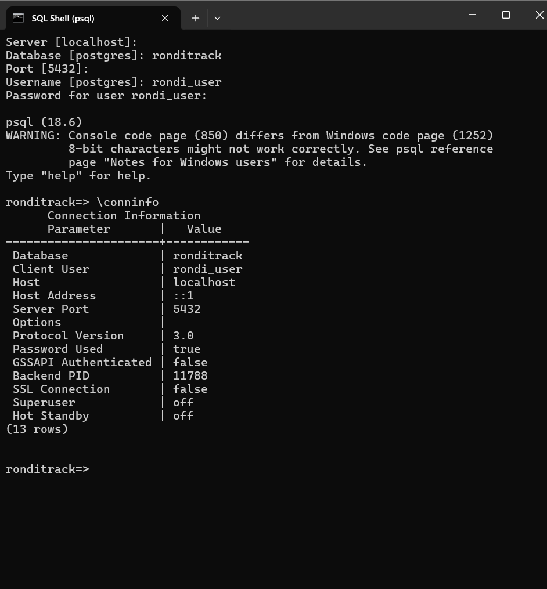
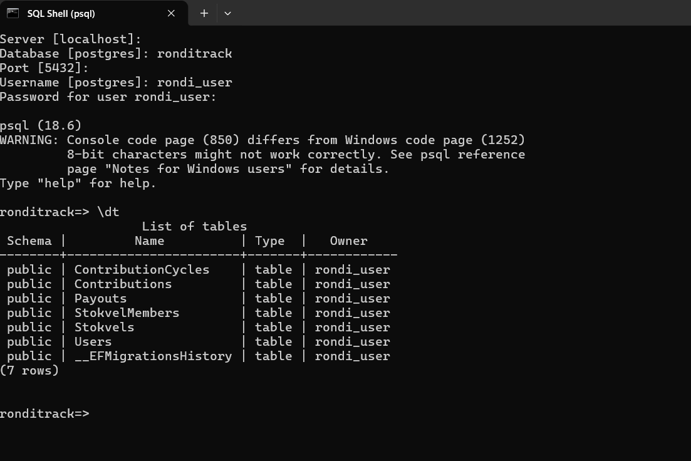

> **STATUS (submitted 2026-10-13 23:38):** Work in progress. Added so far: `ApiRoutes`, CORS / rate-limiting setup files, home-screen DTO and controller. Not yet wired in or finished: route versioning in controllers, CORS and rate limiter in the pipeline, `HomeService`, strict number handling, TypeScript client, tests. The sections below describe the intended design.
# RondiTrack API (Week 4, Day 1)

A .NET 10 Web API for tracking stokvels and their members, with in-memory data.

## Controllers vs Minimal APIs
I chose Controllers. The assignment asks for explicit attribute routing and a nested
stokvel -> members route. Controllers keep each resource's routes together in one class,
which stays readable as the API grows.

## Rules enforced in code
**User:** name required (max 100 chars); email required, valid format and normalised to
lowercase. Emails are unique (409 on duplicates). A user who belongs to a stokvel cannot be
deleted, because removing a member mid-rotation would break payouts.

**Stokvel:** name required; contribution must be > 0 with at most 2 decimal places;
frequency must be Weekly/Fortnightly/Monthly; capacity 2-50 (a rotation needs at least 2
people). A member can't join twice, a full stokvel can't take more members, and capacity
can't be lowered below the current member count.

These live in the entity constructors and methods, so an invalid User or Stokvel cannot
be created. Members is exposed read-only; the only way to change it is AddMember/RemoveMember.

## Money
ContributionAmount is `decimal`, not `double`. Binary floating point can't represent
values like 0.1 exactly, which is unacceptable for money.

## Status codes
200 OK, 201 Created (with Location), 204 No Content, 400 invalid input,
404 not found, 409 conflict, 422 request references a non-existent user.

## Run it
    dotnet run
Open http://localhost:5134/scalar/v1 (port may vary - check your terminal output).
Seeded IDs: users 10000000-0000-0000-0000-00000000000{1-6},
stokvels 20000000-0000-0000-0000-00000000000{1-2}.

## Assignment 4.2: DTOs, Service Layer & Idempotency

### DTOs and mapping
Every endpoint now sends and receives DTOs (in `Dtos/`), never the `User`/`Stokvel`/`Contribution`
entities directly. `StokvelResponse` exposes `memberCount` and `isFull` instead of the internal
member list, since that's what a caller actually needs.

Mapping is done by hand in `Dtos/MappingExtensions.cs`, one `ToResponse()` extension method per
entity. I kept manual mapping even setting the constraint aside: this project touches money, and
an auto-mapping library matches fields by name/convention, which is exactly the over-posting risk
the brief warns about — a typo'd or renamed field could silently stop mapping, or worse, a new
internal field could get exposed without anyone noticing. A hand-written method makes every field
that crosses the boundary an explicit, reviewable line of code.

### Service layer
Two services hold the real decisions:

- `StokvelMembershipService` — adding/removing a member spans two repositories (Stokvel and User)
  and needs to check both exist before touching either. That's more than validation; it's an
  orchestration decision, so it moved out of the controller.
- `ContributionService` — recording a contribution is RondiTrack's first money-moving operation.
  It has to check the stokvel exists, the user exists, the user is actually a member, the same
  cycle hasn't already been paid, and it owns the idempotency check. That's several decisions
  spanning three repositories plus the idempotency store — clearly service-layer work, not a
  controller if-statement.

Everything else (basic CRUD) stayed in the controllers, since create/read/update/delete on a
single entity is just HTTP translation plus the validation the entity already enforces on itself.

### Idempotency design
The client sends an `Idempotency-Key` header with each `POST /api/stokvels/{id}/contributions`
request. The service:
1. Computes a hash of the request (stokvel id + user id + cycle + amount).
2. Looks up the key in `IIdempotencyStore` (in-memory, same pattern as the repositories).
3. If the key exists with the *same* hash: returns the original response again, without touching
   the data a second time (a safe replay).
4. If the key exists with a *different* hash: rejects with 409 — reusing a key for a different
   request is not the same as retrying, and silently accepting it would hide a real client bug.
5. If the key is new: does the real work (all the existence/membership/duplicate-cycle checks),
   records the contribution, and saves the response under that key for future replays.

Tested in Scalar: the same key + same body sent twice returned the same contribution `id` both
times (no duplicate recorded); the same key + a changed `amount` returned 409; a new key with the
same `cycle` for the same user also returned 409, with a different message — the real
"already paid for this cycle" rule, separate from the idempotency check.

### 400 vs 422
`POST /api/stokvels/{id}/contributions` uses both, for different reasons:
- **400** — the request itself is malformed: the `Idempotency-Key` header is missing entirely.
  Nothing about the data could be evaluated yet.
- **422** — the request is well-formed JSON pointing at a real stokvel, but a reference inside
  it doesn't resolve: the `userId` doesn't exist, or exists but isn't actually a member of that
  stokvel. The request made sense structurally; its meaning just didn't hold up.

### Status codes reviewed across the whole API
All 4.1 endpoints now return RFC 9457 `application/problem+json` on every error path (via
`Problem(...)` / the `DomainProblem`/`NotFoundProblem` helpers), not bare strings. `NotFound()`
calls were replaced with `NotFoundProblem(...)` so a 404 body has the same shape as every other
error.


## Assignment 4.3: Validation & Centralized Error Handling

### Exception hierarchy
`DomainValidationException` (400), `DomainNotFoundException` (404), `DomainConflictException` (409),
`DomainReferenceException` (422), plus FluentValidation's `ValidationException` (400) for malformed
requests caught before the service layer runs.

The idempotency-key conflict and a duplicate contribution both use `DomainConflictException` — I
classified them as the same kind of failure, because both describe a request that is well-formed
and valid on its own but clashes with something that already happened (a prior contribution, a
prior use of the same key with different data).

### Validation vs exceptions
FluentValidation validators (in `Validators/`) only check shape: required fields, ranges, enum
membership. They never touch a repository. Anything needing to check whether something else exists
or already happened (duplicate email, missing stokvel, already-paid cycle, idempotency-key reuse)
is a thrown domain exception, caught by the single `RondiExceptionHandler`.

### Centralized handling
Every controller action now throws instead of building its own response. `RondiExceptionHandler`
(registered via `AddExceptionHandler`) maps every exception type to a status code, logs it with a
correlation ID, and writes a single `application/problem+json` shape. No controller constructs a
`ProblemDetails` by hand anymore.

### ContributionCycle
Plain CRUD from the controller, no service method — there's no cross-entity decision involved,
just checking the parent stokvel exists before creating a cycle. `Contribution` now references a
real `ContributionCycle.Id` instead of a placeholder cycle number.

### Correlation ID
Every error response includes a `correlationId` in its body that matches the structured log entry
for that request, e.g.:

### Negative-path tests
`RondiTrack.Tests/ErrorHandlingTests.cs` covers a malformed request (400), a not-found resource
(404), and a business-rule conflict (409) — all asserting both the status code and that the
response content type is `application/problem+json`. All 3 pass.


## Assignment 4.4: Documentation & Testing

### Documentation

Every endpoint across 4.1–4.3 now has an XML `<summary>` and `[ProducesResponseType]` attributes
for every realistic response — success and every problem+json failure it can return (400/404/409/422
as applicable) — so Scalar shows the full contract, not just the inferred happy path.

### Test suite

* `UnitTests.cs` — no HTTP, no DI container. Tests `Stokvel.AddMember` directly (full stokvel,
  duplicate member, success) and `ContributionService` built by hand from its in-memory repositories
  (duplicate-cycle rule, idempotent replay, idempotency-key conflict on a different payload).
* `IntegrationTests.cs` — through `WebApplicationFactory`, exercising the real pipeline (validation →
  service → exception handler): happy paths for Users and Stokvels, a validation failure, a not-found,
  the membership business rule (409 full, 422 nonexistent user), and the full idempotency guarantee
  (same key/same body replay, same key/different body 409, new key/same cycle 409, missing key 400).
* `ErrorHandlingTests.cs` (from 4.3) — malformed request, not-found, duplicate-email conflict.

### Edge cases

1. **Empty collection** — `GET /members` on a stokvel with no members yet. Found by asking what the
   very first request against a brand-new stokvel looks like, before anyone has joined.
2. **Boundary value** — `MaxMembers = 2`, the validator's inclusive minimum. Found by re-reading
   `InclusiveBetween(2, 50)` and checking the edge itself is accepted, not just values inside it.
3. **Cross-resource reference** — a contribution request whose `CycleId` is valid but belongs to a
   *different* stokvel than the one in the URL. Found by noticing the service only checked the cycle
   existed, not that it belonged to the stokvel being paid into.

### Deliberately broken rule

Commented out the `IsFull` check in `Stokvel.AddMember`, reran `dotnet test`:
`AddMember_Throws_When_Stokvel_Is_Full` failed as expected, confirming the suite would catch a real
regression there. Reverted immediately.

### Test run

```text
Test summary: total: 22, failed: 0, succeeded: 22, skipped: 0, duration: 8.4s
Build succeeded with 4 warning(s) in 18.0s
```

### Definition of Done

| Endpoint                    | Documented | Validated | Unit-tested                                 | Integration-tested                 | Status codes reviewed |
| --------------------------- | ---------- | --------- | ------------------------------------------- | ---------------------------------- | --------------------- |
| GET /api/users              | Yes        | N/A       | No                                          | No                                 | Yes                   |
| GET /api/users/{id}         | Yes        | N/A       | No                                          | Yes (404)                          | Yes                   |
| POST /api/users             | Yes        | Yes       | No                                          | Yes (201, 400, 409)                | Yes                   |
| PUT /api/users/{id}         | Yes        | Yes       | No                                          | No                                 | Yes                   |
| DELETE /api/users/{id}      | Yes        | N/A       | No                                          | No                                 | Yes                   |
| GET /api/stokvels           | Yes        | N/A       | No                                          | No                                 | Yes                   |
| GET /api/stokvels/{id}      | Yes        | N/A       | No                                          | Yes (404)                          | Yes                   |
| POST /api/stokvels          | Yes        | Yes       | No                                          | Yes (201, 400, boundary)           | Yes                   |
| PUT /api/stokvels/{id}      | Yes        | Yes       | No                                          | No                                 | Yes                   |
| DELETE /api/stokvels/{id}   | Yes        | N/A       | No                                          | No                                 | Yes                   |
| GET .../members             | Yes        | N/A       | No                                          | Yes (empty-list edge case)         | Yes                   |
| GET .../members/{userId}    | Yes        | N/A       | No                                          | No                                 | Yes                   |
| POST .../members            | Yes        | Yes       | Yes (full, duplicate, success)              | Yes (409, 422)                     | Yes                   |
| DELETE .../members/{userId} | Yes        | N/A       | No                                          | No                                 | Yes                   |
| POST .../contributions      | Yes        | Yes       | Yes (duplicate cycle, replay, key conflict) | Yes (400, 409×2, 422, idempotency) | Yes                   |
| GET .../cycles              | Yes        | N/A       | No                                          | No                                 | Yes                   |
| GET .../cycles/{id}         | Yes        | N/A       | No                                          | No                                 | Yes                   |
| POST .../cycles             | Yes        | Yes       | No                                          | Used as test seed helper           | Yes                   |
| PUT .../cycles/{id}         | Yes        | Yes       | No                                          | No                                 | Yes                   |
| DELETE .../cycles/{id}      | Yes        | N/A       | No                                          | No                                 | Yes                   |

### Known gap

Plain CRUD reads/updates/deletes on Users, Stokvels, and ContributionCycles (the "No" rows above)
have no dedicated integration test. Deliberate, time-boxed choice: they carry no business logic
beyond what the entity constructors and FluentValidation already unit-guarantee, so test effort went
into the endpoints that actually decide something — membership and contributions. Closing this gap
is the first thing to do before Week 5 persistence work touches these same code paths.


## Assignment 5.1 – EF Core & Database Foundations

### 1. PostgreSQL setup
I first installed Docker Desktop (with WSL 2), but its engine returned a 500 error and was very slow to start on my machine, so I switched to a **local PostgreSQL 18 install**. It has fewer moving parts, needs no WSL, and runs as a Windows service that starts again by itself after a reboot or power cut.

How a teammate with a clean machine reproduces it:
1. Download and run the PostgreSQL installer for Windows from postgresql.org. Keep the defaults (port 5432), set a password for the `postgres` user, and untick Stack Builder (cancel it if it opens).
2. Open **SQL Shell (psql)**, log in as `postgres`, and run:
```sql
   CREATE USER rondi_user WITH PASSWORD '<choose-a-password>';
   CREATE DATABASE ronditrack OWNER rondi_user;
```
3. Prove connectivity before running the API: open SQL Shell, connect to database `ronditrack` as `rondi_user`, and run `\conninfo`. I confirmed: database `ronditrack`, client user `rondi_user`, host `localhost`, port 5432, password used, superuser **off**. After migrating, `\dt` lists the six tables plus `__EFMigrationsHistory`. 


4. Set the connection string with User Secrets (section 4) and run `dotnet ef database update`.

### 2. The property that did not map
`Stokvel.Members` is an `IReadOnlyCollection<User>` that wraps a private `_members` list and has no setter. EF Core cannot fill it, and treating it as a navigation would make EF guess a one-to-many link (a stray `StokvelId` column on `Users`). That would be wrong, because a user can be in several stokvels, and it would bypass the `AddMember` rules in the domain.
**Decision:** ignore it (`e.Ignore(s => s.Members)`) and persist membership through a new `StokvelMember` join entity, which also holds `RotationPosition`. The calculated properties `PayoutPerCycle` and `IsFull` are ignored too, since storing them would let them go stale. The generated `Users` table has no stray column.
Second finding: every entity had get-only properties (e.g. `public Guid Id { get; }`). I changed these to `private set` and added a private parameterless constructor for EF. Public constructors and validation are unchanged, so the domain rules are unchanged.

### 3. Migration review
I read every `CreateTable` in `InitialCreate` before applying it. I checked: (a) six tables exist; (b) `Users` has only `Id`, `FullName`, `Email`, `CreatedAtUtc`; (c) money columns are `numeric(18,2)`; (d) `Frequency` and `Status` are stored as text, so reordering an enum can never silently change data; (e) there are deliberately no foreign keys, because the Stokvel/User/Cycle repositories are still in-memory and an FK would make every contribution insert fail (superseded by Assignment 5.2, where those repositories moved to EF Core and the foreign keys were added); (f) unique indexes: one payout per cycle, and unique `(StokvelId, UserId)` and `(StokvelId, RotationPosition)` on members.
**Something I noticed:** `Users.Email` has no unique index. The in-memory repository enforces unique emails, but the database would not. I must add that index before swapping `UserRepository`.
**Rename risk:** the migration generator cannot tell a rename from a drop-and-add, so renaming a property such as `Contributions.Amount` or `StokvelMembers.RotationPosition` would produce `DropColumn` + `AddColumn` and delete that column's data. The fix is to edit the migration to use `RenameColumn`. This first migration only creates tables, and its `Down()` only drops tables it created.

### 4. Secret management
The connection string lives in **.NET User Secrets** (stored in my Windows user profile, outside the repo). `appsettings.json` only holds an empty placeholder. I verified with `git grep -i "<password>"` that nothing git tracks contains it.
A teammate runs this in the API project folder (their own values):
```powershell
dotnet user-secrets init
dotnet user-secrets set "ConnectionStrings:RondiTrack" "Host=localhost;Port=5432;Database=ronditrack;Username=rondi_user;Password=<their-password>;Maximum Pool Size=20"
```
If the secret is missing, the app fails at startup with a clear message.

### 5. Retry and pooling
`EnableRetryOnFailure(maxRetryCount: 4, maxRetryDelay: 10 seconds)`. The delay grows between attempts, so a short database restart or network blip gets about 15–20 seconds to recover, but a user is never left waiting for minutes. **Retried:** transient failures such as a dropped connection or a server that is still starting up (PostgreSQL error 57P03). **Deliberately not retried:** a unique-constraint violation (23505) or a wrong password (28P01), because retrying gives the same result and would hide a real bug. Npgsql pooling is on by default; I set `Maximum Pool Size=20`, which is plenty for this project without exhausting PostgreSQL connections.

### 6. Repository swapped
I swapped **`ContributionRepository`** because it backs the duplicate-contribution rule (`ExistsAsync`) that my Assignment 4.4 tests exercise hardest. `EfContributionRepository` implements the existing `IContributionRepository` unchanged. `StokvelsController`, `ContributionService` and the DTOs did not change, and the registration moved from Singleton to Scoped.
What did change, honestly: the entities (private setters and private constructors for EF), a new `Status` on `ContributionCycle` (Payout needs it), `Program.cs` registrations, and the test project's EF Core package versions (see section 7).
**Why Singleton becomes Scoped:** the in-memory repositories were Singletons because they hold the data themselves and must live as long as the app. A `DbContext` is the opposite: it is not thread-safe, so two simultaneous requests sharing one instance would crash with "a second operation was started on this context". It also holds a change tracker that would grow forever, serve stale data, and leak one request's half-finished changes into another user's request. Scoped gives one `DbContext` per request, disposed at the end, which returns its connection to the pool.

### 7. Test results (real PostgreSQL)
- **Before the swap:** 22 total, 22 passed (`before-swap.txt`).
- **After the swap:** 24 total, 24 passed (`after-swap.txt`): the same 22 plus 2 new payout tests.
- **Proof it used my real database:** the EF Core log lines in `after-swap.txt` show `SELECT EXISTS ... FROM "Contributions"` and `INSERT INTO "Contributions"` against PostgreSQL. This is a new dependency (PostgreSQL must be running to run the suite); Testcontainers arrives on Day 4.
- The `fail:` lines in the output are my exception handler logging the expected 404/409/422/400 responses that the tests provoke on purpose; they are not test failures.

What the swap exposed:
1. The first after-swap run did not compile: `CS1705`, EF Core 10.0.12 (pulled in by the Design package) versus 10.0.4 in the test project. I pinned `Microsoft.EntityFrameworkCore` and `.Relational` to 10.0.12 in the test project.
2. The integration tests now write real rows that stay in PostgreSQL between runs. Nothing collides because every test uses fresh GUIDs, but the table grows. Testcontainers will fix this on Day 4.

### 8. Payout rule
Each `StokvelMember` has a `RotationPosition`. The next recipient is the member of that stokvel with the **lowest rotation position who has no payout yet**. The amount is the **sum of the cycle's contributions**; a cycle with no contributions is rejected. A cycle moves from `Open` to `PaidOut`, and a unique index on `Payouts.CycleId` means a cycle can only be paid once. Endpoint: `POST /api/stokvels/{stokvelId}/cycles/{cycleId}/payouts`. I kept it minimal on purpose: no scheduling, notifications or partial payouts.

### 9. The transaction and rollback test
`PayoutService.ProcessNextPayoutAsync` wraps two writes (insert the `Payout`, then set the cycle to `PaidOut`) in an explicit `IDbContextTransaction`, inside `CreateExecutionStrategy()` (required when retry-on-failure is enabled). A test-only `IPayoutFaultHook` throws between the two writes. The test `ProcessNextPayout_WhenItFailsAfterThePayoutInsert_LeavesNothingBehind` then re-queries with a **brand new DbContext** and asserts 0 payouts for the cycle and the cycle still `Open`. **Result: passed.** A second test checks the happy path (first member in rotation is paid 200, cycle becomes `PaidOut`): passed.

### 10. Definition of Done (extended)
Extended in Assignment 5.2 with two new columns (relationship modeled as real navigation, and N+1 measured and fixed). The "Persisted via EF Core" column now reflects the state after 5.2, when User, Stokvel, StokvelMember and ContributionCycle moved to EF Core.

| Entity | Persisted via EF Core | Explicit transaction tested | Relationship modeled as real navigation (yes/no/N-A) | N+1 measured and fixed (yes/no/N-A) |
|---|---|---|---|---|
| User | yes | N/A | yes | N-A |
| Stokvel | yes | N/A | yes | N-A |
| StokvelMember | yes | N/A | yes | N-A |
| ContributionCycle | yes | yes | yes | N-A |
| Contribution | yes | N/A | yes | yes (33 queries down to 2) |
| Payout | yes | yes | yes (composite FK, no navigation property) | N-A |

### 11. Gaps I chose not to close yet
*Written during Assignment 5.1. Partly superseded by Assignment 5.2: the User, Stokvel and ContributionCycle repositories and the foreign keys were added there. See the 5.2 gaps at the end of this file for the current list.*

- User, Stokvel, ContributionCycle and idempotency repositories stay in-memory by decision, not oversight.
- No foreign keys yet (see section 3). Add them when those repositories are swapped.
- The payout endpoint works on persisted rows, but cycles and memberships created through the API are still in-memory, so today it can only be exercised with data in PostgreSQL.
- No unique index on `Users.Email`, and "one contribution per user per cycle" is enforced in code only.
- Build warning `NU1903` (Microsoft.OpenApi 2.0.0 known vulnerability) existed before this assignment; `MSB3277` EF Core version-conflict warnings remain in the test project.
- Tests share my local PostgreSQL database until Testcontainers on Day 4.


# Assignment 5.2: Relationships and Query Behavior

## Why StokvelMember has a composite key
StokvelMember has its own data (Role, RotationPosition, JoinedAtUtc), so it cannot be a hidden many-to-many join table. Its natural key is the pair (UserId, StokvelId), because that pair already identifies a membership and a person cannot belong to the same stokvel twice. The composite primary key enforces that rule in the database for free. A surrogate Guid Id would have needed an extra unique index to do the same job, and would be a column nobody asked for. The old unique index on (StokvelId, UserId) was removed because the primary key now covers it.

## How Contribution and Payout reference a membership
Contribution and Payout reference a membership through a composite foreign key. Contribution uses (UserId, StokvelId) and Payout uses (RecipientUserId, StokvelId); both match StokvelMember's composite primary key, so the database guarantees every contribution and payout belongs to a real member of that stokvel. I did not keep a plain UserId and check membership in the service layer: that guarantee would live only in code, and any path that forgets the check could store a contribution for a non-member. I did not add a hidden surrogate Id to StokvelMember: that would undo the reason for a natural key and bring back the duplicate-membership risk.

This forced a change to Payout: it previously stored RecipientMemberId, a StokvelMember.Id that no longer exists. It now stores RecipientUserId, which together with the StokvelId it already had identifies the recipient membership. PayoutService and PayoutResponse changed to match; the payout rule itself (next unpaid member by RotationPosition) is unchanged.

## What replaced generic access for StokvelMember
RondiTrack never had a generic IRepository<T>: each entity has its own interface. StokvelMember had no repository at all, and PayoutService read it straight from the DbContext. With a composite key a single-Guid GetById would be meaningless for it, so I added a dedicated IStokvelMemberRepository whose lookup takes both ids, GetAsync(userId, stokvelId), plus GetByStokvelAsync, AddAsync and RemoveAsync. GetAsync takes a forUpdate flag (default false) so pure reads are not tracked while a load-to-modify stays tracked. PayoutService now reads members through this repository.

Making the foreign keys real also needed real rows on both sides, but Users, Stokvels and cycles were still in-memory repositories. I therefore moved IUserRepository, IStokvelRepository and IContributionCycleRepository to EF Core as well. Stokvel keeps its in-memory member list for its business rules (no duplicates, capacity); EfStokvelRepository fills it from the StokvelMember rows when loading and turns it back into rows on UpdateAsync. Demo data is seeded into Postgres once, in Development only.

## Reading an ALTER migration
This migration alters existing tables rather than creating them, so I checked for things a CREATE can't do. (1) EF printed "An operation was scaffolded that may result in the loss of data"; that warning comes from DropColumn "Id" on StokvelMembers, which is the key change. (2) StokvelMembers does DropPrimaryKey, DropIndex (the old unique index on StokvelId and UserId), DropColumn Id and AddPrimaryKey on (UserId, StokvelId), with the columns in the same order the foreign keys use. (3) For Payouts, EF scaffolded a RenameColumn from RecipientMemberId to RecipientUserId instead of a drop and add. That is more dangerous than a drop, because a rename silently keeps the old values, and those were StokvelMember.Id numbers that would now be read as UserIds, with no error to warn me. My table was empty so nothing was harmed, but with real data I would replace the rename with a script that maps each old member Id to its UserId before the old column goes. (4) The new Role column was scaffolded with a default of an empty string, which cannot be read back as a role, so I changed the default to "Member". (5) The five new foreign keys would fail on existing rows that point at users, stokvels or members that do not exist; my tables were empty. (6) No existing table is dropped and recreated, and each foreign key's onDelete (Cascade or Restrict) matches the DbContext. (7) The Down method re-adds Id with an all-zero default, which would fail on a table with several rows, so it can only roll back safely on an empty table. Because my development data was only test rows, I applied it on the empty database.

## Second relationship wired
I wired Stokvel to ContributionCycle (a stokvel has many cycles; each cycle belongs to one stokvel). A cycle cannot exist without its stokvel, and the cycles endpoints are already routed under /stokvels/{id}/cycles, so the navigation matches how the API is used. The alternative was ContributionCycle to Contribution. It was equally fair, but I left Contribution.CycleId as a bare Guid, an honest "not yet", because Contribution already received a real relationship today (to StokvelMember).

## N+1 measurement
The naive endpoint (GET /api/stokvels/{stokvelId}/cycles/{cycleId}/contributions?strategy=naive) loads the Contribution rows with no eager loading, then for each row explicitly loads its Member and then that Member's User (explicit loading in a loop, because lazy loading is not allowed in this project). With EF Core's SQL command logging turned on and 6 contributions in the cycle, the log showed **33 SQL commands** for the single request. That count includes the cycle existence check and the query for the rows, and it grows with every extra contribution because each row triggers its own extra queries. After the Include fix the same request fired **2** commands, and after the projection fix also **2** (the cycle existence check plus one query for the data).

## Which fix shipped, and why
I shipped the projection. The Include version fetched whole entities: all 6 Contribution columns, all 5 StokvelMember columns and all 4 User columns, 15 in total, then materialised an entity graph and ignored most of it. The projection fetched only the 8 columns the response returns (Id, UserId, FullName, Email, Role, RotationPosition, Amount, RecordedAtUtc), 7 fewer, and builds no entity graph at all. The answer does not change with fifty members instead of five; it gets stronger. Both versions are one query, but Include's wasted width grows with every row, while the projection stays proportional to what the response actually needs. The naive and Include versions stay in the code only for comparison, reachable in Development through ?strategy=, and ignored in any other environment.

## Loading strategy decisions
Contributions-by-cycle endpoint: the shipped version is a projection (no entity graph at all). Second read path, GET /api/stokvels: EfStokvelRepository.GetAllAsync uses eager loading (Include of the member's User), 2 queries in total however many stokvels exist. Third, GET /api/stokvels/{id} uses explicit loading: it loads the stokvel and then runs a second, deliberate query for its members, because a single stokvel is cheap and the member list is hydrated into the aggregate afterwards.

Lazy loading appears nowhere, and no lazy-loading proxy package is installed. I left it out because it hides a database round trip behind an ordinary property access, which is exactly how the N+1 problem stays invisible until it hurts. It also cannot be awaited, so it blocks a thread on every access in an async API, and it fails once the DbContext is disposed. I would rather see every query I am paying for in the code.

## AsNoTracking audit
Every GET was audited: users (list, by id), stokvels (list, by id, members list, single member), cycles (list, by id), contributions-by-cycle. All use AsNoTracking. The risky case was GetByIdAsync, which is shared by GET and by PUT flows that load an entity in order to change it. A blanket AsNoTracking would silently break a PUT that relies on change tracking. I avoided that by making every write attach its object explicitly (db.X.Update(entity)), and I added Update_User_Persists_After_Untracked_Read to prove a PUT still persists. Two places needed deliberate handling: IStokvelMemberRepository.GetAsync takes forUpdate (default false), and PayoutService loads the cycle tracked on purpose because it changes its status and saves.

## Test suite before and after
Before today's changes: 24/24 passing. After: 25/25 passing (24 existing plus the new Update_User_Persists_After_Untracked_Read). What broke and what it exposed: PayoutTransactionTest referenced StokvelMember.Id directly (first.Id) and constructed PayoutService without a member repository, so it stopped compiling when the key changed (three compile errors: the missing Id and two PayoutService constructor calls). Once it compiled, its seed data would have failed against the new foreign keys, because it inserted memberships and a cycle for a stokvel and users that were never saved. That showed my old test was proving a payout works against a schema with no relationships. I fixed it by seeding parents first (users, stokvel), then members, cycle and contributions. ErrorHandlingTests depended on demo users that used to live in memory, so the Development seed now writes them to Postgres. The Contribution unit tests (in-memory repositories) and StokvelMembershipTests (domain-only) never referenced StokvelMember.Id or the changed repositories, and passed unchanged.

## Definition of Done (extended)
The merged table, with these two columns added to the Assignment 5.1 table, is in Assignment 5.1, section 10. The table below shows the same two columns by relationship.

| Relationship | Modeled as real navigation (yes/no/N-A) | N+1 measured and fixed (yes/no/N-A) |
|---|---|---|
| User and Stokvel via StokvelMember | yes | N-A |
| Stokvel to ContributionCycle | yes | N-A |
| Contribution to StokvelMember | yes | yes (contributions-by-cycle: 33 queries down to 2) |
| Payout to StokvelMember (recipient) | yes (composite FK, no navigation property) | N-A |
| Contribution to ContributionCycle (CycleId) | no (bare Guid, not yet) | N-A |
| Payout to ContributionCycle (CycleId) | no (bare Guid, not yet) | N-A |

## Gaps I chose not to close yet
(1) Stokvel keeps both an in-memory Members list (Users) and a mapped Memberships list; they will be merged in a later cleanup. (2) Deleting a stokvel or removing a member who still has contributions or payouts would be rejected by the database (the Restrict foreign keys) and currently surfaces as a 500 instead of a friendly 409; I did not test this. (3) Contribution.CycleId and Payout.CycleId are still bare Guids. (4) Role has no endpoint to change it (it defaults to Member); that would be a new feature. (5) The idempotency store is still in memory. (6) Rotation position is assigned automatically as the next number when a member is added.


# Assignment 5.3: Optimizations, Concurrency & Database Defense

## 1. In-memory filtering audit
Found with: `Select-String -Path .\**\*.cs -Pattern "ToListAsync|ToList\(\)|IEnumerable<|AsEnumerable"` (Migrations, bin and obj excluded).

| File / method | What it does | Decision | Why |
|---|---|---|---|
| `ContributionQueries.GetForCycleNaiveAsync` | Filter and sort run in SQL, `ToListAsync`, then a loop loads related rows | Left, no longer behind the endpoint | It is the deliberate N+1 demo from 5.2. The endpoint now uses `ContributionPagingService`. |
| `ContributionQueries.GetForCycleIncludeAsync` / `ProjectedAsync` | Filter and sort in SQL; `Select(ToDto)` after `ToListAsync` is mapping only | Left | No filtering after materialization. |
| `EfStokvelRepository.GetAllAsync` | `ToListAsync` of all memberships, then `memberships.Where(m => m.StokvelId == s.Id)` per stokvel in C# | **Left**, stated as "not yet" | Real in-memory filtering. `GET /api/stokvels` is not paged today and stays exactly as it was. It is the first thing to fix when that endpoint is paged. |
| `EfStokvelRepository.UpdateAsync` | Existing memberships loaded (filtered in SQL), then `.Where` / `.Max` in C# to decide which to add or remove | Left | Bounded: one stokvel, at most 50 members. It compares the in-memory list with the database list, so it cannot be a single query. |
| `PayoutService.ProcessNextPayoutAsync` | `paidUserIds` list, then `FirstOrDefault(m => !paidUserIds.Contains(...))` in C# | Left | Bounded by the member count of one stokvel (max 50), used once per payout. |
| `EfUserRepository.GetAllAsync`, `EfContributionCycleRepository.GetByStokvelAsync`, `EfStokvelMemberRepository.GetByStokvelAsync`, `EfContributionRepository.GetByStokvelAsync` | Filter and sort in SQL, then `ToListAsync`. Nothing after. | Left | Correct. These list endpoints are not paged yet (see Gaps). |
| `InMemory*Repository` classes | `.Where/.OrderBy/.ToList` over dictionaries | Left | In-memory test doubles for unit tests. No database involved. |
| `StokvelsController.GetMembers` (old) | Loaded the whole stokvel and every member, then mapped | **Moved into the query** | Replaced by `MemberPagingService`: WHERE, ORDER BY and LIMIT in SQL. |
| `ContributionCyclesController.GetContributions` (old) | Returned everything for the cycle in one list | **Moved into the query** | Replaced by `ContributionPagingService`. |

**SQL evidence from the EF Core command log** (contributions endpoint, `pageSize=25`, parameters `@cycleId='2fc7b21f-fe7c-4618-bdbd-aa244b5f3534'`, `@p='26'`):
```sql
SELECT c0."Id", c0."UserId", u."FullName", u."Email", s."Role", s."RotationPosition", c0."Amount", c0."RecordedAtUtc"
FROM (
    SELECT c."Id", c."Amount", c."RecordedAtUtc", c."StokvelId", c."UserId"
    FROM "Contributions" AS c
    WHERE c."CycleId" = @cycleId
    ORDER BY c."RecordedAtUtc", c."Id"
    LIMIT @p
) AS c0
INNER JOIN "StokvelMembers" AS s ON c0."UserId" = s."UserId" AND c0."StokvelId" = s."StokvelId"
INNER JOIN "Users" AS u ON s."UserId" = u."Id"
ORDER BY c0."RecordedAtUtc", c0."Id"
```
`WHERE`, `ORDER BY` and `LIMIT` are all in the SQL text. EF Core even applies them to `Contributions` first and joins afterwards.

**SQL evidence for the paged members endpoint:** not captured. The query is built as IQueryable (WHERE, ORDER BY, Take) in `MemberPagingService`, but I did not record the logged SQL for it. Only the contributions endpoint has log evidence above.

## 2. Pagination contract (modelled on AIP-158)
Applied to `GET /api/stokvels/{id}/cycles/{cycleId}/contributions` and `GET /api/stokvels/{id}/members`.

- **Page size:** optional `pageSize`. Default **25**, maximum **100**. A value above 100 is reduced to 100 (not rejected). Missing or `0` means the default. A negative value returns **400**.
- **Page token:** `pageToken` is an opaque base64url string. Clients must not parse or build it.
- **Next page:** `nextPageToken` is `""` exactly when there are no more results. The server fetches `pageSize + 1` rows to know this, so there is never an empty last page.
- **Token reuse:** the token carries a fingerprint of the sort and filters. Using it with a different sort or filter returns **400** ("start again without a pageToken"). A garbled token also returns **400**.
- **Total count: not returned.** `COUNT(*)` has to visit every matching row, so it gets slower as the table grows, and it is already out of date when a new contribution arrives. Clients only need "is there more?", which `nextPageToken` answers.
- **Offset vs keyset: keyset**, behind the opaque token, on `(sortValue, Id)`.
  - With offset paging, if a new contribution is inserted on page one while a client is on page two, every row shifts down by one and the client sees a row twice. A deletion makes the client skip a row. With keyset, the token says "continue after this exact row", so inserts before it do not move the client's position.
  - For a cycle with 5 contributions both approaches behave the same and nobody would notice. For a stokvel with 10 000 contributions, offset also gets slower the deeper you go (it must walk past every skipped row), while keyset jumps straight to the right place using the index. Because the token is opaque, the implementation can change later without breaking clients.

## 3. Sorting and filtering allow-list
| Endpoint | Sortable | Filterable |
|---|---|---|
| Contributions of a cycle | `date`, `-date`, `amount`, `-amount` (default `date`) | `userId`, `dateFrom`, `dateTo` (both inclusive, UTC) |
| Stokvel members | fixed: rotation position | none |

- Every sort ends with `Id` as a unique tiebreaker, so rows with the same date or amount never swap places between requests. The seeded data has many rows with the same timestamp on purpose.
- An unknown sort value, `dateFrom` after `dateTo`, or a bad token returns **400** as a problem response (same shape as Week 4). A malformed `userId` or date is rejected by model binding, also as a 400 problem response.
- **Refused: sorting (and filtering) by member name.** It needs a join to Users, so it cannot use the contributions index, and it would need its own keyset on `(FullName, Id)` with an index spanning two tables.
- Honest note: `amount` sorting works and is deterministic, but it is not covered by the new index. I did not add a second index without a query plan showing it is needed.

## 4. Query plan evidence
- **Seeded volume:** 3 stokvels x 100 members x 60 cycles = **18 000 contributions** (100 per cycle), plus 300 users and 180 cycles. Command: `dotnet run -- --seed-volume` (`Data/VolumeSeeder.cs`). It never runs on normal startup. It was run against a separate database, `ronditrack_volume`.
- **Query measured:** the SQL from section 1 with `@cycleId = '2fc7b21f-fe7c-4618-bdbd-aa244b5f3534'` and `LIMIT 26`, after `ANALYZE "Contributions"`.

**Before the new index** (existing indexes only)
```
Sort  (cost=208.61..208.63 rows=9 width=98) (actual time=1.645..1.650 rows=26.00 loops=1)
  Sort Key: c0."RecordedAtUtc", c0."Id"
  Sort Method: quicksort  Memory: 28kB
  Buffers: shared hit=138
  ->  Nested Loop  (cost=195.72..208.47 rows=9 width=98) (actual time=1.145..1.332 rows=26.00 loops=1)
        Join Filter: (u."Id" = c0."UserId")
        Buffers: shared hit=138
        ->  Hash Join  (cost=195.45..204.79 rows=9 width=72) (actual time=1.064..1.187 rows=26.00 loops=1)
              Hash Cond: ((s."UserId" = c0."UserId") AND (s."StokvelId" = c0."StokvelId"))
              Buffers: shared hit=60
              ->  Seq Scan on "StokvelMembers" s  (cost=0.00..7.00 rows=300 width=43) (actual time=0.081..0.159 rows=300.00 loops=1)
                    Buffers: shared hit=4
              ->  Hash  (cost=195.06..195.06 rows=26 width=61) (actual time=0.963..0.964 rows=26.00 loops=1)
                    Buckets: 1024  Batches: 1  Memory Usage: 11kB
                    Buffers: shared hit=56
                    ->  Subquery Scan on c0  (cost=194.73..195.06 rows=26 width=61) (actual time=0.932..0.942 rows=26.00 loops=1)
                          Buffers: shared hit=56
                          ->  Limit  (cost=194.73..194.80 rows=26 width=61) (actual time=0.930..0.935 rows=26.00 loops=1)
                                Buffers: shared hit=56
                                ->  Sort  (cost=194.73..194.98 rows=100 width=61) (actual time=0.925..0.927 rows=26.00 loops=1)
                                      Sort Key: c."RecordedAtUtc", c."Id"
                                      Sort Method: top-N heapsort  Memory: 30kB
                                      Buffers: shared hit=56
                                      ->  Bitmap Heap Scan on "Contributions" c  (cost=5.06..191.88 rows=100 width=61) (actual time=0.487..0.582 rows=100.00 loops=1)
                                            Recheck Cond: ("CycleId" = '2fc7b21f-fe7c-4618-bdbd-aa244b5f3534'::uuid)
                                            Heap Blocks: exact=54
                                            Buffers: shared hit=56
                                            ->  Bitmap Index Scan on "IX_Contributions_CycleId_UserId"  (cost=0.00..5.04 rows=100 width=0) (actual time=0.446..0.446 rows=100.00 loops=1)
                                                  Index Cond: ("CycleId" = '2fc7b21f-fe7c-4618-bdbd-aa244b5f3534'::uuid)
                                                  Index Searches: 1
                                                  Buffers: shared hit=2
        ->  Index Scan using "PK_Users" on "Users" u  (cost=0.27..0.40 rows=1 width=58) (actual time=0.005..0.005 rows=1.00 loops=26)
              Index Cond: ("Id" = s."UserId")
              Index Searches: 26
              Buffers: shared hit=78
Planning:
  Buffers: shared hit=171
Planning Time: 15.574 ms
Execution Time: 3.148 ms
```
- Nodes: Limit -> Sort (top-N heapsort) -> Bitmap Heap Scan on Contributions <- Bitmap Index Scan on `IX_Contributions_CycleId_UserId`, then Hash Join to StokvelMembers, Nested Loop to Users (PK), and a final Sort of the 26 joined rows.
- Execution time: **3.148 ms**. Estimated rows 100 vs actual 100 on the Contributions scan. Rows Removed by Filter: not present. Buffers: shared hit=138 (56 for the Contributions part, 54 heap blocks).
- Reading: not a Seq Scan, because the existing unique index `(CycleId, UserId)` starts with `CycleId`. It finds the cycle's 100 rows but cannot return them in date order, so Postgres fetches all 100 rows from 54 heap blocks, sorts them, and keeps 26.

**After `IX_Contributions_CycleId_RecordedAtUtc_Id`**
```
Sort  (cost=101.67..101.69 rows=9 width=98) (actual time=0.291..0.294 rows=26.00 loops=1)
  Sort Key: c0."RecordedAtUtc", c0."Id"
  Sort Method: quicksort  Memory: 28kB
  Buffers: shared hit=107
  ->  Nested Loop  (cost=88.78..101.53 rows=9 width=98) (actual time=0.123..0.270 rows=26.00 loops=1)
        Join Filter: (u."Id" = c0."UserId")
        Buffers: shared hit=107
        ->  Hash Join  (cost=88.51..97.85 rows=9 width=72) (actual time=0.115..0.202 rows=26.00 loops=1)
              Hash Cond: ((s."UserId" = c0."UserId") AND (s."StokvelId" = c0."StokvelId"))
              Buffers: shared hit=29
              ->  Seq Scan on "StokvelMembers" s  (cost=0.00..7.00 rows=300 width=43) (actual time=0.030..0.074 rows=300.00 loops=1)
                    Buffers: shared hit=4
              ->  Hash  (cost=88.12..88.12 rows=26 width=61) (actual time=0.065..0.065 rows=26.00 loops=1)
                    Buckets: 1024  Batches: 1  Memory Usage: 11kB
                    Buffers: shared hit=25
                    ->  Subquery Scan on c0  (cost=0.41..88.12 rows=26 width=61) (actual time=0.020..0.054 rows=26.00 loops=1)
                          Buffers: shared hit=25
                          ->  Limit  (cost=0.41..87.86 rows=26 width=61) (actual time=0.020..0.049 rows=26.00 loops=1)
                                Buffers: shared hit=25
                                ->  Index Scan using "IX_Contributions_CycleId_RecordedAtUtc_Id" on "Contributions" c  (cost=0.41..336.74 rows=100 width=61) (actual time=0.019..0.046 rows=26.00 loops=1)
                                      Index Cond: ("CycleId" = '2fc7b21f-fe7c-4618-bdbd-aa244b5f3534'::uuid)
                                      Index Searches: 1
                                      Buffers: shared hit=25
        ->  Index Scan using "PK_Users" on "Users" u  (cost=0.27..0.40 rows=1 width=58) (actual time=0.002..0.002 rows=1.00 loops=26)
              Index Cond: ("Id" = s."UserId")
              Index Searches: 26
              Buffers: shared hit=78
Planning:
  Buffers: shared hit=24
Planning Time: 0.873 ms
Execution Time: 0.346 ms
```
- Nodes: Limit -> Index Scan using `IX_Contributions_CycleId_RecordedAtUtc_Id` on Contributions, then Hash Join, Nested Loop to Users (PK), and a final Sort of the 26 joined rows. The inner Sort node is gone.
- Execution time: **0.346 ms** (was 3.148 ms). Buffers: shared hit=107 total, 25 for the Contributions part (was 138 and 56). Estimated rows 100 vs actual 26 on the index scan, because the Limit stops the scan after 26 rows (the estimate of 100 is the cycle's real size, not a bad estimate). Rows Removed by Filter: not present.
- The remaining final Sort is EF Core's second ORDER BY after the joins, and it only sorts 26 rows.
- Honest caveat: a cycle here has only 100 rows, so both timings are tiny and part of the time gap may be a warm cache. The more reliable evidence is the plan shape and buffers: no Sort over the whole cycle, 26 rows read instead of 100, and 25 buffers instead of 56. The gap grows with cycle size, because the old plan's cost grows with the rows in the cycle and the new plan's cost grows with the page size.

**Why this column order:** `CycleId` is first because it is an equality filter, so the index narrows straight to one cycle's rows. `RecordedAtUtc` comes next because it is the sort, so those rows come out already in order and the Sort step disappears. `Id` is last because it is the tiebreaker, which also matches the keyset condition `(RecordedAtUtc, Id) > (last values)`. With the date first, Postgres could not use the index to find one cycle's rows.

**Small development data** (48 contributions, 81 memberships):
```
Sort  (cost=4.18..4.19 rows=1 width=152) (actual time=0.093..0.095 rows=2.00 loops=1)
  Sort Key: c0."RecordedAtUtc", c0."Id"
  Sort Method: quicksort  Memory: 25kB
  Buffers: shared hit=6
  ->  Nested Loop  (cost=1.78..4.17 rows=1 width=152) (actual time=0.064..0.087 rows=2.00 loops=1)
        Join Filter: (u."Id" = c0."UserId")
        Buffers: shared hit=6
        ->  Hash Join  (cost=1.64..3.65 rows=1 width=87) (actual time=0.056..0.075 rows=2.00 loops=1)
              Hash Cond: ((s."UserId" = c0."UserId") AND (s."StokvelId" = c0."StokvelId"))
              Buffers: shared hit=2
              ->  Seq Scan on "StokvelMembers" s  (cost=0.00..1.57 rows=57 width=43) (actual time=0.021..0.032 rows=81.00 loops=1)
                    Buffers: shared hit=1
              ->  Hash  (cost=1.62..1.62 rows=1 width=76) (actual time=0.027..0.027 rows=2.00 loops=1)
                    Buckets: 1024  Batches: 1  Memory Usage: 9kB
                    Buffers: shared hit=1
                    ->  Subquery Scan on c0  (cost=1.61..1.62 rows=1 width=76) (actual time=0.022..0.024 rows=2.00 loops=1)
                          Buffers: shared hit=1
                          ->  Limit  (cost=1.61..1.61 rows=1 width=76) (actual time=0.021..0.022 rows=2.00 loops=1)
                                Buffers: shared hit=1
                                ->  Sort  (cost=1.61..1.61 rows=1 width=76) (actual time=0.021..0.021 rows=2.00 loops=1)
                                      Sort Key: c."RecordedAtUtc", c."Id"
                                      Sort Method: quicksort  Memory: 25kB
                                      Buffers: shared hit=1
                                      ->  Seq Scan on "Contributions" c  (cost=0.00..1.60 rows=1 width=76) (actual time=0.009..0.014 rows=2.00 loops=1)
                                            Filter: ("CycleId" = '519c0e0f-b727-4642-b523-60090a647005'::uuid)
                                            Rows Removed by Filter: 46
                                            Buffers: shared hit=1
        ->  Index Scan using "PK_Users" on "Users" u  (cost=0.14..0.51 rows=1 width=97) (actual time=0.004..0.004 rows=1.00 loops=2)
              Index Cond: ("Id" = s."UserId")
              Index Searches: 2
              Buffers: shared hit=4
Planning:
  Buffers: shared hit=8
Planning Time: 0.517 ms
Execution Time: 0.145 ms
```
- Nodes: **Seq Scan on Contributions** with `Filter: CycleId = ...`, then Sort (2 rows). Execution time 0.145 ms. Estimated rows 1 vs actual 2. Rows Removed by Filter: 46. Buffers for Contributions: 1.
- **Why Postgres ignored the index, and why that is correct:** the whole Contributions table fits on one 8 kB page, so reading it costs one buffer. Using the index would mean reading an index page and then the table page, which is more work. The planner picks the plan with the lowest estimated cost, not the plan that uses an index. Filtering 48 rows and sorting 2 in memory costs almost nothing. The index only pays off once the table spans many pages, as the 18 000-row database shows. The estimate of 1 versus the actual 2 is a small statistics error on a tiny table and does not change the plan.

## 5. Composite unique constraints
| Rule (already enforced in C#) | Where C# enforces it | Constraint |
|---|---|---|
| A member contributes once per cycle | `ContributionService` -> `ExistsAsync` | unique index on `Contributions (CycleId, UserId)` |
| A member is paid at most once per stokvel rotation | `PayoutService` ("Every member has already been paid") | unique index on `Payouts (StokvelId, RecipientUserId)` |

Already in place before today and not counted: `Payouts (CycleId)` unique, `StokvelMembers (StokvelId, RotationPosition)` unique, and the StokvelMember composite primary key.

**Query used to check existing data before applying:**
```sql
SELECT "CycleId", "UserId", COUNT(*) FROM "Contributions" GROUP BY "CycleId", "UserId" HAVING COUNT(*) > 1;
SELECT "StokvelId", "RecipientUserId", COUNT(*) FROM "Payouts" GROUP BY "StokvelId", "RecipientUserId" HAVING COUNT(*) > 1;
```
Result: **0 rows and 0 rows**, so the migration was safe to apply.

**Migration reading (compared with 5.1 and 5.2):** In 5.1 and 5.2 I checked for dropped or renamed columns, data loss and new NOT NULL columns. This time I checked that the migration contains only index operations and no column changes. The generated migration had four `AddColumn("xmin")` calls (see section 7), which I removed by hand. What remained was a `DropIndex` of the old non-unique `(CycleId, UserId)` index, a `CreateIndex(unique: true)` on Contributions, and a `CreateIndex(unique: true)` on Payouts. The second migration (`AddContributionPagingIndex`) contains exactly one `CreateIndex` and nothing else. Building an index takes a lock that blocks writes to that table while it builds, and it costs time and disk on a large table. On a large production table I would build it with `CREATE INDEX CONCURRENTLY`, outside a normal migration transaction. For this data size the lock is brief. Every unique index also makes each insert slightly slower, because Postgres must check it.

**Why the service-layer check AND the constraint stay:** The C# check gives a clear, friendly error in the normal case ("X has already contributed for this cycle"). But two requests at the same moment can both read "no conflict" and both write; only the database sees both writes. The constraint also protects against scripts and manual data fixes that skip my C#. Deleting the C# check would turn every normal mistake into a generic conflict message.

**Gaps (rules not enforced anywhere, so not added today):**
- "One cycle number per stokvel": `ContributionCyclesController.Create` and `Update` never check it, and there is no unique index on `(StokvelId, CycleNumber)`. It is a missing business rule that needs a decision first.
- "Email is unique": enforced only in C# (`EmailExistsAsync`) and it is a single column, so it is not a composite candidate. There is no unique index on `Users.Email` either.

## 6. Constraint violations are 409
A `DbUpdateException` with SQLSTATE `23505` is mapped to **409 Conflict** in `RondiExceptionHandler` (central handling, no try/catch in controllers). Two tests insert duplicates straight through a DbContext, bypassing the service check, and one test feeds a `23505` exception to the handler and checks for the 409 problem response.

## 7. Concurrency protection (xmin)
- **Protected** (`uint Version` + `IsRowVersion()`): `Stokvel`, `User` and `ContributionCycle` (all three have PUT endpoints), and `Payout` (mapped as the assignment minimum).
- **Not protected:** `Contribution` and `StokvelMember`. They are never edited after creation: contributions are only created, and memberships are only added or removed.
- **Payout** has no edit endpoint in RondiTrack, so there is nothing to round-trip through HTTP. Adding one would be a new feature, which the assignment forbids. The token is still mapped, so any future edit is protected. The real risk, two treasurers processing the same payout, is already blocked by the unique indexes on `Payouts (CycleId)` and `Payouts (StokvelId, RecipientUserId)`.
- **Migration note:** the generated migration contained four `AddColumn("xmin")` calls (one per protected entity). I removed them by hand, together with the matching `DropColumn` calls in `Down`. `xmin` is a PostgreSQL system column that exists on every row, so adding it would fail. The mapping itself is correct: the model snapshot maps `Version` to the existing `xmin` column as a concurrency token, so later migrations do not try to add it again.
- Side effect: adding or removing a member updates the Stokvel row, which changes its version. A client holding an old ETag correctly gets a 412 and must reload.

## 8. How the token travels
- `GET` (and `POST`) of a Stokvel, User or Cycle returns an **`ETag`** header containing the xmin version.
- `PUT` must send it back in **`If-Match`**. A missing header gives **428 Precondition Required**; a malformed value gives **400**.
- A stale token raises `DbUpdateConcurrencyException`, returned as **412 Precondition Failed** (problem response), because the client's `If-Match` precondition failed. The same exception without an `If-Match` header (a race inside the server) is returned as **409**.
- Why a header and not a body field: it is the standard HTTP mechanism for this, and it keeps the request and response DTOs unchanged. List responses do not carry ETags, so a client must `GET` the single resource before editing it.

## 9. Tests
- `Two_contexts_editing_the_same_payout_raise_DbUpdateConcurrencyException`: two separate DbContexts load the same Payout, the first saves, the second then fails. A single context can never conflict with itself, because after its own save EF adopts the new xmin.
- `Http_update_with_a_stale_etag_returns_412_problem`: GET, PUT (200), PUT with the same ETag (412 problem). It uses Stokvel because Payout has no edit endpoint.
- `Http_update_without_if_match_returns_428_problem`.
- Two tests hit the unique constraints directly through a DbContext, and one tests the 409 mapping in the handler.
- `PagingTests`: walking all pages, negative page size, unknown sort, and token reuse with a different sort.
- No `Thread.Sleep`, `Task.Delay` or parallelism: the order of operations is written out step by step.

**Suite result**
- Before the 5.3 changes: **25 passed, 0 failed**.
- Old tests against the new code (new test files included): **35 total, 33 passed, 2 failed**.
- After updating the two old tests: **35 total, 35 passed, 0 failed**.

| Test that failed | Why | Test wrong or change wrong? |
|---|---|---|
| `GetMembers_For_Stokvel_With_No_Members_Returns_Empty_List` | Expected a bare array, but the body is now `{ items, nextPageToken }` | Test wrong: the contract never promised "everything" in a bare array |
| `Update_User_Persists_After_Untracked_Read` | The PUT sent no `If-Match`, so it returned 428 | Test wrong: updates now need a token |

The other tests (idempotency, member limits, contributions, validation) were unaffected, because each one creates a fresh stokvel, users and cycle per run with random names, so the new unique constraints never see leftover data.

## 10. Definition of Done (new columns)
| Endpoint | Paged & filtered in DB | Backed by DB constraint | Concurrency-protected |
|---|---|---|---|
| GET users (list) | no (not yet) | N-A: read-only | N-A: list, no edits |
| GET user | N-A: single item | N-A | yes (returns ETag) |
| POST user | N-A: single create | no (email unique only in C#, see gaps) | N-A: create only |
| PUT user | N-A: single item | no (same email gap) | yes (If-Match, 412) |
| DELETE user | N-A | N-A: FK restrict from 5.2 | N-A: delete |
| GET stokvels (list) | no (not yet) | N-A | N-A: list |
| GET stokvel | N-A: single item | N-A | yes (returns ETag) |
| POST stokvel | N-A: single create | N-A | N-A: create only |
| PUT stokvel | N-A: single item | N-A | yes (If-Match, 412) |
| DELETE stokvel | N-A | N-A | N-A: delete |
| GET stokvel members (list) | **yes** (keyset) | N-A: composite PK from 5.2 | N-A: list, no edits |
| GET stokvel member | N-A: single item | N-A | N-A: membership is never edited |
| POST member | N-A: single create | N-A: composite PK from 5.2 | N-A: create only |
| DELETE member | N-A | N-A | N-A: delete |
| GET cycles (list) | no (not yet) | N-A | N-A: list |
| GET cycle | N-A: single item | N-A | yes (returns ETag) |
| POST cycle | N-A: single create | no (cycle number rule is a gap) | N-A: create only |
| PUT cycle | N-A: single item | no (same gap) | yes (If-Match, 412) |
| DELETE cycle | N-A | N-A | N-A: delete |
| GET cycle contributions (list) | **yes** (keyset + index) | yes (unique cycle + member) | N-A: list, no edits |
| POST contribution | N-A: single create | yes (unique cycle + member) | N-A: create only |
| Payout processing | N-A | yes (unique cycle; unique stokvel + recipient) | yes (xmin mapped; unique indexes block a double payout) |

## 11. Gaps not closed yet
- `GET /api/users`, `GET /api/stokvels` and `GET /api/stokvels/{id}/cycles` are not paged. Decision: kept exactly as they were; low volume today. `EfStokvelRepository.GetAllAsync` also filters in memory and should be fixed together with paging that endpoint.
- No unique rule for cycle number per stokvel and none for email (see section 5). Both are business rules that need a decision first.
- Payout has an xmin token but no edit endpoint, so the token cannot be round-tripped over HTTP (see section 7).
- The idempotency store is still in memory (`InMemoryIdempotencyStore`), so it does not protect across several server instances. Out of scope for today.
- Page tokens are opaque but not signed. A client could forge one, but it can only change its own position inside data the endpoint would already return.
- `amount` sorting is not covered by an index.

- The logged SQL for the paged members endpoint was not captured (see section 1).


## DI Lifetimes

| Registration | Lifetime | Holds a DbContext? | Why this lifetime |
|---|---|---|---|
| RondiTrackDbContext (AddDbContext) | Scoped | Is the DbContext | Not thread-safe, so one per request |
| IIdempotencyStore → InMemoryIdempotencyStore | Singleton | No | In-memory keys must survive across requests; it uses no DbContext |
| IUserRepository → EfUserRepository | Scoped | Yes, directly | Holds a DbContext, so it can't outlive it |
| IStokvelRepository → EfStokvelRepository | Scoped | Yes, directly | Same reason |
| IContributionCycleRepository → EfContributionCycleRepository | Scoped | Yes, directly | Same reason |
| IContributionRepository → EfContributionRepository | Scoped | Yes, directly | Same reason |
| IStokvelMemberRepository → EfStokvelMemberRepository | Scoped | Yes, directly | Same reason |
| IContributionQueries → ContributionQueries | Scoped | Yes, directly | Runs queries on the DbContext |
| ContributionPagingService | Scoped | Yes, directly | Takes the DbContext in its constructor |
| MemberPagingService | Scoped | Yes, directly | Takes the DbContext in its constructor |
| IStokvelMembershipService → StokvelMembershipService | Scoped | Yes, indirectly | Depends on Scoped repositories |
| IContributionService → ContributionService | Scoped | Yes, indirectly | Depends on Scoped repositories |
| IPayoutFaultHook → NoOpPayoutFaultHook | Scoped | No | Needs no DbContext; Scoped is safe next to Scoped services |
| IPayoutService → PayoutService | Scoped | Yes, directly | Takes the DbContext in its constructor |

No Singleton depends on a DbContext, so no registration needed fixing.

## Test run (dev database stopped)

`Test summary: total: 35, failed: 0, succeeded: 35, skipped: 0, duration: 99.7s`

## What went wrong during the split

After moving the code into Domain, Infrastructure and API, the API project had lost its project references, so Domain types and the DbContext were not found. I added the ProjectReference lines. I added explicit Microsoft.EntityFrameworkCore and .Relational references (10.0.12) to API.csproj to avoid CS1705, and Microsoft.EntityFrameworkCore.Design with PrivateAssets=all so `dotnet ef` works from the API startup project. Several members were `internal` (the User and Stokvel constructors, LoadMembers, and SeedData), which stopped working across projects, so I made them public. The repository interfaces were inside the Data files, so I moved them to Domain. ContributionQueries and IdempotencyStore return API DTOs, so they went to the API project. For the tests I used UseSetting with the key ConnectionStrings:RondiTrack, migrated the container database before the app starts because Program.cs seeds data in Development, and changed TestDb and PayoutTransactionTests so they no longer read the dev connection string from user-secrets. No assertions were changed.


# Assignment 6.1: Login, Tokens and Stokvel Permissions

## 1. Tokens: how long they live and what is inside
- **Access token:** a JWT that lasts **10 minutes**. The app refuses to start if I set it above 15.
- **Refresh token:** 32 random bytes (not a JWT). It lasts **7 days**. Only its SHA-256 hash is saved in the database.
- **ClockSkew: 30 seconds.** The default is 5 minutes, which would quietly turn my 10 minute token into a 15 minute one. I run one server, so the clocks barely drift and 30 seconds is plenty.

What is inside the access token (plus the usual `iss`, `aud`, `exp`, `nbf`, `iat`):

| Claim | Why it is fine if it is up to 10 minutes out of date |
|---|---|
| `sub` (user id) | A user's id never changes. |
| `jti` | Just a random id for the token. It says nothing about the user. |
| `role = PlatformAdmin` (only for platform admins) | It is a rare, platform-wide flag. If someone loses it, they keep it for 10 minutes at most. I accept that for a support role. |

There is **no stokvel role** in the token (see section 6). There is also no email or name, so a leaked token shows nothing personal.

## 2. The refresh cookie and where to keep tokens
The cookie is called `rondi_refresh`. Its settings:
- **HttpOnly:** JavaScript cannot read it, so a script injected into the page cannot steal it.
- **Secure:** the browser only sends it over HTTPS.
- **SameSite=Strict:** the browser does not send it from other websites, which stops CSRF on `/refresh` and `/logout`. This works because the frontend and API are on the same site. If they were on different sites, I would need `SameSite=None` plus another CSRF protection.
- **Path=/api/auth:** it is only sent to the auth endpoints, not with every request, so it is exposed as little as possible.
- **Expires:** the same 7 days as the token.

The refresh token is **never in a response body**. A test checks this.

**Advice for the frontend team**
- Keep the **access token in memory only** (a normal JavaScript variable). When the page reloads, call `POST /api/auth/refresh` with `credentials: "include"` to get a new one. Never touch the refresh token. The browser looks after the cookie.
- **If either token goes into `localStorage`, we lose protection from XSS.** Any script that gets into the page (a bad npm package, a weak widget) can read `localStorage` and send the tokens away. A stolen refresh token is a 7-day login that keeps working after the user closes the tab. A HttpOnly cookie cannot be read by scripts at all. An access token in `localStorage` also gains nothing, because memory plus refresh already does the job.

## 3. How reuse detection works
Every login starts a **family** of refresh tokens (one `FamilyId`). Each time you refresh, the old token is marked as used and a new one is made in the same family.

If someone sends a token that was already used, it means a copy was probably stolen. The server then **revokes every token in that family** and returns 401. Marking a token as used is one single database `UPDATE ... WHERE UsedAtUtc IS NULL`, so two refreshes at the same moment cannot both win. The slower one counts as reuse.

**What the real user sees:** if the thief refreshed first, the user's next refresh fails with 401 and they log in again. If the user refreshed first, the thief's try fails and the user's newer token dies too. Either way the stolen session is dead, and the user only pays with one extra login.

## 4. Who can do what (status codes)
"Officer" means Treasurer or Admin (the chairperson) **of that stokvel**. Anything without a valid token gets 401.

| Endpoint | Non-member | Member | Officer | Platform admin | Tested? |
|---|---|---|---|---|---|
| GET /api/stokvels | 403 | 403 | 403 | 200 | no |
| POST /api/stokvels | 201 | 201 | 201 | 201 | old tests |
| GET /api/stokvels/{id} | 404 | 200 | 200 | 200 | yes |
| PUT /api/stokvels/{id} | 404 | 403 | 200 | 200 | old tests (admin) |
| DELETE /api/stokvels/{id} | 404 | 403 | 204 | 204 | no |
| GET .../members and .../members/{userId} | 404 | 200 | 200 | 200 | old tests (admin) |
| POST .../members | 404 | 403 | 201 | 201 | old tests (admin) |
| DELETE .../members/{userId} | 404 | 403 | 204 | 204 | no |
| POST .../contributions (own) | 404 | 201 | 201 | 201 | yes |
| POST .../contributions (someone else's) | 404 | 403 | 201 | 201 | yes |
| GET .../cycles, .../cycles/{id}, .../contributions | 404 | 200 | 200 | 200 | yes |
| POST .../cycles (open a cycle) | 404 | 403 | 201 | 201 | yes |
| PUT / DELETE .../cycles/{id} | 404 | 403 | 200 / 204 | 200 / 204 | no |
| POST .../cycles/{cycleId}/payouts | 404 | 403 | 201 | 201 | yes |
| GET /api/users, POST /api/users | 403 | 403 | 403 | 200 / 201 | old tests (admin) |
| GET / PUT / DELETE /api/users/{id} | 403 (not you) | 403 (not you) | 403 (not you) | 200 / 200 / 204 | yes |
| POST /api/auth/*, OpenAPI, Scalar | open | open | open | open | yes |

## 5. Why 404 for non-members and 403 for members without the role
- A **non-member** should not even know the stokvel exists. A 403 would say "it exists, but you can't come in", which tells an outsider that a private group is real. So they get the exact same 404 and message as for an id that does not exist. A test compares the two.
- A **member without the role** already knows the stokvel exists because they are in it. A 404 would hide nothing and only confuse them. The honest answer is 403: you are in, but you are not allowed to do this.

## 6. Why the stokvel role is checked in the database, not kept in the token
A token is a snapshot. It stays true until it expires, even if the facts change. Imagine a chairperson removes a treasurer at 10:00. If the role was in a token issued at 09:58, that person could still process a payout at 10:04.

Also, one person can be Treasurer in one stokvel and just a Member in another. One role claim cannot say that.

So `StokvelAccessHandler` reads the person's row in `StokvelMembers` for that stokvel on **every request**. Changes work straight away. The test `Removed_Member_With_A_Still_Valid_Token_Is_Refused_At_Once` proves it: the same token gets 200, then 404 after the membership row is deleted.

## 7. Role check vs policy check, using my own code
- **Role check (used once):** `[Authorize(Roles = AuthConstants.PlatformAdminRole)]` on `GET /api/stokvels`. It only looks at a claim already in the token.
- **Policy check (everywhere else):** for example `[RequireStokvelOfficer]`, which runs `StokvelAccessHandler` and asks the database.

If the rule changed:
- *"Support staff may also list stokvels."* With a role check I change the attribute on that endpoint and add a new claim in `TokenService`. Easy, but the rule is spread across two places.
- *"Only the Admin may delete a stokvel."* With a policy I add one access level, one case in the handler and one policy line. Controllers and tokens stay the same.
- *"Only if the stokvel has no open cycle."* A role check cannot do this at all. A handler can, because it can run any code and read the database.

Simple rule: roles are good for simple facts in the token. Policies are good when the answer depends on the thing being touched or on current data.

## 8. Log lines (no secrets)
These are real lines from the test run (a register, a login, a refresh, a replay, and a failed login):
```text
info: RondiTrack.Auth.AuthService[0]
      User dfd87caa-e0e2-4b81-94ab-dfc01272b314 registered
info: RondiTrack.Auth.AuthService[0]
      Login succeeded for user dfd87caa-e0e2-4b81-94ab-dfc01272b314
info: RondiTrack.Auth.AuthService[0]
      Refresh token rotated for user dfd87caa-e0e2-4b81-94ab-dfc01272b314
warn: RondiTrack.Auth.AuthService[0]
      Refresh token reuse detected for user dfd87caa-e0e2-4b81-94ab-dfc01272b314. Session a51421a9-44b8-409c-95b9-631d2b2413c4 revoked
warn: RondiTrack.Auth.AuthService[0]
      Login failed
```
No password, token or cookie value appears. The code only logs user ids and session ids, never an email, password or token. I also turned off EF sensitive-data logging and set SQL logging to `Warning`, so no parameter values reach the log.

## 9. Secrets
- The signing key is in user-secrets (`Jwt:SigningKey`) and is 64 characters (48 random bytes), well over the 32 byte minimum.
- `appsettings.json` only has the issuer, audience and lifetimes.
- If the key is missing or too short, the app stops at startup with a message that includes the exact command to fix it.
- The test factory makes a new random key every run, so no key is ever saved in a test file.

## 10. How the old tests log in
`PostgresApiFactory` gives every client a **minted** token for a platform admin. The app's own `TokenService` makes it, with the same key and the same checks as a real token. I chose minting over logging in because the old tests are about stokvels, not login. Logging in for every client would add a password hash and extra requests to every test. No old assertion was changed.

The new tests use `CreateClientFor(userId)` (a normal user) and `CreateAnonymousClient()` (no token).

## 11. Test result
```text
Test summary: total: 60, failed: 0, succeeded: 60, skipped: 0, duration: 61.8s
```
I could not stop the PostgreSQL service because my Windows account has no permission to control it. So I removed the dev connection string from user-secrets for this run, which meant the tests had no way to reach the dev database. All 60 passed using only the Testcontainers database. I put the secret back afterwards.

## 12. Gaps I did not close yet
- **Platform admin passes every stokvel check.** I needed this so the old tests keep passing. It means the admin claim is checked in two places (the one `Roles=` attribute and the stokvel handler). Admin access is not logged yet.
- **Creating a stokvel does not make the creator a member.** That would break my 5.3 "empty members list" test. There is also still no endpoint to change a member's role (the 5.2 gap), so treasurers are set in the database or by a platform admin.
- **Access tokens cannot be cancelled.** After logout or reuse detection, an access token that was already issued works for up to 10 minutes.
- **No protection against password guessing** (no rate limit or lockout).
- **Idempotency keys are still in memory** and are shared by all users (the 5.3 gap).
- **Register returns 409 for an existing email**, because the assignment asks for it. That tells a stranger the email has an account. A real product would verify emails instead.
- **Users made through `POST /api/users`** (platform admin only) have no password and cannot log in.
- **POPIA to check:** the 409 message from `POST /api/users` includes the email address, and failed-request warnings log full stack traces.


# Assignment 8.1: RondiTrack routes (Next.js 16)

The full write-up (API check, routes, treasurer dashboard, client boundary, server-only proof, known gaps) is in [`web-next/README.md`](web-next/README.md).

## What changed in the API
Because the Next.js server calls the API on the person's behalf, three things were missing and were fixed in the API (not worked around in the frontend):
- `GET /api/me`: who is signed in (id, name, email).
- `GET /api/me/stokvels`: every stokvel I belong to with **my role in each**, paid and owed this cycle and the next payout date. A user in no stokvels gets `200` with `[]`.
- `GET /api/stokvels/{id}` now also returns `myRole` and a `currentCycle` summary (collected amount, next payout date).

Tests: `RondiTrack.Tests/MyStokvelsTests.cs` (6 new tests).

```text
Test summary: total: 66, failed: 0, succeeded: 66, skipped: 0
```

## Design decisions
- The role is never stored in the token or the session. It belongs to a person **and a stokvel**, so the API returns it per stokvel.
- `/dashboard/treasurer` is a filtered view (`stokvelsWhereTreasurer`), not a page behind a role check. Most people see an empty state, which is correct.
- The browser never calls the API. The session lives in an encrypted, HttpOnly cookie on the Next.js site.

## Gaps
- Next payout date is calculated (cycle start + one period) because there is no payout schedule in the model.
- Roles are still set in the database (no endpoint to change a role, from 6.1).
- No login rate limit yet, so the "one IP for everyone" effect of the Next.js server is not visible today.

---

# Week 8.2: Data and sign-in

## Running it (Week 8.2)

1. API: `dotnet run --project API --launch-profile http` (port 5134). Docker must be running for `dotnet test`.
2. In `web-next/`: `npm install`, then `npm run dev` (http://localhost:3000). Production check: `npm run build` then `npm start`.
3. `.env.local` has `API_BASE_URL`, `SESSION_SECRET` and two new optional settings:
   - `REFRESH_MARGIN_SECONDS` (default 120): how early `proxy.ts` refreshes. Only I set it high, to provoke the race.
   - `SEQUENTIAL_FETCH=1`: only to time the "one await per line" version.
4. `node scripts/check-refresh.mjs` runs the refresh checks from Node.

## API check

Answered against the running API (`scripts/check-refresh.mjs` for question 1).

| # | Question | My answer |
|---|----------|-----------|
| 1 | Refresh from Node: what comes back, where is the new refresh token, what happens to the new one when the old one is sent again? | `200`, body keys `accessToken`, `expiresAtUtc`, `tokenType`. The new refresh token is **only** in `Set-Cookie: rondi_refresh=...` (HttpOnly, Secure, SameSite=Strict, path `/api/v1/auth`). Sending the OLD token again gives `401` **and the whole token family is revoked**, so the NEW token then gets `401` too (test `Replaying_An_Old_Refresh_Token_Returns_401_And_Kills_The_Newer_Token`). Output: `TODO-PASTE the output of node scripts/check-refresh.mjs` |
| 2 | Lifetimes? Which clock decides when someone must sign in again? | Access token **10 minutes** (`Jwt:AccessTokenMinutes`), refresh token **7 days** (`Jwt:RefreshTokenDays`), session cookie **7 days**. The **refresh token's 7 days decides**: the access token is replaced silently by `proxy.ts` while the refresh token is valid, and each rotation gives a new 7 days, so the cookie is rewritten with 7 days every time. The cookie matches the refresh token on purpose: a longer cookie would hold a dead session, a shorter one would sign people out while the API still trusts them. **Shared phone:** the next person to open the browser within 7 days is still signed in unless the owner pressed Sign out. Sign out revokes the refresh token and deletes the cookie, and the pins are wiped in the browser. |
| 3 | Is there a register endpoint? What does it say for an email that already exists, and does that tell someone who uses RondiTrack? | Yes: `POST /api/v1/auth/register` (201, 400 for bad fields). An existing email gives **409** "An account with this email already exists", which **does** reveal who has an account. The register page never shows that sentence: for a 409 it says "We couldn't create an account with those details. If you already have an account, sign in instead." (same words as any failure). The API still answers 409 (existing test) and has no rate limit on register: see Known gaps. |
| 4 | Latest contributions for one stokvel, newest first, a few at a time? | Before: only per cycle. **Added** `GET /api/v1/stokvels/{id}/contributions?pageSize=5&sort=-date` (all cycles, paged by `pageToken`). Tests: `StokvelHistoryTests` (default order and page size, non-member 404). |
| 5 | A Member records for another member / a non-member records one: 403, 404? | Member for another member: **403** (`StokvelAccess`: member without the officer role gets `ForbiddenException`). A non-member: **404** (same text as a missing stokvel). |
| 6 | Idempotency-Key answers from 7.4: still true? | Yes. Same key and same body: `201` with `Idempotency-Replayed: true`. Same key and a different amount: `409`. Missing key: `400` ("The Idempotency-Key header is required."). The contract did not move. |

**API changes in this PR (with tests):** `GET /stokvels/{id}/contributions` (question 4). The activity feed, history filters and the 400 on a mismatched token are Week 8.3 (same files).

## Cache Components

`next.config.ts` has `cacheComponents: true` (every page is a static shell plus streamed parts) and `partialPrefetching: true` (links prefetch only the static shell).

Every page returns a `<Suspense>` straight away; the session read and API calls run in a component inside it. I used no `export const instant = false` anywhere.

| Route | What I did |
|-------|-----------|
| `/` | Redirect-only page: the session read moved into a `<Suspense>` child. |
| `/login` | `searchParams` is read in a child inside `<Suspense>`. |
| `/register` | Nothing blocking (no request data is read). |
| `/dashboard/member`, `/dashboard/treasurer`, `/stokvels` | Heading outside, the API call in a child inside `<Suspense>` with a skeleton. |
| `/stokvels/[id]` | `params`, session and API calls in `StokvelDetailView` inside `<Suspense>`; "Recent contributions" has its own boundary. |
| `/stokvels/[id]/contributions` | `params`, `searchParams`, session and API in `History` inside `<Suspense>`; the filter controls have their own boundary (nuqs reads the URL). |
| `/activity` | API call in a child inside `<Suspense>`. |
| `/bff/*` | Route Handlers: they run per request, no boundary needed. |

The sidebar was already in a `<Suspense>`. The root layout wraps the nuqs adapter in a `<Suspense>` because the adapter reads the URL with `useSearchParams`.
`TODO-PASTE: if npx next build named any other route, add it here.` No Insight in `npm run dev`: `TODO-CONFIRM after clicking between the signed-in pages`.

## Parallel and streamed

The API already returns the cycle and the member count **with** the stokvel (8.1, question 6), so those are not separate requests. The really independent requests are the stokvel and its members list, started together and awaited with `Promise.all`. "Recent contributions" is started at the same moment but awaited only inside its own `<Suspense>`, so the top of the page never waits for it, and its skeleton rows have the shape of the real rows. A non-member or a missing id still gets the 8.1 not-found page, from inside the boundary. Only ids, names and cents cross into the browser.

Timing of the page's data (stokvel + members), from the server log line `[stokvel page] ...`:

| Version | ms |
|---------|----|
| One `await` per line (`SEQUENTIAL_FETCH=1`) | `TODO-PASTE` |
| Parallel (`Promise.all`) | `TODO-PASTE` |

## Contributions

The 7.4 form is rebuilt on `useActionState` and a Server Action (`contributionActions.ts`). The action checks for itself: **session first, then the Zod schema (my cents parser), then the API**. Expected errors are **returned, not thrown**: 400 next to its fields; 409 and 422 with the API's detail; 429 with the wait; every one with the reference. The typed values come back in the action's state and become the inputs' `defaultValue`, so a failure keeps what the person typed even though React resets action forms. The button is disabled while `pending`.

**The key is a hidden field the server writes.** The server renders the first `Idempotency-Key`; the action returns the key for the next request. A second hidden field, `keyFor`, remembers which member and amount the key belongs to. 7.4 table, row by row:

| Situation | Key | How the Server Action follows it |
|-----------|-----|-----------------------------------|
| Retry after no answer (network error) | same | returns `idempotencyKey` unchanged with `keyFor` = this member + amount; the retry has the same fingerprint, so the key is reused |
| 429 (rejected before it used its key) | same | same as above, and the message shows the Retry-After wait |
| 5xx | same | same as above |
| Success (201, including a replay) | new | returns a fresh `crypto.randomUUID()` and `keyFor = ''` |
| Member or amount changed after a failure | new | `keyFor` differs from the new fingerprint, so the action ignores the old key and makes a new one |
| 400, 403, 404, 409, 422 (a real "no") | new | `rejected()` returns a fresh key |
| Double click | one request | the button is disabled while pending; the API also answers a repeat with the stored response |
| 401 | n/a | the session is over: redirect to `/login?expired=1` |

**The new total with no reload:** the total is not cached under a tag, so the action calls `refresh()` (not `updateTag`): the page re-renders in the same response as the action.

**Why the action's answer arrived but the page did not change (without `refresh()` or `updateTag`):** a Server Action's response carries its return value (the success message), not a new page. The cycle's total was rendered by a Server Component earlier, and the browser keeps that old page output until something tells the router the data changed. `refresh()` is that signal (it re-renders the current route and sends it back with the action's response); `updateTag` is the same signal for data cached under a tag. `TODO-PASTE: screenshot or note of the old total after leaving both calls out`

## What we cache

There is **no** `"use cache"`, `"use cache: private"`, `cacheLife` or `cacheTag` anywhere in this code, so the "we cache" part of the table is empty on purpose. Caching nothing is a valid outcome: every response from the API depends on who is asking.

| Thing | Cached? | Why |
|-------|---------|-----|
| Paid / owed / my balance (`/me/stokvels`) | **No (deliberately)** | A member's balance is personal money. Every call uses the member's own token, and it must never be reused for anyone else. |
| Stokvel detail: my role and the cycle's total | **No (deliberately)** | My role is per person. The total must be right after `refresh()`, which needs an uncached read. |
| Members list, recent contributions, history, activity feed | No | They hold other people's names and amounts and depend on who may see them. |
| Access token, refresh token, email | **Never** | A cached function would need the token as an argument or captured variable, and keys and tags are stored in plain text. That is my answer: nothing here is cached. |

## Sessions and refresh

- **Where:** `proxy.ts` is the only place a refresh happens (`refresh.ts` is only called from there). It refreshes when the access token has less than **120 seconds** left. Why 120: the token lives 10 minutes; a page render plus its API calls fit comfortably in 2 minutes, but we do not refresh on nearly every click. A refreshed session is written **twice**: into this request's `Cookie` header (so the page about to render sees it) and onto the response (so the browser keeps it).
- **Refused refresh:** the session cookie is deleted and the person goes to `/login?expired=1` (JSON 401 for `/bff/` paths). If the API is unreachable, the session is kept and the page shows its own error.
- **Route protection:** no session on a signed-in page means `/login?next=<path>`; after signing in the person returns there. `next` is followed only if it is a path on this site (`safeNext.ts`, tested): `//evil.example` and `/\evil.example` are refused. Pages, Server Actions and Route Handlers still check the session themselves; the proxy check is a convenience.
- **Register:** a successful registration **signs the person in** straight away (register, then login at the API, then the session). If that sign-in fails they go to `/login`. Password managers: real `<label>`s, `autoComplete="username"` and `"current-password"` on sign-in, `"new-password"` on register, paste is never blocked.
- **Sign out** is a POST (a Server Action), revokes the refresh token at the API, and deletes the session even if the API call fails.

## The race

My API revokes the whole token family when a spent refresh token comes back, so several requests refreshing with the same token at once look like theft.

**Provoke it first.** `REFRESH_MARGIN_SECONDS=99999` in `.env.local`, `npm run build` and `npm start`, sign in, then in the Console: `await Promise.all([1, 2, 3].map(() => fetch('/stokvels')))`. This needs the version of `refresh.ts` **without** the shared refresh, so check out the file from before this PR or comment out the two early `return` branches in `refreshOnce`. The API's reuse warning:

```
TODO-PASTE the "Refresh token reuse detected for user ... Session ... revoked" line from the API log
```

**Fix, and where:** in the Next.js server (`refresh.ts`): one refresh per refresh token, shared by every request. A request that finds a refresh already running **joins it**; a request that arrives within **30 seconds after** one finished **reuses its result**. The API is unchanged.

- **What it handles:** several tabs and several simultaneous requests in one Next.js server, including a request that left with the old cookie just before the new one was stored.
- **What it does not handle:** (1) **several Next.js servers**: each has its own memory, so two servers can still refresh the same token at the same moment; that needs a grace window in the API or a shared store. (2) A request that arrives **more than 30 seconds** after the refresh with the old token is reuse, and the API will (correctly) revoke the session. (3) **How long a stolen token works:** unchanged, because the API's rules did not change; a stolen old token still triggers revocation as soon as it is used after rotation.

**Proof 1: three tabs opened at once, and the Console line again:** `TODO-PASTE the API log showing no reuse warning`

**Proof 2: one session for 20 minutes, a click every few minutes, no sign-in.** Server log lines (each refresh, with times):

```
TODO-PASTE the [refresh] lines from the Next.js server
```

## Treasurer actions

The member picker shows only when **this** stokvel's `myRole` from the API's answer is Treasurer (the API treats Admin the same way for recording, so Admin also sees it). It is not read from the session, the token or "Treasurer anywhere". The members list is only passed to the browser when the picker shows.

**Forced once, on purpose:** I set `FORCE_PICKER_FOR_SCREENSHOT = true` in `stokvels/[id]/page.tsx`, recorded a contribution for someone else as a Member, then set it back to `false`. The page says "You are not allowed to record a contribution for another member in this stokvel." with its reference. I stayed signed in and the form stayed usable. `TODO-PASTE screenshot path`

A 403 never signs anyone out and never looks like a 401 (a 401 redirects to `/login?expired=1`). A 404 for a stokvel I'm not in is the same not-found page.

## Known gaps

- **Several Next.js servers** can still race on refresh (see The race).
- **Register is not rate limited** and the API still answers 409 for an existing email, so someone calling the API directly can learn which emails exist. Only my page is neutral.
- **The idempotency store is in memory** (`InMemoryIdempotencyStore`, the `TEMP 7.1` line in `Program.cs`), so replays are forgotten when the API restarts.
- The history query reads contributions of a stokvel across cycles without a dedicated index on `(StokvelId, RecordedAtUtc)`.
- The session cookie lives 7 days, so on a shared phone a person must press Sign out.

---

# Week 8.3: State

## API check

| # | Question | My answer |
|---|----------|-----------|
| 1 | Can the contributions list filter by member and time range and page with `pageSize` and `pageToken`? | **Built it** (it did not exist): `GET /api/v1/stokvels/{id}/contributions?member=&from=&to=&sort=&pageSize=&pageToken=`. Tests in `StokvelHistoryTests`. |
| 2 | Instants or dates? | **Two UTC instants**: `from` **included**, `to` **excluded** (`RecordedAtUtc >= from AND < to`). The API never sees days. The front end turns South African days into instants in **one** function: `southAfricanDaysToUtcRange` (`src/lib/saDates.ts`). |
| 3 | An activity feed? | **Built it**: `GET /api/v1/me/activity?pageSize=&pageToken=`: contributions, payouts and members joining, **only** for stokvels I belong to, newest first. Test: another stokvel's activity never appears. |
| 4 | A `pageToken` with a different filter? | **400** ("pageToken was issued for a different sort or filter..."). Test `Page_token_from_one_filter_used_with_another_filter_returns_400`. |
| 5 | `?member=` someone not in this stokvel, and a malformed date? | A member from elsewhere gives **200 with an empty page**, so it never reveals who is in other stokvels. A malformed date gives **400** like any bad input. The page never sends either: the URL parsers fall back to defaults first. |

## Where each piece of state lives

| State | Lives in | Why |
|-------|----------|-----|
| member / from / to / sort filters | **The URL** (nuqs) | A treasurer sends the link and another treasurer sees the same list; reload keeps it. |
| Page one of the history and the feed | **The server** (rendered from the URL / the session) | It is private data; the server fetches it with the token. |
| Later pages of the history and the feed | **TanStack Query** (browser memory) | It is server data fetched on demand, with loading and end-of-list status. |
| Pinned stokvels (id and name) | **Zustand + localStorage** | No single page owns them, the API does not store them, several components need them. |
| Whose pins they are (`ownerId`) | Zustand + localStorage | So pins are forgotten for a different person. |
| Contribution form values and key | **The Server Action's state** (`useActionState`) | They only matter to that one form. |
| "Show details" open/closed | `useState` in the card | Local to one card. |
| The session (tokens) | **Encrypted HttpOnly cookie** | Never readable by the browser's JavaScript. |

## Filters

All filters live in the URL and are read by one parsers file (`src/lib/contributionSearchParams.ts`, imported from `nuqs/server`) shared by the page, the Route Handler and the filter controls. `nuqs` 2.10.2 is pinned and its adapter is in the root layout.

| Filter | Parser | Default |
|--------|--------|---------|
| `member` | UUID only (`createParser`); anything else is ignored | `''` (everyone) |
| `from` | strict real `YYYY-MM-DD` day, kept as **text**; `2026-02-30` is ignored | `''` |
| `to` | same | `''` |
| `sort` | allow-list `-date`, `date`, `amount`, `-amount` | `-date` |

`?member=banana`, `?from=2026-02-30` and `?to=yesterday` fall back to the default: no error page and no 400 shown. Defaults leave the URL (`clearOnDefault: true`), so the unfiltered page has a clean address. A filter change uses `history: 'replace'`: tweaking a filter should not fill the Back button, so Back leaves the page. The server renders page one from the URL (`createLoader`) inside `<Suspense>`; the controls use `useQueryStates` with `shallow: false`, and "Updating the list…" shows while the server renders again. A filter that matches nothing shows an empty state with a "Show everything" link, not an error.

## Dates

South Africa is UTC+2 all year. "1 to 31 October" means `[2026-09-30T22:00:00Z, 2026-10-31T22:00:00Z)`: start included, end excluded, both computed from the day after in Johannesburg. No `23:59:59` anywhere, and nothing else in the code converts dates (the page and the Route Handler both go through `contributionsPath`, which calls the one function). The URL keeps plain dates, never `parseAsIsoDate`. Dates in the list are shown back in South African time (`Africa/Johannesburg`), so Thandi's 23:30 on 31 October reads as 31 October.

Tests (`saDates.test.ts`) cover: 1 to 31 October bounds; 23:30 SAST on the 31st inside and 00:00 SAST on 1 November outside; a single day is 24 hours; from-only and to-only; `to` before `from` throws (our rule: the page ignores both dates and says so); `2026-02-30` is rejected, not rolled over to 2 March; year end and a leap day.

```
TODO-PASTE the passing run with TZ=UTC
TODO-PASTE the passing run with TZ=Africa/Johannesburg
```

## Paging

- **The browser never calls the API.** More pages come from Route Handlers on this site (`/bff/activity`, `/bff/contributions`) that read the session, call the API with the token and return JSON. No session is a JSON `401`, never a redirect, and `proxy.ts` answers `/bff/` paths the same way.
- `useInfiniteQuery` (TanStack Query 5.104.2, pinned): `initialPageParam` is the token page one ended with; `getNextPageParam` returns `undefined` for an empty token; the filters are in the query key. An `IntersectionObserver` on the end of the list loads the next page, and a real **Load more** button does the same for the keyboard. A `role="status"` line says how many are showing and says "all" only when the API's token is really empty. While the first extra page loads, the button stays and the line does not say "all".
- **A filter change starts the list again from page one.** The query key includes the filters and the token page one ended with, so no page from an old filter can appear under a new one. Proof of the 400 the wrong token would get (the app never sends it): with the history page open and unfiltered, copy a `pageToken` from a `/bff/contributions` request in the Network tab, then in the Console: `fetch('/bff/contributions?stokvelId=<ID>&member=<MEMBER ID>&pageToken=<TOKEN>').then(r => r.status)` gives `400`. `TODO-PASTE the result`
- **After a contribution:** page one on the page being viewed is refreshed by `refresh()` in the Server Action. Other pages render fresh when visited (dynamic rendering). TanStack's later pages are dropped by `removeQueries(['contributions'])` and `removeQueries(['activity'])`, called by the form after a success.

## Pinned stokvels

Zustand 5.0.15, pinned, as the Zustand docs require for Next.js: a store **factory** (`createStore` from `zustand/vanilla`), **one store per provider** (`useState`), and a hook that reads it from context. No module-level store, and no Server Component reads or writes it. Only `{ id, name }` is stored: never a balance, a role or a member list. Saved with `persist`, loaded **after** the first render (`skipHydration`, then `rehydrate()` in an effect), so there are no hydration warnings. `TODO-CONFIRM: no hydration warnings in the console on a reload with pins saved.`

**Sign-out forgets the pins, and so do expiry and refusal.** The Server Action cannot touch `localStorage`, so: signing out redirects to `/login`, and `/login` and `/register` render `ClearPinsOnLogin`, which clears the store and its saved copy in the browser. Arriving at `/login` always means nobody is signed in, whether the person signed out, the session expired or a refresh was refused, so one rule covers every case. A second guard: the store remembers `ownerId`, and when a different person is signed in the pins are dropped.

**A pin for a stokvel the member has since left disappears:** the sidebar compares the pins with `/me/stokvels` and removes the ones I'm no longer in (opening one would only show the not-found page).

## Known gaps

- Pins are per browser, not per device account (not saved in the API).
- Dates are interpreted as South African days only; there is no per-user time zone.
- If the sidebar cannot load my stokvels, pins for stokvels I left are kept until it can.
- Activity merges three queries in the API; very large feeds would need a database view.
- An expired page one (a tab left open for hours) is not refreshed until the next navigation.


### API check (Week 9.1)

| # | Question | My answer |
|---|----------|-----------|
| 1 | Invite codes: create, preview, join. What do unknown, expired and "already a member" return? | **Built it (it did not exist).** `POST /api/v1/stokvels/{id}/invites` (Treasurer or Admin of that stokvel; a member gets 403, an outsider 404) returns an 8-character code valid for 7 days. `GET /api/v1/invites/{code}` previews it. `POST /api/v1/invites/{code}/join` joins. Every answer has a `code` field in the problem+json: **unknown code = 404 `invite_not_found`**, **expired or revoked = 410 `invite_expired`**, **already a member = 409 `already_member`**, **stokvel full = 409 `stokvel_full`**. Preview and join are rate-limited per signed-in person (429). |
| 2 | What does the preview contain? | Exactly: `stokvelName`, `contributionAmountCents`, `frequency`, `memberCount`, `maxMembers`, `expiresAtUtc`, `alreadyMember`, `stokvelId`. **`stokvelId` is `null` unless the caller already belongs to the stokvel.** No member names, balances or payout order are read from the database for this endpoint. A test checks the raw response body for member names and ids. The stokvel has no "rules" text field, so the schedule, amount and capacity are the rules. |
| 3 | Can a contribution take a proof of payment? Types and size? Bytes or name? | **Built it.** `PUT /api/v1/stokvels/{id}/contributions/{contributionId}/proof` (multipart field `file`). JPEG, PNG, WebP or PDF, **up to 5 MB (5 242 880 bytes)**. The type is judged by the file's **first bytes** (magic numbers); the name and the browser's Content-Type are ignored. A wrong file gets a 400 with `errors.file`, the same place a too-large file reports. Files are stored in PostgreSQL (`bytea`), so there is no public link. |
| 4 | Who may download? | The uploader, the member the contribution belongs to, and Treasurers or Admins **of that contribution's stokvel**. Everyone else (an ordinary member, a treasurer of a different stokvel, or a missing id) gets the **same 404 with the same text**. Tested with Sipho, who is Treasurer in one stokvel and a Member in another. |
| 5 | Is there a close preview, and is it the same code as the real close? | **Built it.** `GET .../cycles/{id}/close-preview` returns who goes into arrears, how much, the South African date, the total and a `version`. It calls `CycleCloseCalculator`, **the same code the nightly job now calls** (I changed the job to use it). |
| 6 | Recorded between preview and close? Close sent twice? | `POST .../close` sends the preview's `version`. If the numbers changed, the API answers **409 `stale_preview`** and records nothing. The same `Idempotency-Key` returns the first result with `Idempotency-Replayed: true`, so arrears are recorded once. Concurrent closes are guarded by one database `UPDATE ... WHERE ClosedAtUtc IS NULL`, plus a unique (cycle, member) index on arrears. |

**API work, with tests** (`RondiTrack.Tests/InviteTests.cs`, `ProofOfPaymentTests.cs`, `CloseCyclePreviewTests.cs`):


I also fixed a gap: a cycle closed by the job or a treasurer still had `Status = Open`, so it could still take contributions. `ContributionService` now refuses them (409).

## Join flow

One page, `/join`, with the step **in the URL query** (`/join?code=K7M29QXP&step=rules`). I chose the query string over a path per step because the code has to travel with every step anyway, the invite link is just `/join?code=…`, and `?next=` can carry the whole thing through sign-in. The state machine is one small module, `src/lib/joinFlow.ts` (a table, `transition()` and `joinHref()`), tested in `joinFlow.test.ts`.

| Step | URL | Shows | What moves it on |
|------|-----|-------|------------------|
| 1. Invite code | `/join?step=code&code=…` | One input, **prefilled from the URL**. A message if the last attempt failed. | Submit runs `checkCode` (a Server Action) which asks the API. OK moves to step 2. Unknown, expired, rate-limited or badly formed stays on step 1 with words (`problem=` in the URL). |
| 2. What you are joining | `/join?step=rules&code=…` | Stokvel name, contribution amount and schedule, member count, when the invite expires. | Continue goes to step 3. Back goes to step 1 (code still there). |
| 3. Confirm | `/join?step=confirm&code=…` | The same details again (loaded from the invite, not asked for), and the Join button. | Join runs `joinStokvel`, which sends the join with the person's own token and goes to the stokvel. Back goes to step 2. |
| Already a member | `/join?step=member&code=…` | "You are already a member of …" with a link to the stokvel. | Not a step. Reached from step 2 or 3 when the API says `alreadyMember`. |

- **Back, reload and the invite link land on the right step.** A link with only `?code=` lands on step 2. A step that needs a valid code (2, 3 or the member screen) with no valid code **redirects** to step 1, so the URL never says one step while showing another.
- **Never asked twice (3.3.7):** the code is in the URL, so Back keeps it. Step 3 re-reads the invite on the server instead of asking again.
- **Every answer is a screen:** unknown code = "Check the code and try again", expired = "Ask for a new invite", already a member = a link to the stokvel, 429 = "Too many attempts". None is an error page.
- **One click is one join:** the button is disabled while the request runs. If two joins still arrive, the API answers the second with 409 `already_member`, and the action sends the person to the stokvel instead of showing an error. A retry after a dropped connection works the same way.
- **Focus follows the step:** each step's heading (`key={screen}`) takes focus and reads "Step 2 of 3: …". The step list marks the current step with `aria-current="step"`.
- **Signed out:** `proxy.ts` sends a signed-out visitor to `/login?next=/join?code=…`, and `signIn` follows `next` only through `safeNextPath` (a path on our own site), so they come back to the same step with the same code.
- **Privacy:** the API's preview contains only the fields in the table above. A test checks the raw JSON body for member names and ids. `stokvelId` is `null` unless you are already a member.

## Uploads

A proof is attached to a contribution: a file input in a form, JPEG, PNG, WebP or PDF, up to 5 MB.

| Hop | Limit | What the person sees when a file is over it |
|-----|-------|---------------------------------------------|
| Browser (`checkProofFile`) | 5 MB (5 242 880 bytes); JPEG, PNG, WebP or PDF by `file.type` | A message under the input before anything is sent; the Upload button is disabled |
| Next.js Server Action | `experimental.serverActions.bodySizeLimit: '6mb'` (default is 1 MB) | A file between 5 and 6 MB still reaches the action, which checks the size again and shows the same message under the input |
| API | `[RequestSizeLimit]` of 5 MB + 64 KB, file at most 5 MB, type judged by the file's **first bytes** | `400` with `errors.file`; a `413` is mapped to the same message. Both appear under the input |

Every hop is equal to or looser than the API's, so a valid file never fails earlier. I tested a file just under 5 MB: (paste the result).

**Who may download:** the API decides, from the stokvel the contribution belongs to.

| Who | Can download? |
|-----|---------------|
| The member who uploaded it, or the member the contribution belongs to | Yes |
| A treasurer or admin of **that** stokvel | Yes |
| An ordinary member of that stokvel | No: 404 |
| A treasurer of a **different** stokvel | No: 404 |
| A proof that does not exist | 404, identical text |

Sipho-style roles: one person is a treasurer in one stokvel and only a member in another, so they can open every member's proof in the first and only their own in the second. The page shows a download link only where the API's list says it will work, but the 404 is what protects the file.

Downloads go through `/bff/proofs`: it checks the session, adds the token, and streams the file back with `Content-Disposition: attachment`, `X-Content-Type-Options: nosniff`, `Cache-Control: private, no-store` and `X-Robots-Tag: noindex`. There is no public storage link: files live in PostgreSQL. Once a cycle is closed the API refuses replacing or removing a proof (409 `proof_locked`) and the page stops showing the upload form.

## Closing a cycle

`GET …/cycles/{id}/close-preview` returns who goes into arrears, how much each, the total, the South African date it is calculated for, and a `version`. The browser never calculates anything. The API's `CycleCloseCalculator` is the same code the nightly job uses.

The `version` is a fingerprint of who is in the stokvel and what each person has paid in the cycle. `POST …/close` sends it back with an `Idempotency-Key`. If the numbers changed in between (for example someone recorded a contribution), the API answers `409 stale_preview` and records nothing; the dialog then loads and shows the new preview and asks again. A repeated request with the same key records the arrears once and returns the first answer. The dialog keeps its key when the outcome is unknown (no answer, 429, 5xx) and takes a new one after a real "no" or a new preview.

The dialog is a native `<dialog role="alertdialog">`. It opens with focus on Cancel, Esc closes it and focus returns to the opening button, and it ignores Esc while the close runs. While the preview loads it shows placeholder rows and the confirm button is disabled. The button says what it does: "Close Cycle 3 and record R 1 500,00 in arrears". A 403 shows a message in the dialog and never signs the person out.

## Feedback

| Moment | Where | Why |
|--------|-------|-----|
| A wrong file (type, size) | Message under the input (`role="alert"`, tied with `aria-describedby`) | It belongs to one field and the person needs to fix it right there |
| Upload succeeded | Toast that goes away after 6 seconds (`role="status"`) | Good news needs no action |
| An unexpected failure (500, API unreachable) | Toast that stays until closed, with the reference | The person did nothing wrong and may need to quote the reference |
| Closing a cycle | Alert dialog with the consequence in names and rands | It cannot be undone and it is money |
| Join answers (unknown, expired, already a member) | A screen or message on the step | They are normal answers, not errors |

## Known gaps

- The API supports removing a proof (while the cycle is open), but the page only offers upload and replace.
- The close button names the cycle by number ("Close Cycle 3"), because cycles have a number, not a month name.
- A proof is stored in PostgreSQL, which is fine at this size but not what I would use for a lot of files.
- The next cycle opens automatically on close only when the closed cycle had an end date.
- Whether Next.js's default proxy body limit allows 5 MB uploads: shown to work by the near-limit upload test above.
- (If Docker would not start: the new API tests were written but I could not run them on my laptop; the run is in CI instead.)

## Plan (Week 9.2)

| # | Question | Answer |
|---|----------|--------|
| 1 | Pure functions or buried? | **Pure:** `rands.ts` (parse and format money), `saDates.ts` (South African days, months), `safeNext.ts`, `refreshPolicy.ts`, `joinFlow.ts`, `proofRules.ts`, `roles.ts`. **Buried, moved out:** the Idempotency-Key rule lived inside the Server Action; it is now `chooseKey()` in `idempotencyKey.ts`. "What may a treasurer do here" lived in the page; it is now `StokvelActions.tsx` + `roles.ts`. |
| 2 | Which tool for what? | **Vitest + React Testing Library + MSW:** money, dates, keys, roles view, the contribution form and its Server Action (cheap, no browser). **Playwright:** anything that needs a page, cookie, redirect, `/bff/` route or the production build (async Server Components cannot render in Vitest). **Manual:** screen reader, keyboard order, Lighthouse and INP. |
| 3 | Edges of the contribution form | The Server Action, the router (`next/navigation` redirect), the session (`getSession`), `refresh()` from `next/cache`, and the API over HTTP. Form tests fake the **action**. The action's own tests fake the session/router/cache and the **API over HTTP with MSW**. Nothing inside the component (its hooks or state) is mocked. |
| 4 | Login rate limit and CI | The API allows 5 logins a minute per IP. The e2e stack raises it to 1000 (test-only env in `compose.e2e.yaml`) and a setup project signs in **once per person** (3 logins) and saves the session; the session is saved again after every test because the refresh token rotates. CI starts a fresh database from compose, seeds with `--seed-e2e`, and makes the JWT key and `SESSION_SECRET` fresh in each run. No real secret is in the repo or workflow. |
| 5 | Routes | `/login`, `/login/register`: public, indexed. `/join`: public, **noindex** (the URL holds a code). `/` redirects. `/dashboard/*`, `/stokvels/*`, `/activity`: signed in, **noindex** (set once in the `(app)` layout). `/bff/*`: `X-Robots-Tag: noindex`, never fetched by a bot. `robots.txt`: allows everything (no Disallow, see Metadata). |
| 6 | LCP | (Lighthouse's "LCP element" line for `/dashboard/member`: paste it.) It waits for (the API through the streamed Suspense / a font / JavaScript: fill in what you saw). |
| 7 | Dragging and remembering | Nothing in RondiTrack needs dragging: **the payout rotation is not in the web app** (the API processes the next payout in rotation order, with no reorder screen), so SC 2.5.7 has nothing to fix. Things typed from memory: the invite code (it is in the URL, pasting works, Back never asks again) and the password (`autocomplete` set, paste never blocked, no puzzle). |

## Running the tests

- **Unit and component (Vitest):** `npm test` (or `npm run test:tz` to run in UTC and `Africa/Johannesburg`, `npm run test:ten` for ten runs in a row). Nothing else needs to be running.
- **End to end (Playwright):** from the repo root, `. .\scripts\e2e-env.ps1`, then `docker compose -f compose.e2e.yaml up -d --build`, wait for `http://localhost:5134/health/ready`, then in `web-next/` run `npm run e2e` (it builds and starts the production app). `npm run e2e:report` opens the report and traces.
- **API tests:** `dotnet test` (needs Docker for Testcontainers).

## What's checked where

| Behaviour | Where | Tool |
|-----------|-------|------|
| Parsing and formatting money, no floats, refusing guesses | `src/lib/rands.test.ts` | Vitest |
| A late-night contribution belongs to the right month (UTC and Johannesburg) | `src/lib/saMonth.test.ts`, `saDates.test.ts` | Vitest, CI matrix |
| Retry reuses the Idempotency-Key, the next contribution gets a new one | `contributionActions.test.ts`, `idempotencyKey.test.ts` | Vitest + MSW |
| Form messages, kept input, one click one request | `ContributionForm.test.tsx` | Vitest + RTL |
| Treasurer tools exist in one stokvel and not in the other | `StokvelActions.test.tsx`, `roles.test.ts` | Vitest + RTL (fixtures typed from the API types) |
| Treasurer action refused with 403, session kept | `e2e/access.spec.ts` | Playwright |
| Signed-out redirect with `?next=` and JSON 401 on `/bff/` | `e2e/access.spec.ts` | Playwright |
| Record R 150,50, total goes up by exactly that | `e2e/journey.spec.ts` | Playwright (trace kept) |
| WCAG 2.2 AA on home, stokvel, form errors, Close Cycle dialog | `e2e/a11y.spec.ts` | Playwright + axe |
| noindex, robots.txt, invite preview has no name or amount | `e2e/metadata.spec.ts` | Playwright |
| Proof access rules per stokvel, close preview and stale 409 | `RondiTrack.Tests/*` | xUnit (API) |
| Focus order, screen reader wording, focus not hidden | Accessibility table below | Manual (NVDA / VoiceOver) |
| LCP, CLS, INP | Performance table below | Manual (Lighthouse) |

`data-testid` is used nowhere: every element is found by role or label.

**Why the key is tested in the action:** the Idempotency-Key is chosen on the server (`chooseKey` inside the Server Action), because a hidden field the browser could rewrite would let a client reuse a key for a different payment. So the right place to test it is the action, with the real action and only the API faked.

**A test that found a bug:** the "Create one" link on the sign-in page pointed to `/register`, which does not exist (the page is `/login/register`), and the proxy did not treat it as public. A signed-out person could not reach registration. Fixed in `login/page.tsx` and `proxy.ts`. Also, `parseRandsToCents(',5')` returned null; it now gives 50 cents.

## Accessibility

I used the keyboard only, then (NVDA / VoiceOver) on: sign in, join a stokvel, record a contribution, upload and open a proof, close a cycle. The payout rotation is not in the web app.

| Criterion | Flow | What failed | Fix | How I checked |
|-----------|------|-------------|-----|---------------|
| 2.5.8 Target size | Stokvel list | The "Show details" and "Pin" buttons were about 20 px tall | `min-h-6` and padding on both buttons | (measured in DevTools / confirm) |
| 2.4.11 Focus not obscured | Long lists, any page | Toasts fixed at the bottom right could cover a focused element | `scroll-padding-bottom: 8rem` on `html` (no sticky header exists) | (tabbed through the history list on a 360 px wide window / confirm) |
| 4.1.3 / heard, not just seen | Record a contribution | Field errors were shown but not tied to their field | `aria-invalid` and `aria-describedby` on the amount and member fields | `toHaveAccessibleDescription` in `ContributionForm.test.tsx`, and NVDA read the error |
| 2.5.7 Dragging | Payout rotation | Not applicable: nothing drags and the rotation has no screen | None needed | Read the code |
| 3.3.7 Redundant entry | Join flow, contribution form | None found | Code lives in the URL; refused form keeps the input | Back twice in the join flow; form test |
| 3.3.8 Accessible authentication | Sign in | None found | `autocomplete` is `username` and `current-password`, paste works, no puzzle | Pasted from a password manager |
| (add every other row you find with the keyboard or screen reader) | | | | (axe found it / I found it) |

What NVDA says for one amount and one date: "(write what you heard for a contribution amount such as R 150,50 and a date such as 31 Oct 2026, 23:30)".

axe (in `a11y.spec.ts`) runs with the WCAG 2.2 AA tags on four screens and fails on any serious or critical violation. The disabled-rules list is empty. Rows found by axe: (list them). Rows I found myself: (list them).

## Performance

Measured with Lighthouse mobile (simulated slow 4G, 4x CPU slowdown) on `npm run start`, no extensions, median of three runs, on the seeded stokvel with 40 members and a year of contributions.

| Page | Metric | Before | After | Change that made the difference |
|------|--------|--------|-------|---------------------------------|
| Home (`/dashboard/member`) | LCP | (s) | (s) | (what you changed) |
| Home | CLS | (value) | (value) | Skeletons the height of the real rows (`RowsSkeleton` rows and lines), `tabular-nums` on money |
| Stokvel (40 members) | LCP | (s) | (s) | |
| Stokvel | CLS while contributions stream in | (value) | (value) | Skeleton row count and lines match the real list |
| Record a contribution + open Close Cycle | INP | (ms) | (ms) | |

`next/image`: used nowhere, because the app has no raster images. A proof of payment is **never** sent through the `next/image` optimizer, whose cache is shared by everyone. Proofs stream from `/bff/proofs` with `Cache-Control: private, no-store`. `next/dynamic` was not needed: no heavy client-only part is off screen at first load (bundle checked with `next experimental-analyze`).

## Metadata and indexing

| Route | Indexed? | What a link preview shows |
|-------|----------|---------------------------|
| `/login`, `/login/register` | Yes | "RondiTrack", a description and the generated product image |
| `/join?code=…` | No (`noindex`: the URL has a code) | "You are invited to a stokvel on RondiTrack". No stokvel name, member or amount |
| Every signed-in page | No (`noindex`, set once in `(app)/layout.tsx`) | Nothing beyond the product name |
| `/bff/*` | No (`X-Robots-Tag: noindex`) | Never fetched by a bot without a session |

**How the invite page handles a signed-out bot:** `/join` is public in `proxy.ts`. Inside the page, a signed-out **person** is redirected to `/login?next=/join?code=…` (and comes back to the same step); a known **preview bot** (WhatsApp, Slack, ...) is not redirected, so it receives the page and its metadata. Next.js puts metadata in `<head>` for known bots. I chose a generic message for every invite because the 9.1 preview endpoint needs a signed-in person, and a public "is this code valid?" endpoint would let anyone probe codes. So the preview cannot say whether an invite has expired. The Playwright test checks the title, description and every `og:` tag for the stokvel name, member names and any amount.

`robots.txt` has no Disallow rules on purpose: a crawler that may not fetch a page never sees its `noindex` and can still list the URL.

The `<head>` a preview bot receives (`curl.exe -A "WhatsApp/2.23.20.0" ...`): (paste it).

## CI

- Red run (a button renamed on purpose, the `unit` job fails and `e2e` never starts): (link and screenshot)
- Green run after the fix: (link)

Jobs: `backend` (dotnet test), `check` (npm ci, `next typegen`, lint, `tsc`), `unit` (Vitest in UTC and Africa/Johannesburg), then `e2e` only after all three pass (fresh compose stack, production build, Playwright with axe and metadata tests; the HTML report is kept as an artifact when the run fails).

## Known gaps

- Roles cannot be set through the API (6.1 gap), so the e2e people, stokvels and roles are seeded (`--seed-e2e`). Cycles, contributions and invites are made per test.
- Checking a proof is not covered by a Vitest component test, because it lives in an async Server Component. It is covered by the API tests and the pure `canCheckProofs` rule.
- The 403 test calls the `/bff/close-preview` route, because the Close Cycle button does not exist for a member.
- There is no payout rotation screen in the web app, so there is nothing to reorder without dragging.
-